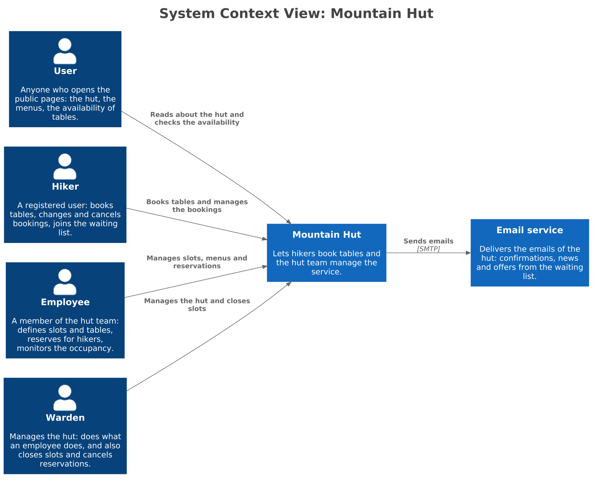
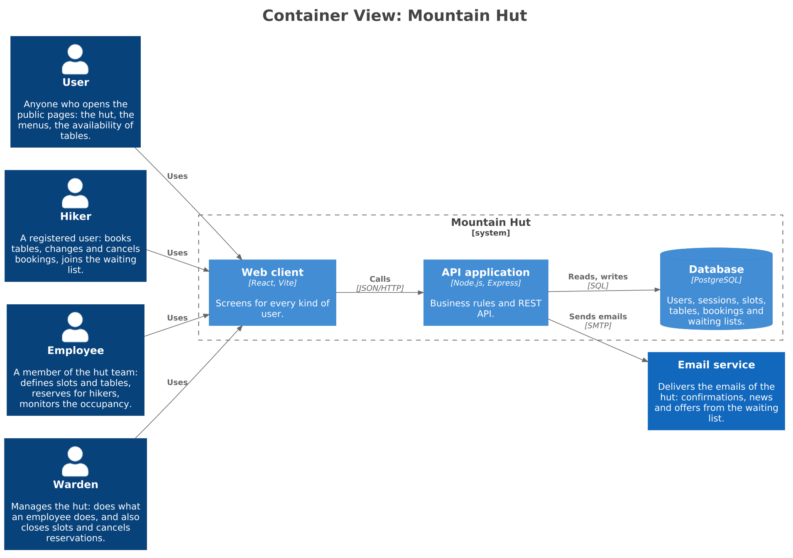
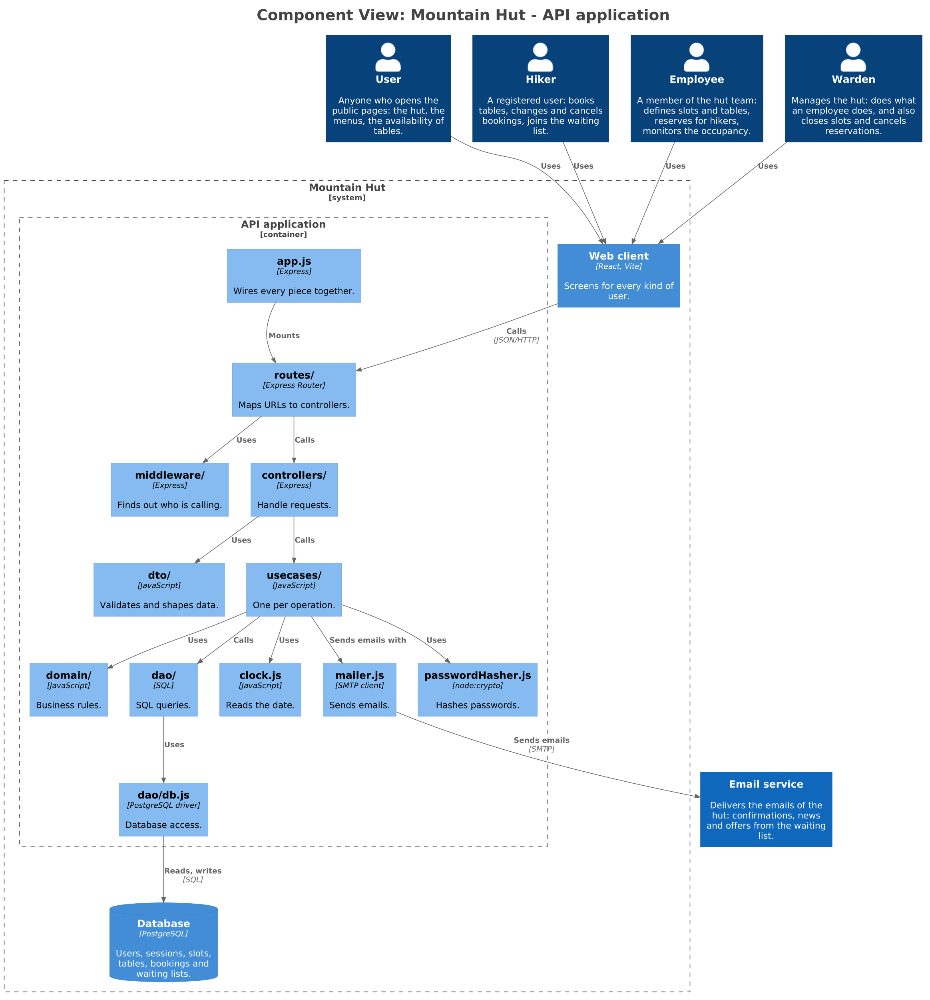
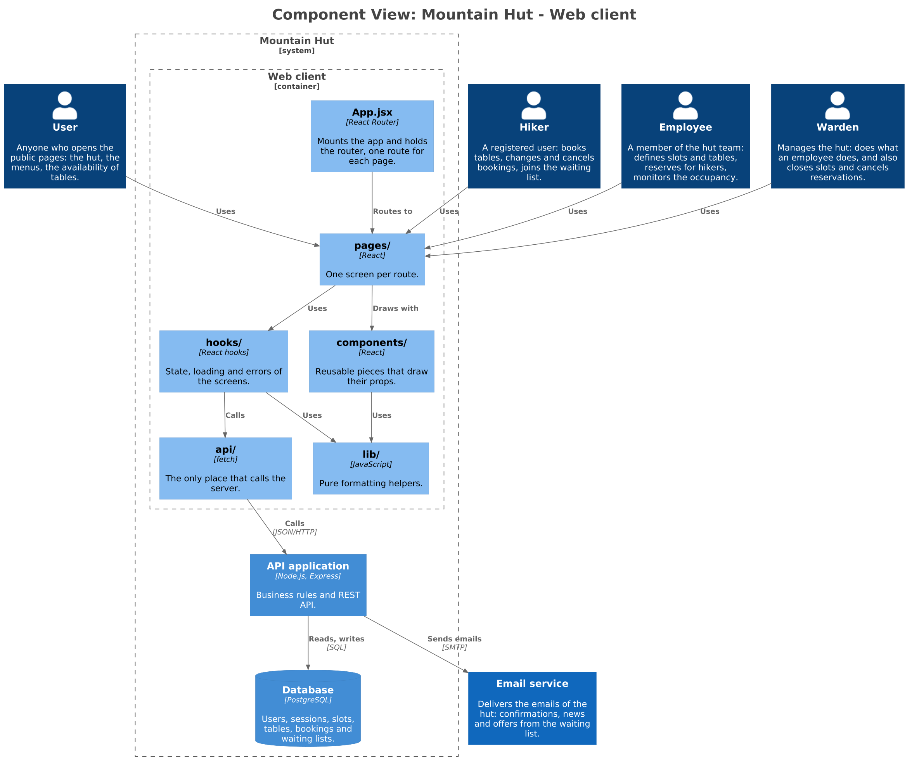
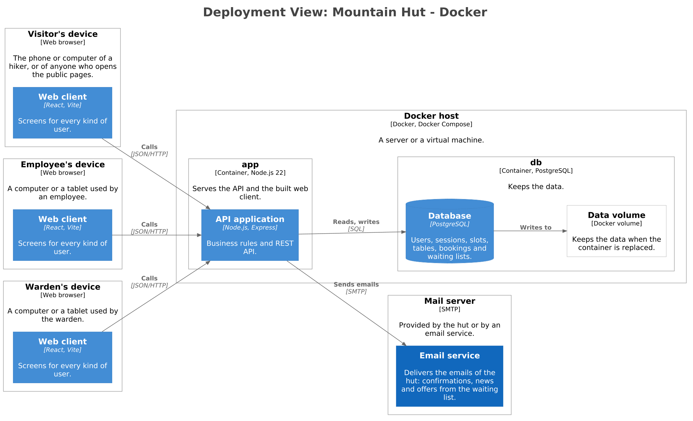

# Mountain Hut — Architecture

This document explains how the system is built: what runs where, how the code is organised, how a user logs in, and how Docker and the CI/CD pipelines fit.

The diagrams follow the [C4 model](https://c4model.com) and are made with [Structurizr](https://structurizr.com). The source is [`diagrams/workspace.dsl`](diagrams/workspace.dsl); every diagram is saved next to it as a PNG and as an SVG with the same name (`diagrams/structurizr-<view>.png` and `.svg`).

Each level zooms into the previous one and keeps what surrounds it, like the layers of an onion: the people, the external system and the other containers stay in every diagram, so nothing is seen out of context. The deployment diagram shows the infrastructure instead of the people: the devices they use stand for them.

## 1. System context (C4 level 1)



Four kinds of people use one system:

- **User:** anyone who opens the public pages: the hut, the menus, the availability of tables. No login.
- **Hiker:** a registered user. Books, changes and cancels table bookings, gives the dietary requirements of the party, joins the waiting list. A party is not a role: one hiker is its contact point.
- **Employee:** a member of the hut team. Defines slots, tables and menus, reserves for a hiker who phones or arrives at the hut, monitors the occupancy, changes reservations.
- **Warden:** manages the hut. Does everything an employee does, and also cancels reservations and closes slots.

The system has **one external dependency**, the **email service**. It delivers the confirmation of a booking, the news about a changed reservation and the offers made from the waiting list.

## 2. Containers (C4 level 2)



- **Web client:** a React single-page application, built with Vite.
- **API application:** Node.js and Express. It holds all the business rules and the REST API under `/api`. In Docker it also serves the built web client (see [section 6](#6-docker)).
- **Database:** PostgreSQL. Users, sessions, slots, tables, bookings and waiting lists.

The browser talks only to the API, in JSON over HTTP. Only the API talks to the database and to the email service.

## 3. Backend



### Layers and the one rule

The code is in `server/src`.

| Folder | Role | May import |
|---|---|---|
| `domain/` | The business rules as pure functions, and the domain errors | nothing |
| `usecases/` | One function per operation: orchestrates dao, domain, clock and mailer | `domain/` only |
| `dao/` | All the SQL; `db.js` is the only file that knows the database driver | `db.js` only |
| `dto/` | Validates the input, shapes the output | `domain/errors.js` only |
| `controllers/` | HTTP adapter: reads the request, calls one use case, chooses the status code | `dto/` only |
| `routes/` | Maps URLs to controllers, and puts the middleware in front of the protected ones | `express` only |
| `middleware/` | Code that runs before the controllers: finding out who is calling | nothing: what it needs is handed over |
| `app.js` | Builds every piece and wires them together | everything |
| `config.js`, `clock.js`, `index.js` | The only reader of the environment; the only reader of the date; the start of the server | nothing; nothing; `app.js` |
| `passwordHasher.js`, `sessionTokens.js` | The only place that hashes passwords; the only place that makes and hashes session ids | nothing |
| `mailer.js` | The only place that send emails. | nothing |

**The rule: source-code dependencies point inward, towards the core.** A use case does not import the dao: `app.js` hands it over as a parameter, and likewise for the clock, the mailer, the password hasher, the controllers, the middleware and the routers. ESLint fails on any other import (`server/eslint.config.js`). The diagram above shows who *calls* whom at runtime; the table shows who may *import* whom.

`config.js` is the only module that reads the environment. It first loads `server/.env` if the file exists (a variable already set in the real environment wins, so Docker, CI and the IDE are not overridden) and then exports one frozen object. A wrong value stops the server at start-up, not at the first request. `server/.env.example` lists the variables.

| Variable | Default | Meaning |
|---|---|---|
| `DATABASE_URL` | — (required) | The database of the server |
| `TEST_DATABASE_URL` | — | The database of the tests; used instead of `DATABASE_URL` when `NODE_ENV=test`, which vitest sets by itself |
| `PORT` | `3001` | The port of the server |
| `HUT_TIME_ZONE` | `Europe/Rome` | The time zone of the hut (an IANA name, checked at start-up) |
| `SESSION_TTL_HOURS` | `24` | How long a login lasts |
| `COOKIE_SECURE` | `false` | Sets `Secure` on the session cookie; `true` when the site is served over HTTPS |

`dao/db.js` is the only module that imports the PostgreSQL driver. It takes the database URL from `config.js` and exports async `get`, `all`, `run` and `inTransaction` helpers. `get` returns one row or `null`, `all` returns an array, and `run` returns `{ rows, rowCount }`. Queries made by DAO functions inside `inTransaction` use the same connection; nested transactions use savepoints.

The server uses `DATABASE_URL`; tests use the separate `TEST_DATABASE_URL`, because the tests delete data. The driver would read a `DATE` column as midnight of the *server's* time zone, which is the previous day on a server east of UTC; `db.js` therefore returns `DATE` as plain text (`'2026-11-02'`), and so the date of a slot never moves.

### Database and scripts

The schema is defined by the numbered migrations in `server/migrations/`: `000_users_and_sessions.sql` (users and sessions) and `001_booking_schema.sql` (slots, tables, bookings). The scripts in `server/scripts/` are run with npm:

| Command | What it does |
|---|---|
| `npm run db:create` | Creates the database named in the URL (connecting through the `postgres` maintenance database). With `NODE_ENV=test`, the test database |
| `npm run db:migrate` | Applies the migrations not yet applied |
| `npm run db:seed` | Adds the demo data (among them a few employees and a warden) |
| `npm run db:drop` | Drops the `public` schema; it refuses to run in production |
| `npm run db:reset` | `db:drop` and then `db:migrate` |

Vitest applies the migrations to the test database by itself before the tests (`globalSetup`), and runs the test files one at a time, because they share that database.

### Booking persistence

A `slot` represents a concrete date and time of the hut (a local `DATE` and a `TIME`, without time zone) and can reference a reusable `table_set`; each set contains its tables in `hut_table`, each with a `table_number` (unique inside the set) and a capacity. A slot with no assigned table set has no bookable seats. `booking` stores the hiker (`hiker_id`, a foreign key to the user), the party size and the table set used, while `booking_table` stores the number of seats assigned to each table in that set. A table can therefore hold multiple bookings as long as their assigned seats do not exceed its capacity: tables are shared between parties. There is no row per seat and no "hold" on seats: only counts.

A unique partial index (`booking_one_active_per_hiker_slot_idx` on `hiker_id, slot_id` where `cancelled_at IS NULL`) guarantees that a hiker has at most one active booking per slot, even if two requests arrive together.

The slots DAO calculates free seats by subtracting active `booking_table.seat_count` allocations from the capacities of the slot's tables, lists the slots from a date on (with their free seats, `0` when a slot has no tables) and the tables with free seats of a slot. Cancelled bookings are excluded. The booking DAO locks the slot row (`FOR UPDATE`), checks that the hiker has no active booking for it and that the requested seats are still free, then inserts the booking and its table assignments in the same transaction. When a check fails it throws an error with a `code` (`SEATS_UNAVAILABLE`, `DUPLICATE_BOOKING`) that the use case understands.

Layer folders may have an `example.js` while they have no real implementation; those placeholders are removed as the real files are added.

### The rules of a booking

- **Time zone.** The time of a slot is the local time of the hut (`HUT_TIME_ZONE`). `clock.js` turns a local date and time into an instant (`clock.at`), the other way round (`clock.localDateTime`) and gives the current day of the hut (`clock.today`); it handles the daylight-saving change. The server's own time zone does not matter.
- **Booking window.** A booking is open until **2 hours before** the start of the slot, the limit included (`domain/bookingWindow.js`). There is no limit on how far ahead a hiker can book.
- **One booking per hiker per slot.** Cancelled bookings do not count.
- **Seating** (`domain/seating.js`, pure functions). The whole party goes to **one table** when one has enough free seats: the one with the fewest free seats that is enough (a tie goes to the lowest table number). Otherwise the party is split over **as few tables as possible**, choosing the group of tables that leaves the fewest seats free. The server chooses; the hiker does not pick tables.

### Example: a request, start to finish: `POST /api/bookings`

This shows how the layers work together. The endpoints, with their requests, answers and errors, are in [`docs/openapi.json`](openapi.json).

A booking takes two calls. First the client asks `GET /api/slots/:slotId/seating?partySize=N`: the server answers where the party *would* sit, with the rules above, and books nothing. Then the client sends `POST /api/bookings` with **those same tables** in the body. The server works out the proposal again and books the request only if it is exactly that; otherwise it books nothing and answers `409`. A hiker never gets other tables than the ones shown.

1. The route puts `requireAuth` in front of the controller (a booking needs a logged-in user).
2. The controller validates the body `{ date, slotId, partySize, tables: [{ tableNumber, seats }] }` with the DTO and calls the use case with the user and the data. Invalid input gives `400`: a missing or empty `tables`, a table twice, or seats that do not add up to `partySize`.
3. The use case checks that the user is a hiker (`403`), then:
   - it reads the slot on that date and asks `checkSlotOpen` (the domain, with the time from the clock) whether it can still be booked; a missing slot, a slot without tables or less than 2 hours to the meal give `422`;
   - it checks that the hiker has no active booking for the slot (`422`);
   - it reads the tables of the slot that have free seats and asks the domain where the party would sit now (the same function as the preview); if the tables of the request are not exactly that (other tables, other seats, or the party does not fit any more) the answer is `409`;
   - it asks the dao to insert the booking. The dao, in one transaction, locks the slot row and checks the seats and the duplicate again, so two hikers booking the last seats take turns. If another booking took the seats in between, nothing is booked and the answer is `409`.
   After a `409` the client asks for a new preview.
4. The controller shapes the answer: `201` with the booking and the numbers of the tables.

No email is sent yet. When the mailer exists, the use case will call it after the commit, and a failed email will never undo the booking.

Nothing is held between the preview and the booking: if someone books in between and the proposal changes, the booking fails instead of seating the party somewhere else.

### Errors

The domain throws errors, never HTTP status codes. One middleware in `app.js` turns them into responses with the shape `{ "error": "<ErrorName>", "message": "..." }`.

| Error | Status | Meaning |
|---|---|---|
| `ValidationError` (and malformed JSON) | `400` | the input is wrong |
| `UnauthorizedError` | `401` | nobody is logged in |
| `ForbiddenError` | `403` | logged in, but not allowed |
| `NotFoundError` (and an unknown path under `/api`) | `404` | the thing asked for is not there |
| `ConflictError` | `409` | not possible in the current state (the tables are not the ones now proposed for the party; the email is already registered) |
| `UnprocessableError` | `422` | a rule of the hut fails (booking closed less than 2 hours before the meal, slot not bookable, a second booking for the same slot) |
| anything else | `500` | unexpected |

### Why it is built this way

- **The rules are the risk, so they are the easiest thing to test.** `domain/` has plain functions: "booking closes 2 hours before the slot" is a one-line test.
- **Time is injected.** Only `clock.js` reads the date, so a test can fix the instant. ESLint forbids `Date` in `domain/` and `usecases/`.
- **The database is replaceable in one place.** Only `db.js` imports the driver.
- **Emails leave after the commit.** The mailer is handed to the use case like the clock, so a test passes a fake and checks who was told what.
- **People can work in parallel.** A new feature adds files in its own resource; `app.js` is the only shared file.

## 4. Frontend



The code is in `client/src`.

| Folder | Role | May import |
|---|---|---|
| `pages/` | One screen per route: the home page, the availability, the bookings of a hiker, the pages of the staff and of the warden | `hooks/`, `components/` |
| `hooks/` | State, loading and errors, the steps behind a button | `api/`, `lib/` |
| `components/` | Reusable pieces that draw their props | `lib/` |
| `api/` | The only place that calls the server: one function per endpoint, on top of `request.js` | nothing |
| `lib/` | Pure formatting helpers (the time of a slot as `12:00–13:00`) | nothing |
| `App.jsx`, `main.jsx` | The router with one route per page; the mount of the app | everything |

As in the backend, ESLint enforces the table (`client/eslint.config.js`). It also forbids `fetch` anywhere but `api/`.

**A screen, start to finish: the availability.** The page asks the `useAvailability` hook; the hook calls the function of `api/` for `GET /api/slots?date=...`; the answer contains the bookable slots and their free seats, and comes back as plain data; a component draws each slot, using `lib/` to write its time as `12:00–13:00`. The page needs no login, so no route guard is involved.

### Why it is built this way

- **The client has no business rules.** The server decides whether a party fits and where it sits; the client only shows it.
- **One place talks to the server.** If an endpoint changes, only `api/` changes.
- **The client knows who is logged in, but the server decides.** A page can hide a button or redirect a visitor, but that is only convenience: every protected endpoint checks the session again.

## 5. Authentication with server-side sessions

Only some endpoints need a login. The **public** ones stay open: the availability, the meals and menus, the content of the home page, and the login itself. Everything else needs a session. The login is a **server-side session**: a random id, kept in the database and sent to the browser in a cookie.

### The pieces

| Piece | Where | What it does |
|---|---|---|
| `UnauthorizedError` (`401`), `ForbiddenError` (`403`) | `domain/errors.js` | Already there; the middleware in `app.js` turns them into status codes |
| `login`, `logout`, `authenticate` | `usecases/` | Check the credentials and create or delete the session; given a session id, return the user or fail with `401`. Who may do what is checked here, on the user the controller hands over |
| `users`, `sessions` | `dao/` | Find a user by email; create, find and delete a session |
| `parseLogin`, `toUserDto` | `dto/` | Validate email and password; shape the user without the password hash |
| Login and logout controllers | `controllers/` | Call the use case, then set or clear the cookie. The cookie is an HTTP detail, so it never reaches a use case |
| `requireAuth` | `middleware/` | Reads the cookie, asks `authenticate` who is calling and puts the user in `req.user` |
| `POST /api/sessions`, `DELETE /api/sessions`, `GET /api/sessions/current` | `routes/` | Login, logout, and "who am I" for the client |
| `passwordHasher.js` | `src/` | `hash` and `verify`; the only file that knows the algorithm |

### Who can log in

Hikers, employees and the warden, with email and password. The role is stored with the user: `hiker`, `employee` or `warden`. A **temporary hiker** (the employee enters only a name and an optional phone) has no password, and the login refuses it.

### The session and the cookie

- At login the server creates a random id (32 random bytes) and stores in the `session` table the **hash** of the id, the user and the expiry. The id itself exists only in the cookie, so a copy of the database does not give access.
- The cookie is called `sid`. It is `HttpOnly` (JavaScript cannot read it), `SameSite=Lax`, `Secure` when the site is served over HTTPS, and it lasts as long as the session. The length of a session is a setting.
- Logout deletes the row and clears the cookie, so it really ends the login. A signed token could not be revoked.

### Login and a protected request

**Login.** The controller validates the body with the DTO. The `login` use case reads the user from the dao, asks the password hasher to check the password and creates the session. The controller sets the cookie and answers `201`. Wrong credentials or a user without a password give `401`, with the same message for both, so the answer does not tell which emails exist.

**A protected request.** The router puts `requireAuth` in front of the controller of that path. `requireAuth` reads the cookie and asks `authenticate`: an unknown or expired session gives `401` and the controller never runs. Otherwise `req.user` is set, the controller passes the user to the use case as a plain argument, and the use case answers `403` if the role is not allowed.

### Roles

`requireAuth` only answers "who is calling?". **Who may do what is a business rule**, so it stays in the use case and in `domain/` (for example, a warden can do everything an employee can, and only the warden closes a slot). The route says which endpoints need a login; the use case says which role.

### Attacks it takes into account

- **Cross-site requests (CSRF):** the cookie is `SameSite=Lax`, state is never changed by `GET`, and the API accepts only JSON bodies, which a form on another site cannot send.
- **Stealing the session from the page (XSS):** the cookie is `HttpOnly`, and React escapes what it draws.
- **Stolen database:** passwords are stored only as salted hashes and session ids only as hashes.
- **Guessing which emails exist:** the same answer and the same work for a wrong password and an unknown email.

Not designed yet, to be decided when they are needed: a password reset and a limit on login attempts.

### Why sessions and not tokens

- **The server can end a session.** Logout and "this user can no longer log in" take effect at once.
- **Nothing to store in the browser.** The cookie is invisible to JavaScript.
- **One origin.** The client and the API share an origin (the Vite proxy in development, the same server in Docker), so cookies work without extra setup.
- The price is one indexed query per request, which is fine for a hut.

## 6. Docker



**Two containers**, started together with Docker Compose on one host:

- **`app`:** the API application. The image is built in two stages: the first builds the client with Vite, the second contains the server with its production dependencies and the built client. Express serves `/api` and the static client, and answers any other path with `index.html`, so the router of the client works.
- **`db`:** the official PostgreSQL image, with a named volume so the data survives when the container is replaced.

The web client runs in the browser of each device: the visitor's, the employee's and the warden's. They all reach only the `app` container. The email service is outside: the API reaches it with SMTP settings given as environment variables.

**What the code offers to Docker**

| Need | How |
|---|---|
| The port | `PORT`, default `3001` |
| The database | `DATABASE_URL` |
| Time zone of the hut, session length, `Secure` cookie | `HUT_TIME_ZONE`, `SESSION_TTL_HOURS`, `COOKIE_SECURE` (set `COOKIE_SECURE=true` behind HTTPS) |
| Email (when the mailer exists) | SMTP settings, as environment variables |
| Creating the tables | a migration command run before the server starts |
| Stopping | the server closes cleanly on `SIGTERM` |
| Knowing that it is ready | Compose waits for the database with `pg_isready` and for the API on its port |

**In development Docker is not needed.** Copy `server/.env.example` to `server/.env`, create the database with `npm run db:create`, apply the schema with `npm run db:migrate` (and `npm run db:seed` for the demo data). The server runs with `npm run dev` and the client with the Vite dev server, which forwards `/api` to the server.

The Docker files are `Dockerfile`, `.dockerignore`, `docker-compose.yml` and the workflow `.github/workflows/docker.yml`.

## 7. CI/CD pipelines

The branches follow `feature/* → dev → qa → main`, and the pipelines follow the branches: each stage checks more than the one before.

```text
feature/* ──PR──▶ dev ──PR──▶ qa ──PR──▶ main
                   │           │          │
               integration     qa       deploy
```

| Workflow | When it runs | What it does |
|---|---|---|
| `branch-flow.yml` | every Pull Request into `dev`, `qa` or `main` | Checks the flow: who can merge into whom, that `qa` is promoted before a new batch, that the fixes of `qa` are back in `dev`, that a branch contains the current `dev` |
| `ci.yml` | every Pull Request into `dev`, `qa` or `main` | Installs, runs the lint and the tests of the server (against a PostgreSQL service, with `TEST_DATABASE_URL` set), the lint and the build of the client; for a Pull Request into `qa` or `main`, also the end-to-end tests with Playwright |
| `integration.yml` | push to `dev` | The checks of `ci.yml` again, on the merged `dev` |
| `qa.yml` | push to `qa` | The checks of `ci.yml`, end-to-end tests included, again on the merged `qa` |
| `deploy.yml` | push to `main` | The checks of `ci.yml`, end-to-end tests included, one last time; then builds the client, keeps the build and delivers |
| `docker.yml` | called by `deploy.yml`, after its checks | Builds the Docker image from the verified commit and publishes it |

**Branch protection.** The rules of `main`, `qa` and `dev` are in `.github/rulesets/`. The checks they require are the ones of `branch-flow.yml` and of `ci.yml`: the server and the client on every branch, and the end-to-end tests on `qa` and `main`. Nothing merges while they are red.

**Tests.** The tests are written on `qa`, by the people who test the batch. The pipelines of `dev` run the tests already merged. The end-to-end tests run on the Pull Requests into `qa` and `main`, so a new test runs before it merges into `qa`.

**How Docker fits.** The image is built and published by its own workflow, called only on `main` and only after the checks of that commit passed, so what is delivered is what was tested. The image is published to a container registry.
