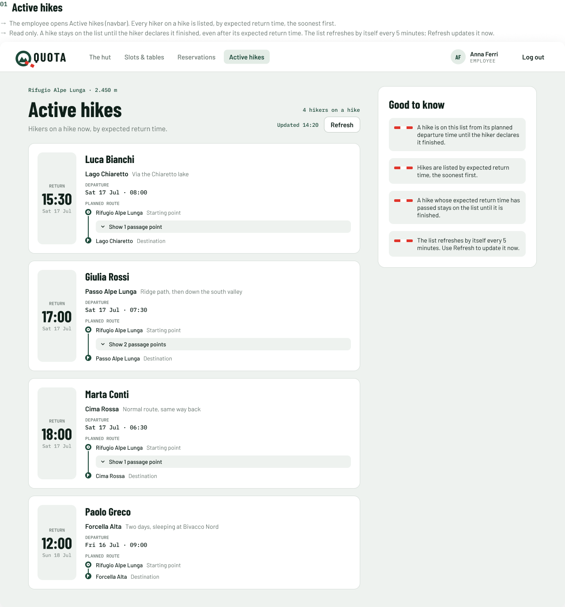
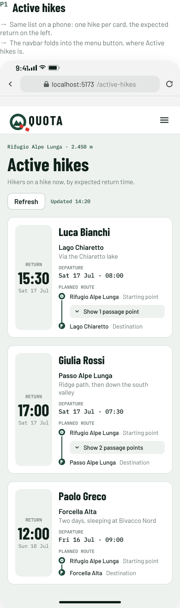

# Active hikes mockup (MH-21)

Mockup for story **MH-21 View active hikes**, used by the staff frontend and backend tasks and their tests.

> "As an employee I want to see all hikers who are currently registered as being on a hike so that I can monitor their expected return times."

One new page, **Active hikes**, lists the hikes in progress of all hikers. It is read only: the employee (or the warden) looks at it to follow the expected return times. The hikers register their hikes in [MH-20](../register-a-hike/README.md).

**Figma (source of truth):** page *MH-21 View active hikes* in [Mountain Hut – Mockups (Team 16)](https://www.figma.com/design/VlTombwHX1DQ7yB2x4U5Yx?node-id=786-23191). Every element is an instance from the *Components* page. Most of them are already used by the [slots mockup](../slots/README.md), the [register a hike mockup](../register-a-hike/README.md) and the [booking](../booking/README.md) mockup: button, alert, trail blaze, route icon and the phone bars. This story adds:

- *Navbar / Staff with Active hikes*: the staff navbar with a fourth link, **Active hikes**, after *The hut*, *Slots & tables* and *Reservations*. Variants: `Role` (Employee, Warden). It is a separate navbar for this page: the shared *Navbar / Logged in* is not changed.
- *Active hike card*: one hike of the list. Variants: `Size` (Desktop, Phone) and `State` (Collapsed, Expanded). It shows the expected return on the left, then the hiker, the destination, the route, the departure and the **planned route**: the start, the destination and, between them, a line *Show N passage points* that opens the list. It is the same planned route as on the [My hikes](../register-a-hike/README.md) card of the hiker.

Same QUOTA brand, colours and fonts.

## Rules on these screens

Everything shown comes from the story or from the product owner's answers. Nothing from later stories.

| Source | Rule |
|---|---|
| Story MH-21 | The employee sees all the hikers who are currently registered as being on a hike, to monitor their expected return times. |
| Story MH-21 (notes) | The information of a hike is its destination (a name), its route (a text description) and its intermediate passage points. |
| Product owner, [#51](https://github.com/SE2-Polito/AY26-27-Mountain-Hut/issues/51) | A hike has a planned departure and an expected return, both with day and time. |
| Product owner, [#53](https://github.com/SE2-Polito/AY26-27-Mountain-Hut/issues/53) | A hike is considered started at its planned departure time. A hiker who decides not to leave declares the hike finished with MH-22, even before it starts. |
| Team decision (not yet confirmed by the product owner) | **Active** means: from the planned departure time until the hiker declares the hike finished. A hike that has not started is not listed. A hike past its expected return time stays listed until it is finished. |
| Team decision (not yet confirmed by the product owner) | The hikes are listed by expected return time, the soonest first. |
| Team decision (not yet confirmed by the product owner) | Each hike shows the hiker's name, the expected return (time and day), the destination, the route, the departure and the planned route (start, passage points, destination), with the passage points hidden behind a line *Show N passage points*, as on the hiker's page. A hike without passage points shows none. |
| Team decision (not yet confirmed by the product owner) | The warden is an extension of the employee (as on [Slots & tables](../slots/README.md)): the same page, with the same navbar link. The first part only for the warden is MH-25. The page is reached from a new navbar link, *Active hikes*, after *Reservations*. |
| Team decision (not yet confirmed by the product owner) | The list **refreshes by itself every 5 minutes** and has a **Refresh** button that updates it at once. A line says when it was last updated. A failed refresh keeps the list as it was. |
| Team decision | The page is read only. Marking a hike as completed by the staff (MH-30), the alerts for late hikers (MH-24, MH-26) and the emergency details (MH-25) are other stories. |

## The flow

1. The employee opens **Active hikes** from the navbar (screen 1). The page lists every hiker who is on a hike, by expected return time, the soonest first. A line on the top right says how many hikers are on a hike.
2. Each hike is a card. On the left the **expected return**: the time, and under it the day. On the right the hiker's name, the destination with the route, the departure (day and time) and the passage points in order, joined by arrows.
3. A hike stays on the list until the hiker declares it finished with MH-22. So a hike that is past its expected return time is still listed, in its place by expected return time.
4. With no hike in progress, the page says so (screen 2).
5. The passage points of a hike are hidden behind *Show N passage points*, between the start (the hut) and the destination. Pressing it opens the whole list, in order, one under the other (screen 3), and the line says *Hide N passage points*. With many points the card grows only while the list is open.
6. If the list cannot be loaded, a red note says so (screen 4). The note stands on the page, not inside a white card.

The only button is **Refresh**, next to the time of the last update (*Updated 14:20*). The list also refreshes by itself every 5 minutes, and the time of the update changes with it. If a refresh fails, the list stays as it was and the red note of screen 4 is shown above it. The cards have no buttons.

## Screens

| # | Screen | Image |
|---|---|---|
| 1 | Active hikes |  |
| 2 | No active hikes |  |
| 3 | A hike with many passage points, opened |  |
| 4 | The list does not load |  |

### On a phone

This is the same website in a phone browser, not a separate app. Below 992 px (react-bootstrap `lg`) the layout changes:

- The page becomes one column.
- The navbar folds into the menu button, where *Active hikes* is.
- In a card, the route goes under the destination, and the planned route is as wide as the card.

| # | Screen | Image |
|---|---|---|
| 1 | Active hikes |  |
| 2 | No active hikes |  |

The list with many passage points and the error are the same as on a computer.

## Fields and rules

### Active hikes

| Part | Rule |
|---|---|
| Which hikes | The hikes of all hikers that have started (planned departure time passed) and are not finished. |
| Order | By expected return time, the soonest first. |
| Count | "*N* hikers on a hike", above the list, on the right. |
| Refresh | The list loads when the page opens, refreshes by itself every 5 minutes, and **Refresh** updates it at once, whenever the employee wants. Beside the button: "Updated *HH:MM*", the time of the last update. |
| Expected return | Time (*15:30*) and day (*Sat 17 Jul*). The day is shown also when it is not today. |
| Hiker | The name of the hiker who registered the hike. |
| Destination, route | The destination in bold, the route description after it (under it on a phone). |
| Departure | Day and time (*Sat 17 Jul · 07:30*). |
| Planned route | The start (*Rifugio Alpe Lunga*, *Starting point*), then, when the hike has passage points, a line *Show N passage points* (closed by default), then the destination (*Destination*). Opened, the line says *Hide N passage points* and the points are listed in order, one under the other, each with its icon. A hike without passage points has no such line. |
| Buttons | None. |

## Texts and answers

| When | What the employee sees |
|---|---|
| Page subtitle | Hikers on a hike now, by expected return time. |
| Refresh | Button **Refresh**; next to it "Updated 14:20". |
| *Good to know* | A hike is on this list from its planned departure time until the hiker declares it finished. · Hikes are listed by expected return time, the soonest first. · A hike whose expected return time has passed stays on the list until it is finished. · The list refreshes by itself every 5 minutes. Use Refresh to update it now. |
| No hikes | **No active hikes.** Hikers who are on a hike will appear here, with the time they expect to be back. |
| List not loaded | Red note: "Something went wrong on our side. Try again in a minute." |
| Not logged in (`401`) | The login page (login mockup, screen 4). |

## Left out on purpose

These belong to other stories or were not asked for:

- Alerts and notifications for hikers who are late or missing (MH-24, MH-26).
- The emergency details of a party and the party members (MH-23, MH-25).
- Marking a hike as completed by the staff and managing registered hikes (MH-30), registering a hike for a hiker (MH-28), updating a hike (MH-27).
- The route on a map (MH-29).
- Search, filters and any other way to sort the list (not for now).
- The hiker's phone number and emergency contact.

## Open questions

These are for the product owner. Until they are answered, the mockup follows the team decisions above.

- **What an active hike is.** The mockup lists a hike from its planned departure time until the hiker declares it finished (#53), so a hike past its expected return time stays listed (see the proposal below). Is this what the staff expect?
- **Late hikes.** Should a hike past its expected return time be marked in the list, before the alerts of MH-24? The mockup does not mark it.
- **What the employee sees of each hiker.** The mockup shows the name, the destination, the route, the times and the passage points. Does the employee also need the phone number or the number of people (MH-23)?
- **Refresh interval.** The team proposes every 5 minutes plus the Refresh button. Is that enough for the staff?

## How "active" can grow with the next stories

Only MH-20 and MH-21 are built in this sprint, so nobody can yet declare a hike finished (MH-22). The team proposes to decide *active* in one place, so the later stories only add to it:

- A hike has a planned departure, an expected return and a **finished** mark that is empty when the hike is registered (it can be a nullable `finished_at`).
- **Active** = the planned departure time has passed **and** the hike is not finished. The list of this page asks exactly this.
- MH-22 (the hiker) and MH-30 (the employee) only fill the *finished* mark: the hike leaves the list at the next refresh, and this page does not change.
- MH-24 and MH-26 look at the same hikes (active, past the expected return time) and add the alerts. MH-27 changes the route or the expected return of a hike: the list shows the new values at the next refresh.
- With only MH-20 and MH-21, a hike never leaves the list once it has started. A hiker cannot register a hike in the past (MH-20), so for the demo a hike is registered with a departure a few minutes ahead: it appears at the first refresh after its departure time, and it stays. The server already has a clock (`server/src/clock.js`) that can be moved in the tests and in the demo, so a hike can be shown starting without waiting.

The names, hikes, days and times of the screens are examples. Sample data (hut, names, dates) is invented for the mockup.
