# Landing page and availability mockup (MH-52)

Mockup for story **MH-04 Check availability**, used by the frontend task (MH-63) and by the end-to-end tests.

> "As a user I want to check table availability for a given date, time and party size so that I can decide whether to make a booking."

The public home page (`/`) is the landing page, with a picture, a slogan and a search bar, like a booking site. The search leads to Book a table (`/book`), which gives the answer. **Figma (source of truth):** page *MH-52 Landing & availability* in [Mountain Hut – Mockups (Team 16)](https://www.figma.com/design/VlTombwHX1DQ7yB2x4U5Yx?node-id=285-326), built from instances of the *Components* page, with four new ones for this story: *Search field*, *Time wheel*, *Availability answer* and *Navbar / Visitor*, plus three icons. [index.html](index.html) shows the same screens in a browser with their notes. Same QUOTA brand, colours and fonts as the [login](../login/README.md) and [booking](../booking/README.md) mockups, and the same party bar and review dialog as the booking.

## Rules on these screens

Everything shown comes from the story or from the product owner's answers. Nothing from later stories.

| Source | Rule |
|---|---|
| MH-04 clarifications | The check is public: no login is required. |
| MH-04 clarifications | The answer comes from the free seats and the table layout. With 6 free seats split over 3 tables, a party of 6 is available. |
| MH-04 clarifications | The detail says where the seats are, for example 2 + 3 + 1 seats. |
| MH-04 clarifications | No alternative is suggested: the user can just check a different slot. |
| [#17](https://github.com/SE2-Polito/AY26-27-Mountain-Hut/issues/17) | A time with no tables defined has 0 seats, so it is not available. |
| [#7](https://github.com/SE2-Polito/AY26-27-Mountain-Hut/issues/7) | Booking closes 2 hours before the start of the slot. |

## The flow

1. **The landing page.** A picture, the slogan and a search bar: day, people, From and To. No login. Only days that have slots are in the list. From and To open a scroll wheel, like the timer of a phone: hours and minutes in steps of 5. To is always after From.
2. **Check availability.** The button waits for From and To, then opens `/book` with the same choices. **From and To are a search, not a new slot:** the hut serves only the slots set by the staff (#6, #9). A slot matches if its interval **overlaps** From/To for a positive duration (`slot start < To` and `slot end > From`). Intervals that only touch at a boundary do not match. This is a team UX choice, not an explicit PO rule.
   - **One slot matches:** it is already chosen and the card gives the answer.
   - **Several match:** the user picks one, then the card gives the answer.
   - **None matches:** the answer is not available.
3. **The answer** is in the card of Book a table: **Available** with the detail of the seats, or **Not available**. It changes when the user changes the day, the people or the time on that page. Nothing is booked or held.
4. **Review booking.** A logged-in hiker sees *Check your booking*. A visitor goes to the login with the note "Log in to book a table." (login mockup, screen 4), and from there to *Sign up* if they have no account. The choices are kept in both.
5. **Back after the login or the sign-up.** The user returns to `/book` with *Check your booking* already open, so the only step left is **Confirm booking**.

## Screens

| # | Screen | Image |
|---|---|---|
| 1 | The landing page | 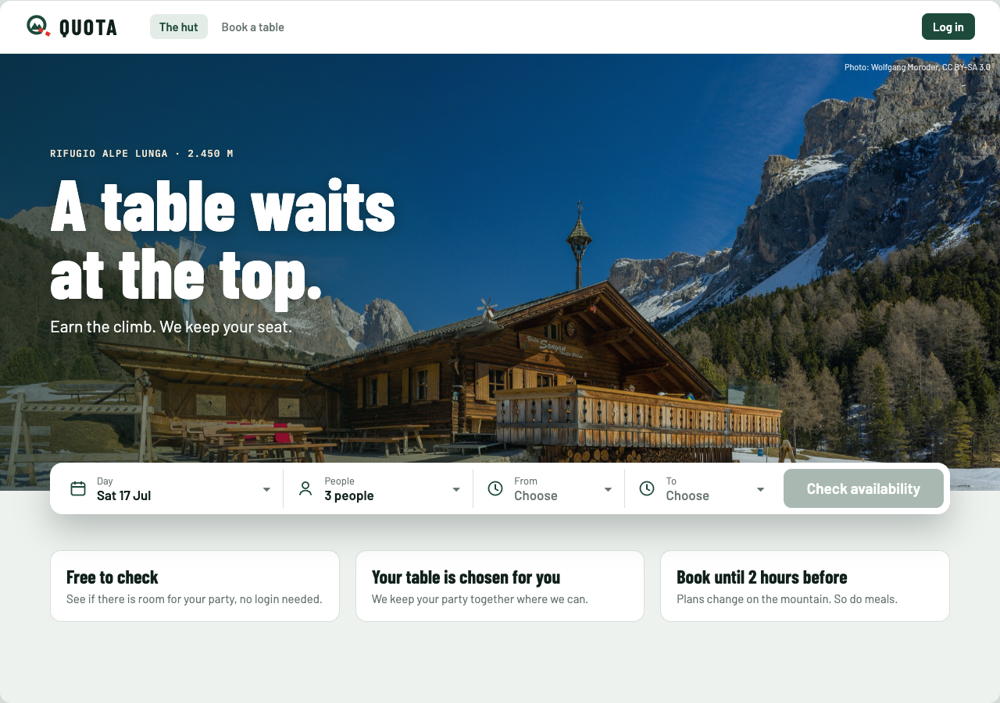 |
| 2 | Choosing the times | 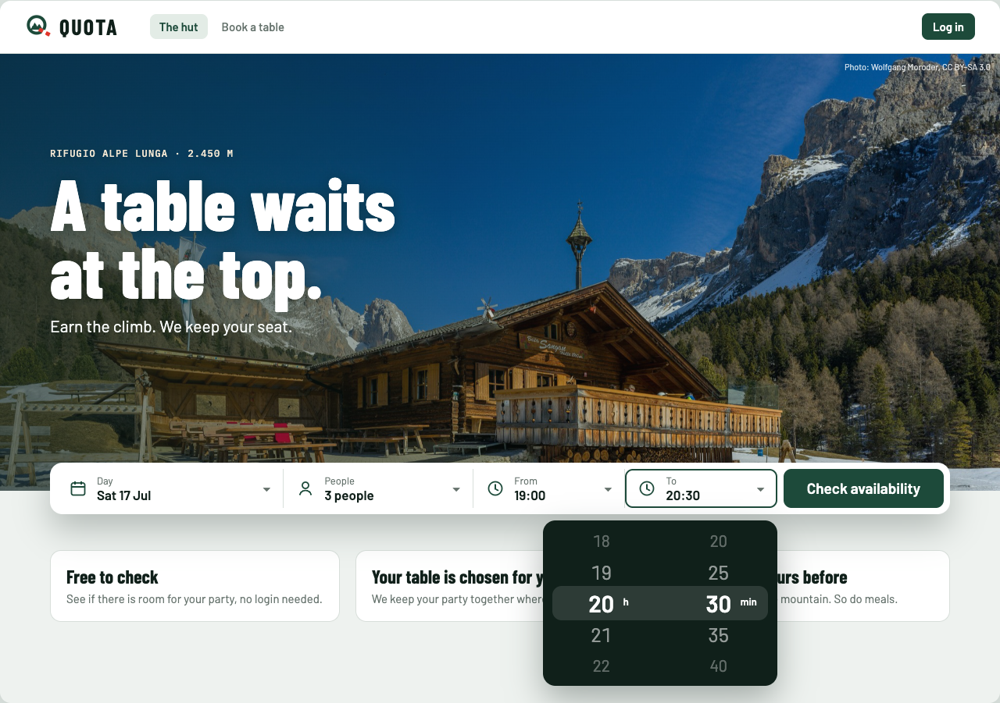 |
| 3 | One time matches: available | 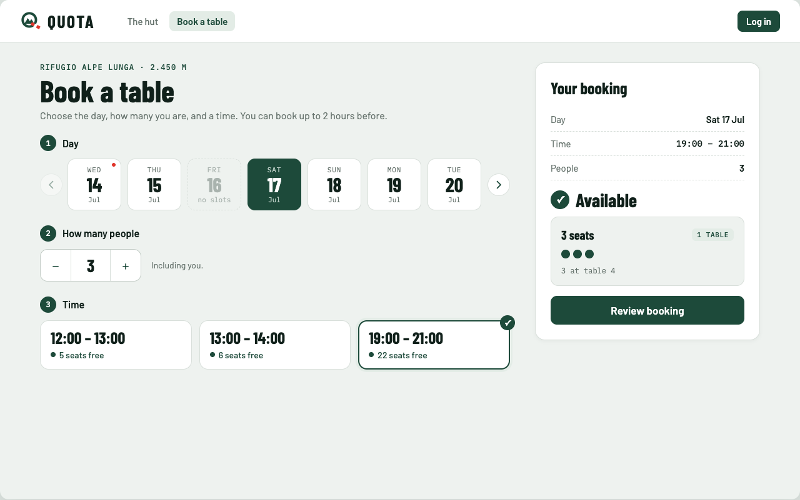 |
| 4 | One time matches: available, split over tables | 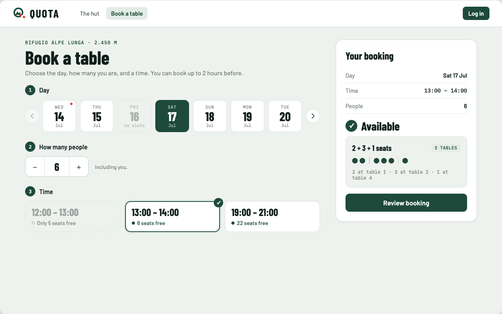 |
| 5 | Several times match | 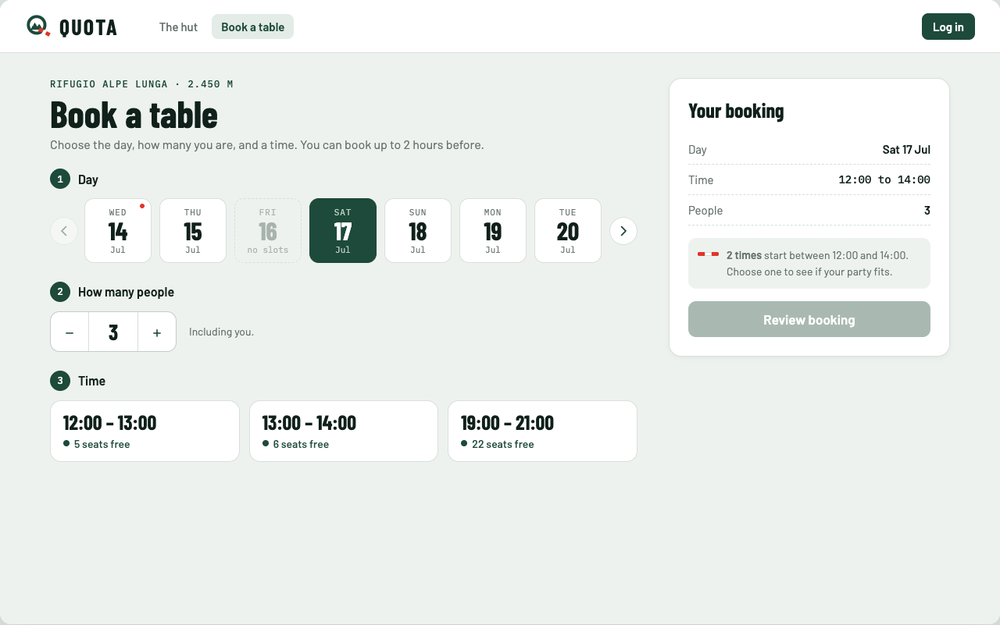 |
| 6 | Not available: party too big | 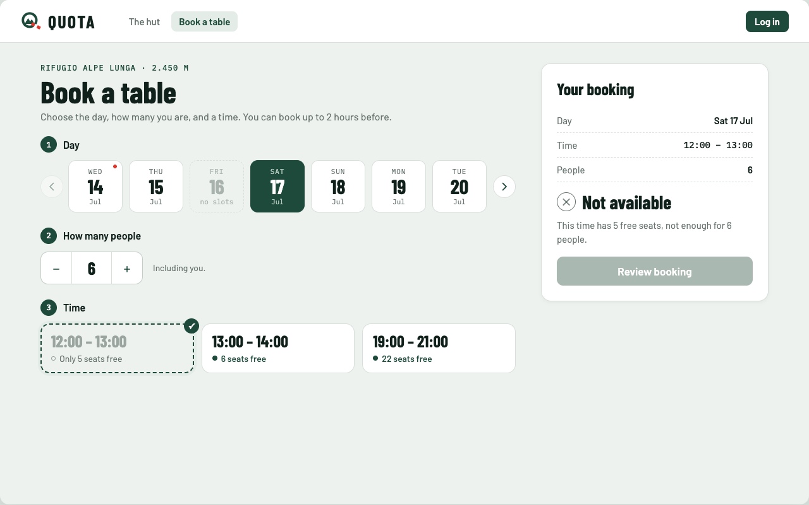 |
| 7 | Not available: no free seats | 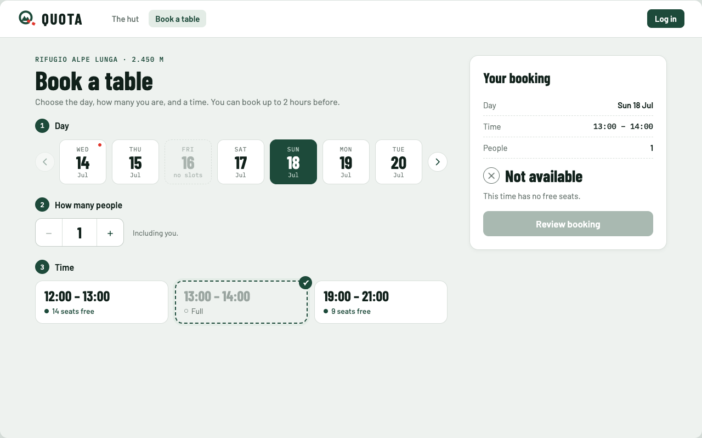 |
| 8 | No time matches | 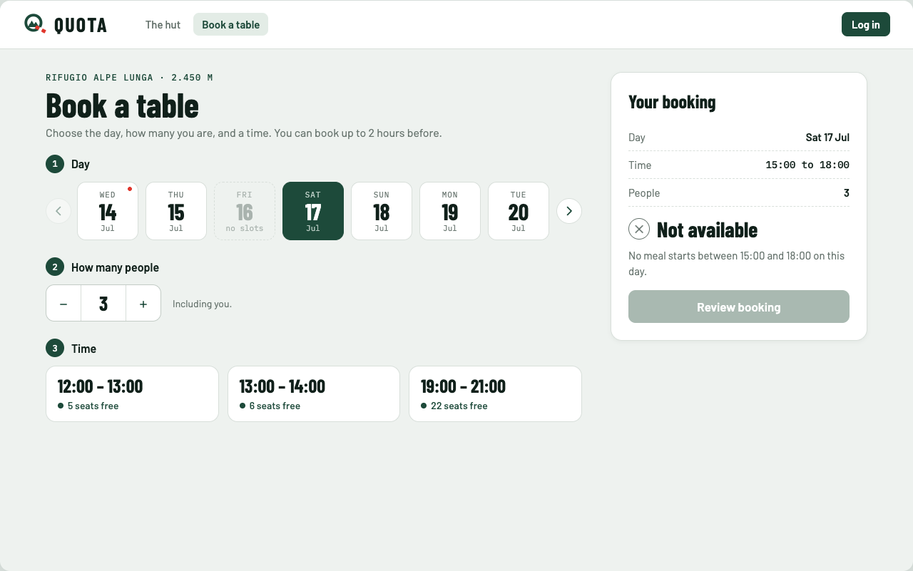 |
| 9 | Back after the login or the sign-up, ready to confirm | 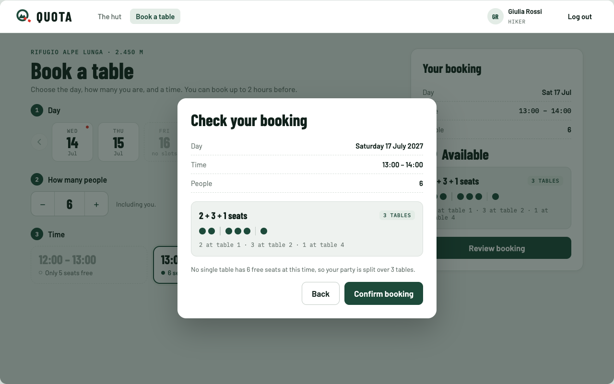 |

### On a phone

The same website in a phone browser. Below 992 px (react-bootstrap `lg`) the bar of the landing page becomes three rows and a button, the navbar folds into the menu button, and on `/book` the answer sits in the bar at the bottom.

| # | Screen | Image |
|---|---|---|
| 1 | The landing page | 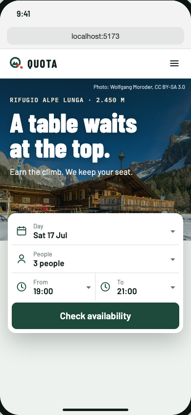 |
| 2 | Available | 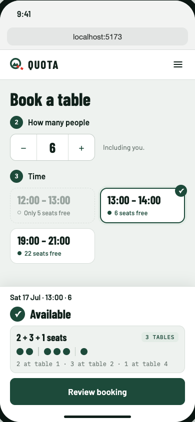 |
| 3 | Not available | 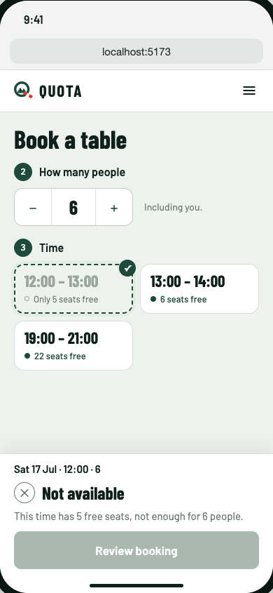 |

## Texts and server answers

The answer comes from `GET /api/slots/:slotId/seating?partySize=N`, which is public and books nothing.

| When | What the user sees |
|---|---|
| Slogan (a proposal) | A table waits at the top. Earn the climb. We keep your seat. |
| From or To missing on the landing page | *Choose*, and *Check availability* is disabled |
| Several slots can host the party | *N* overlapping slots are currently bookable for *M* people. Choose one to check availability. *Review booking* is disabled |
| Slots overlap, but none can host the party | None of the *N* overlapping slots is currently bookable for *M* people. Choose a time to check its availability. *Review booking* is disabled |
| No slot matches | **Not available.** No meal slots overlap your selected time range (*HH:MM*?*HH:MM*) on this day. *Review booking* is disabled |
| Time card on `/book` | As in the booking: *N* seats free, Only *N* seats free, Full |
| Time less than 2 hours away | Closed at *HH:MM*, as in the booking |
| The party fits (`200`) | **Available**, and the party bar: "*2 + 3 + 1* seats", a *K* tables chip, the seats in one bar, and "2 at table 1 · 3 at table 2 · 1 at table 4". *Review booking* is enabled |
| The party does not fit (`409` `NO_SEATS`), the time has free seats | **Not available.** This time has *N* free seats, not enough for *M* people. *Review booking* is disabled |
| The party does not fit (`409` `NO_SEATS`), 0 free seats | **Not available.** This time has no free seats. *Review booking* is disabled |
| The time has no tables yet (`422`) | **Not available.** This time has no free seats. *Review booking* is disabled |
| Employee or warden | The same answer, and `/book` says that only hikers can book (booking mockup, screen 7) |

## Implementation (MH-63 / MH-65)

- `/` uses a calendar date input, initially set to today, with past days disallowed. This replaces the mockup's day dropdown. The public API determines which days have slots: days without slots show a message and cannot be searched. The search keeps the party size, including when it is too large, and passes `date`, `people`, `from` and `to` to `/book`.
- `/book` matches slot intervals that overlap the From/To range for a positive duration, then counts only slots currently bookable for the selected party size. One candidate is selected automatically; several require a choice. If none overlap, the page gives a not-available message. If slots overlap but none is bookable for the party, they remain selectable so the user can inspect an individual answer. All times of the day remain visible, as in screens 3–8, so the user can check a different time without it being suggested.
- The desktop card and the mobile bottom bar show the public seating answer and its split detail. Checking does not reserve seats. Review booking is enabled only after a successful check and only for hikers or visitors who can log in.
- Login and sign-up preserve the choices in the return URL. `review=1` reopens *Check your booking* after authentication; confirmation still requires the hiker's explicit action and obtains a fresh seating proposal.
- The check needs no new endpoint.
- **Change search** returns to the home form with the currently selected day and party size and the original From/To range filled in, ready to edit.

## Open points

- **Range examples.** With slots 12:00?13:00 and 13:00?14:00, 12:30?13:30 matches both; 12:00?13:00 matches only the first. With the next slot starting at 19:00, 14:00?19:00 matches none. Static screenshots may still show the earlier start-time wording.
- **From and To.** The PO asked for the date and time to be chosen from those available (#6). This mockup keeps that rule: From and To only search among the slots. A time chosen freely by the hiker would need a question to the PO.
- **The team has to agree on this page.** It is one more way to answer the question of where the availability lives: the search on the home page, the answer on `/book`. It needs no change to the routes.
- **The scenarios of MH-04** say "opens the availability check" and "asks for the availability". Here those steps are the search bar with From and To, and *Check availability*. They also use the words **available** and **not available** and the detail `2 + 3 + 1` seats, which this mockup keeps.
- **The picture.** It is a stand-in, not our hut. A photo of the real hut can replace it, or we keep it with its credit (see below).
- **The slogan and the three short texts** are proposals.
- **Party size.** The PO answered "No limit" in [#27](https://github.com/SE2-Polito/AY26-27-Mountain-Hut/issues/27). The form keeps oversized parties and reports unavailability instead of silently reducing the requested number.

## Left out on purpose

These belong to other stories and are added with them: the booking itself (MH-01), party requirements (MH-05), menus and meal names (MH-10, MH-11), waiting list (MH-16).

Sample data (hut, names, dates, tables) is invented for the mockup.

## Photo credit

[`hero.jpg`](hero.jpg): [Sangon Hut with the Odles Group and the Mastlé Mountain](https://commons.wikimedia.org/wiki/File:Sangon_utia_da_mont_sun_Ciaulonch_cun_Odles_y_stevia.jpg), by Wolfgang Moroder, [CC BY-SA 3.0](https://creativecommons.org/licenses/by-sa/3.0), resized. If it goes on the site, the credit goes with it.
