# Book a table mockup (MH-39)

Mockup for story **MH-01 Book a table**, used by the booking frontend and backend tasks and their tests.

> "As a hiker I want to book an available table for a selected date, time, and party size so that my party has a place reserved for the meal."

**Figma (source of truth):** page *MH-39 Book a table* in [Mountain Hut – Mockups (Team 16)](https://www.figma.com/design/VlTombwHX1DQ7yB2x4U5Yx). Every element is an instance from the *Components* page (day, day arrow, time slot, people stepper, step heading, party seats, phone browser bar and top bar). [index.html](index.html) shows the same screens in a browser with their notes. Same QUOTA brand, colours and fonts as the [login mockup](../login/README.md).

## Rules on these screens

Everything shown comes from the story or from the product owner's answers. Nothing from later stories.

| Source | Rule |
|---|---|
| Story, [#6](https://github.com/SE2-Polito/AY26-27-Mountain-Hut/issues/6) | Required: date, time, number of people. Date and time are chosen from those available. |
| MH-02, [#9](https://github.com/SE2-Polito/AY26-27-Mountain-Hut/issues/9) | A slot is a start and end time chosen by the staff; a day can have several (e.g. 12–13 and 13–14). Times are shown as times, not as "lunch" or "dinner". |
| [#17](https://github.com/SE2-Polito/AY26-27-Mountain-Hut/issues/17) | A day or time with no tables defined has 0 seats and cannot be booked. |
| Story | The number of people must fit in the free seats of that time. |
| [#7](https://github.com/SE2-Polito/AY26-27-Mountain-Hut/issues/7) | Booking is possible up to 2 hours before the start of the slot. |
| Story, [#11](https://github.com/SE2-Polito/AY26-27-Mountain-Hut/issues/11) | The system chooses the tables: it keeps the party together where possible and uses the smallest set of free seats. Tables can be shared with other parties; a party can be split over several tables. |
| [#13](https://github.com/SE2-Polito/AY26-27-Mountain-Hut/issues/13), [#15](https://github.com/SE2-Polito/AY26-27-Mountain-Hut/issues/15) | Only a logged-in hiker can book. A user who is not logged in is sent to the login page (login mockup, screen 4). |

## The flow

1. **Day.** Only days that have slots can be picked; the others show "no slots". The strip has no end: it scrolls sideways (with the arrows on a computer) and loads the next days as the hiker gets near its end.
2. **How many people.** A stepper, starting at 1.
3. **Time.** Each slot shows its free seats. A slot that cannot fit the party, or that starts in less than 2 hours, stays visible but cannot be picked, and says why. So the hiker never picks a time that fails.
4. **Review booking** opens a check with the tables the system chose. **Confirm booking** saves it; **Back** keeps every choice.
5. **Table booked** shows what was booked and where the party sits.

The summary on the right (a bar at the bottom on a phone) fills in as the hiker chooses, and says until when the chosen time can be booked.

## Screens

| # | Screen | Image |
|---|---|---|
| 1 | Book a table | 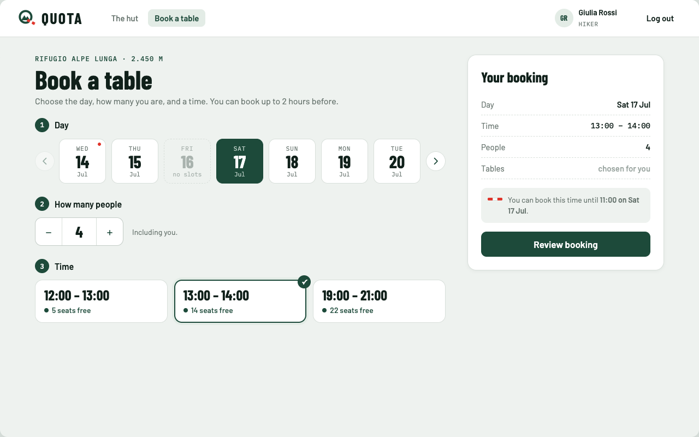 |
| 2 | Party bigger than a time's free seats | 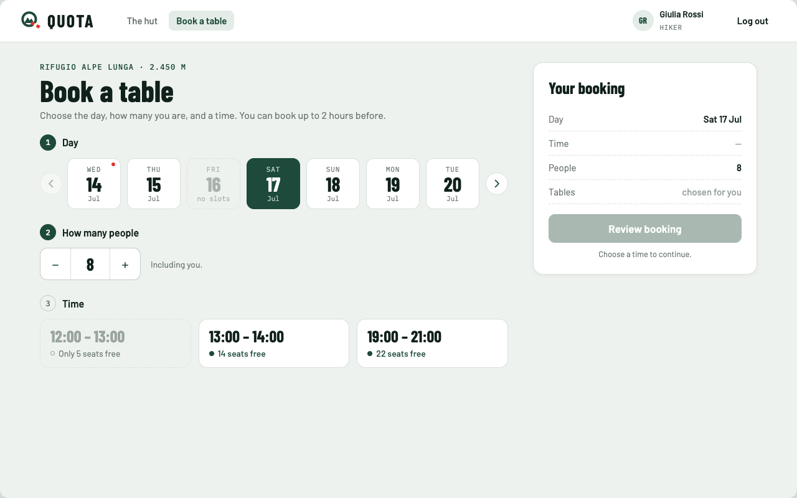 |
| 3 | Too late for a time (2-hour limit) | 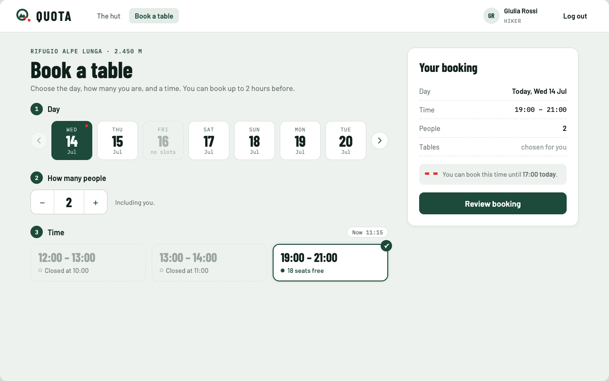 |
| 4 | Check and confirm, party split over 2 tables | 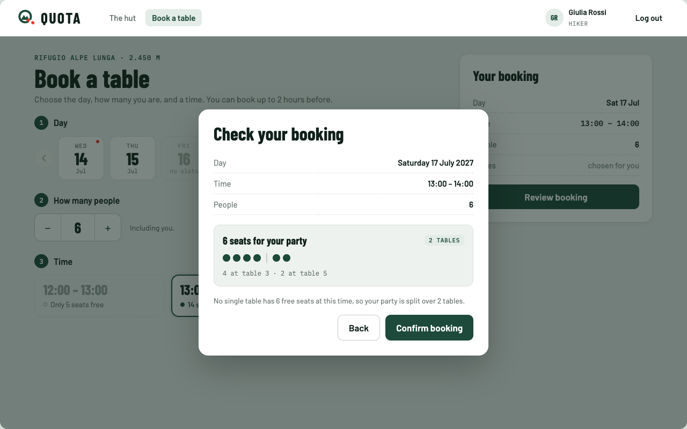 |
| 5 | Seats taken by someone else meanwhile | 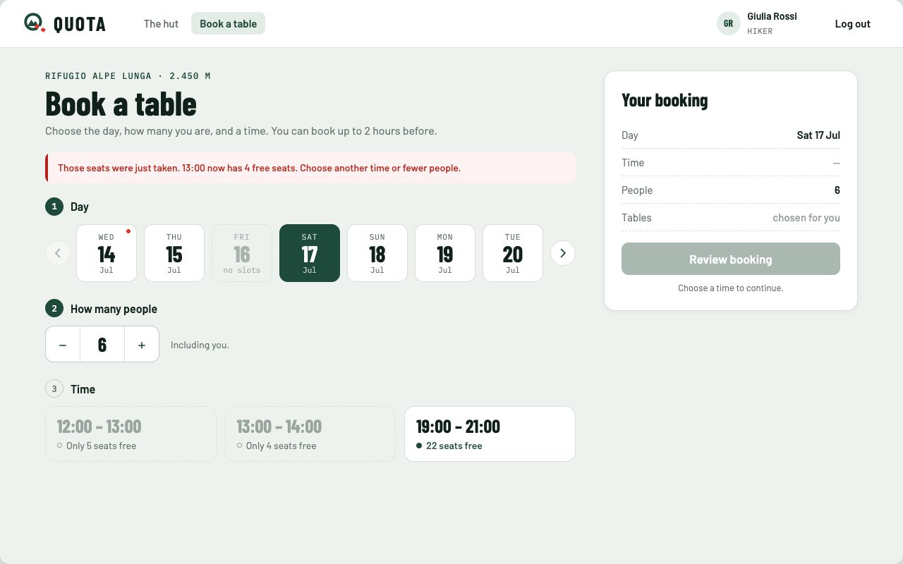 |
| 6 | Table booked | 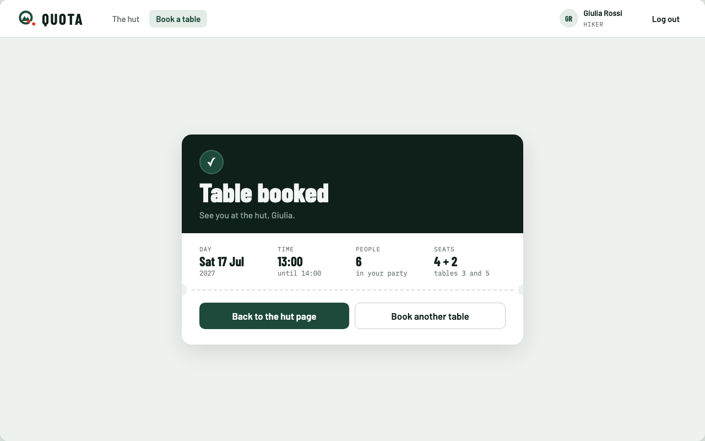 |

### On a phone

The same website in a phone browser, not a separate app. Below 992 px (react-bootstrap `lg`) the page becomes one column, the navbar folds into the menu button, the summary becomes a bar fixed at the bottom, the review dialog becomes a sheet from the bottom, and the days are swiped sideways (no arrows).

| # | Screen | Image |
|---|---|---|
| 1 | Book a table | 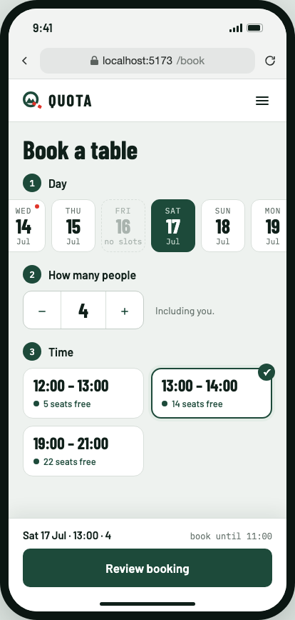 |
| 2 | Party bigger than free seats | 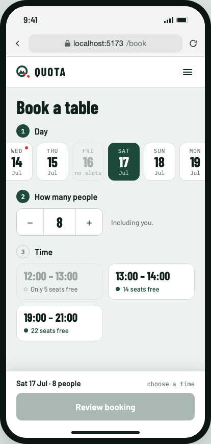 |
| 3 | Check and confirm | 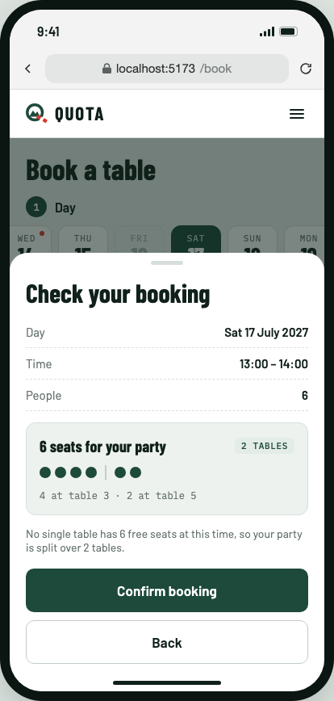 |
| 4 | Seats taken meanwhile | 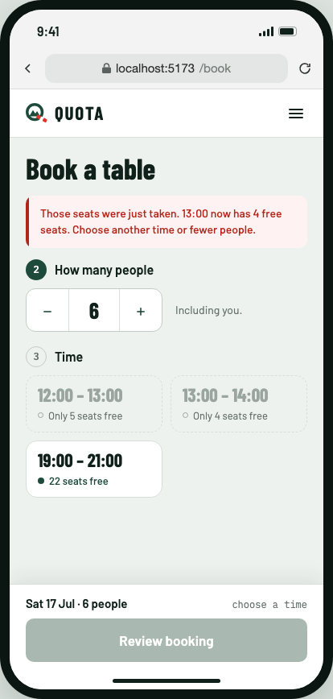 |
| 5 | Table booked | 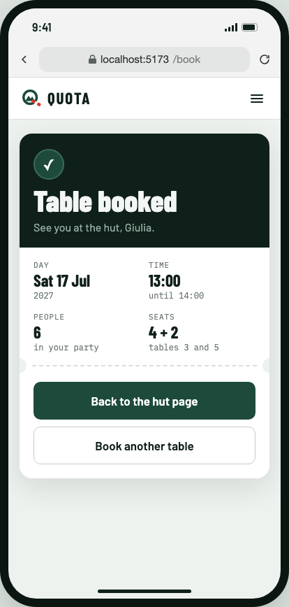 |

## Texts and server answers

| When | What the hiker sees |
|---|---|
| Page subtitle | Choose the day, how many you are, and a time. You can book up to 2 hours before. |
| Slot that fits | *N* seats free |
| Slot too small for the party | Only *N* seats free |
| Slot less than 2 hours away | Closed at *HH:MM* |
| Summary note | You can book this time until *HH:MM on day*. |
| No time chosen | Button disabled, "Choose a time to continue." |
| Party split | One card for the whole party: "*N* seats for your party", a *K* tables chip, the seats in one bar split by a thin line, and "4 at table 3 · 2 at table 5". Below it: "No single table has *N* free seats at this time, so your party is split over *K* tables." Shown as one party on purpose, so it does not look like separate bookings. |
| Server saved the booking (`201`) | Table booked. See you at the hut, *first name*. |
| Seats gone or time closed meanwhile (`409`) | Those seats were just taken. *HH:MM* now has *N* free seats. Choose another time or fewer people. The free seats are reloaded; the hiker's choices are kept. |
| Invalid request (`400`) | Checked in the browser first, so it should not happen; if it does, the general message "Something went wrong on our side. Try again in a minute." |

## Left out on purpose

These belong to other stories and are added with them: confirmation email (MH-03), dietary needs and allergies (MH-05), seeing, changing and cancelling one's bookings (MH-06, MH-08), menus and meal names (MH-10, MH-11), waiting list (MH-16).

## Open questions (not decided here)

Asked to the product owner and still open; the mockup does not depend on the answers:

- How far ahead a table can be booked ([#26](https://github.com/SE2-Polito/AY26-27-Mountain-Hut/issues/26)). The day strip has no end and shows the days that have slots, so the server decides how far ahead a day has any.
- Smallest and largest party ([#27](https://github.com/SE2-Polito/AY26-27-Mountain-Hut/issues/27)). The stepper goes from 1 to the most free seats of any time that day.
- More than one booking by the same hiker in a slot ([#25](https://github.com/SE2-Polito/AY26-27-Mountain-Hut/issues/25)).
- A table not shared with other parties ([#21](https://github.com/SE2-Polito/AY26-27-Mountain-Hut/issues/21)).
- The story says the party must be "smaller than" the free seats; we read it as "fits in" (6 people can take 6 free seats).

Sample data (hut, names, dates, tables) is invented for the mockup.
