# Copy a week mockup (MH-09)

Mockup for story **MH-09 Repeat a weekly schedule**, used by the staff frontend and backend tasks and their tests.

> "As an employee I want to copy or repeat a schedule across multiple weeks so that I do not have to configure recurring slots individually."

**Figma (source of truth):** page *MH-09 Copy a week* in [Mountain Hut – Mockups (Team 16)](https://www.figma.com/design/VlTombwHX1DQ7yB2x4U5Yx?node-id=613-126). Every element is an instance from the *Components* page. Most of them are already used by the [slots](../slots/README.md) mockup: navbar, day, day arrow, slot row, button, alert and the phone bars. This story adds:

- *Week option*: a week the schedule can be copied to. Variants: `Content` (Empty, Has slots, Booked) and `Selected` (No, Yes). A booked week cannot be ticked.
- *Week day*: one day of the copied week with its number of slots. Variants: `State` (Slots, None).
- *Week summary*: the copied week, with its dates, its total slots and one *Week day* for each day.
- *Week nav*: the week shown in the day strip (`Mon 12 – Sun 18 Jul`) between the two day arrows. Variants: `Size` (Desktop, Phone). The phone shows the short dates (`12 – 18 Jul`).
- *Day*: gets a new `Size` property. `Regular` is the day already used by MH-02. `Compact` is a narrower day without the month, so the 7 days of a week fit on one line on a phone.

Same QUOTA brand, colours and fonts.

## Rules on these screens

| Source | Rule |
|---|---|
| Story, [#9](https://github.com/SE2-Polito/AY26-27-Mountain-Hut/issues/9) | The schedule of all the days of a week is replicated into another week, instead of entering the slots one by one. The schedule stays flexible: each week can differ. |
| Story | The schedule can be repeated across multiple weeks, so one or more weeks can be chosen at once. |
| [#45](https://github.com/SE2-Polito/AY26-27-Mountain-Hut/issues/45) | A weekly schedule cannot be copied onto an existing schedule that has reservations. |
| Story | A week with slots and no reservations can be copied onto: the copy completely replaces its schedule. |
| [#45](https://github.com/SE2-Polito/AY26-27-Mountain-Hut/issues/45) | Copied slots can be adjusted later with MH-19. MH-09 adds no way to change a slot. |

## The selected-day week

The employee first selects a day in the existing day carousel. That day becomes the first day of the source period, and the page then shows the seven-day period from that day through the following six days, so it is always clear which schedule is copied:

- The selected-day period always shows 7 days. It is not required to start on Monday.
- The week line shows the selected day and the following six days. Continuation periods start 7 days later and keep the same seven-day alignment.
- *Copy this week* sits on the week line, next to the dates it copies.

## The flow

1. **Select a day.** On *Slots & tables*, the employee picks the first day of the source period in the day carousel (screen 1).
2. **Copy this week.** The button on the week line copies the seven-day period beginning on the selected day.
3. **Choose the weeks.** The dialog shows the period being copied and the slots of each day. Below it are the continuation periods beginning 7 days later, and *Show more weeks* adds more of them (screen 2).
   - **Empty week:** can be ticked. Nothing is replaced.
   - **Week with slots and no bookings:** can be ticked. Once ticked, the row says in red that its slots will be replaced (screen 3).
   - **Week with bookings:** locked. It cannot be ticked.
4. **Confirm the replacement.** Only when a ticked week has slots, a second step says how many slots are deleted (screen 4). With only empty weeks ticked, the copy starts at once.
5. **Week copied.** The dialog closes and an alert on the page names the periods. The employee stays on the same selected day (screen 5).

Each copied slot keeps its day of the week, its start and end time and its table set. A slot without tables stays without tables. Bookings are never copied.

## Screens

| # | Screen | Image |
|---|---|---|
| 1 | Slots of a day, with *Copy this week* | 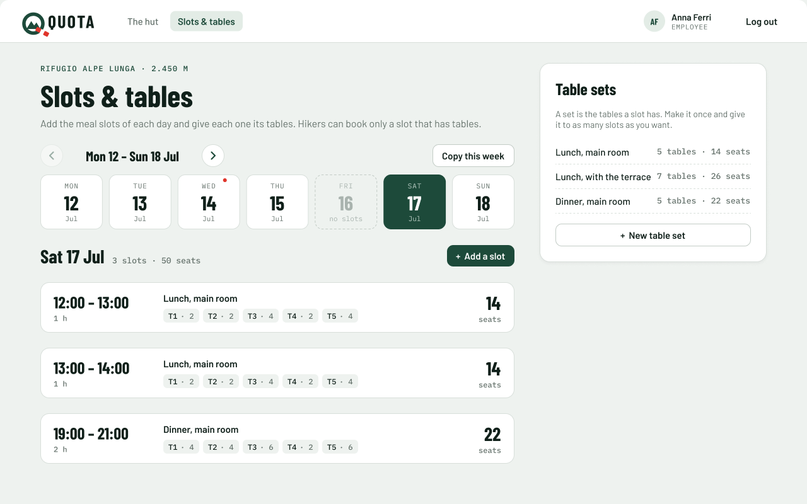 |
| 2 | Choose the weeks | 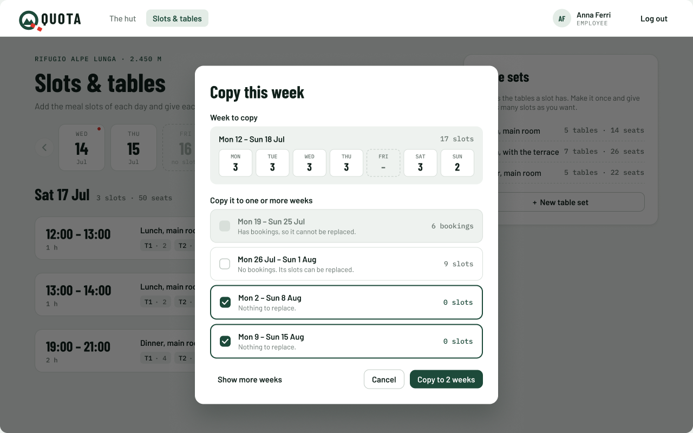 |
| 3 | A week that already has slots | 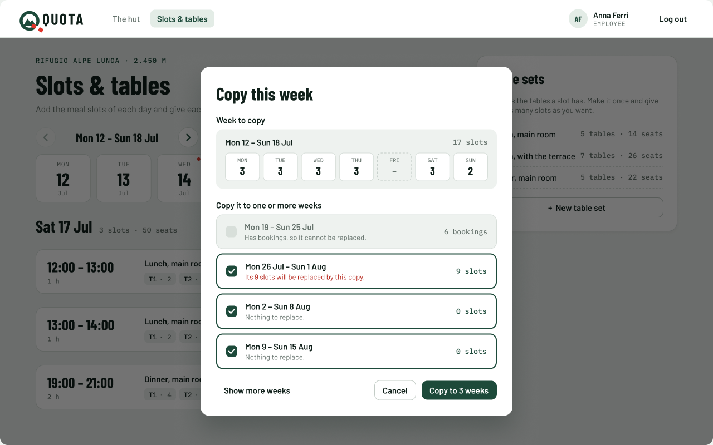 |
| 4 | Confirm the replacement | 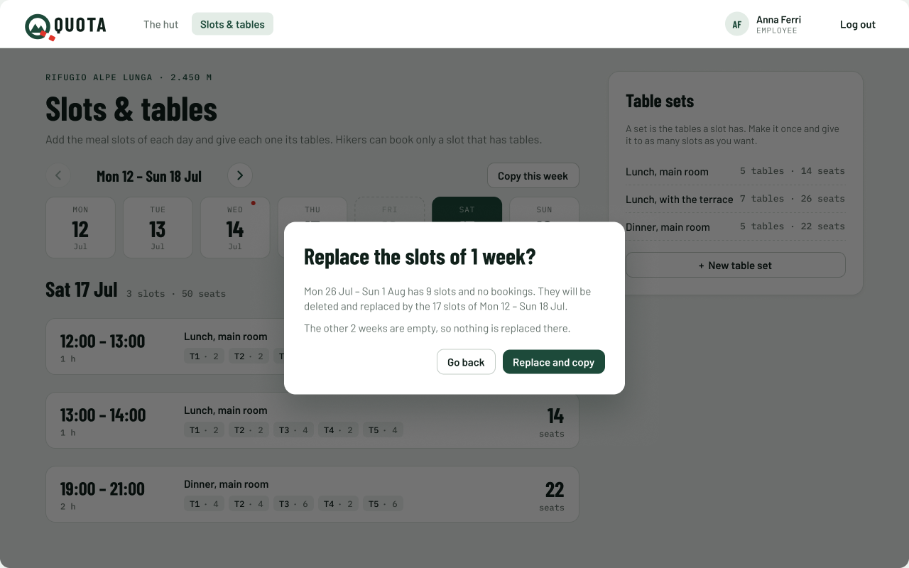 |
| 5 | Week copied | 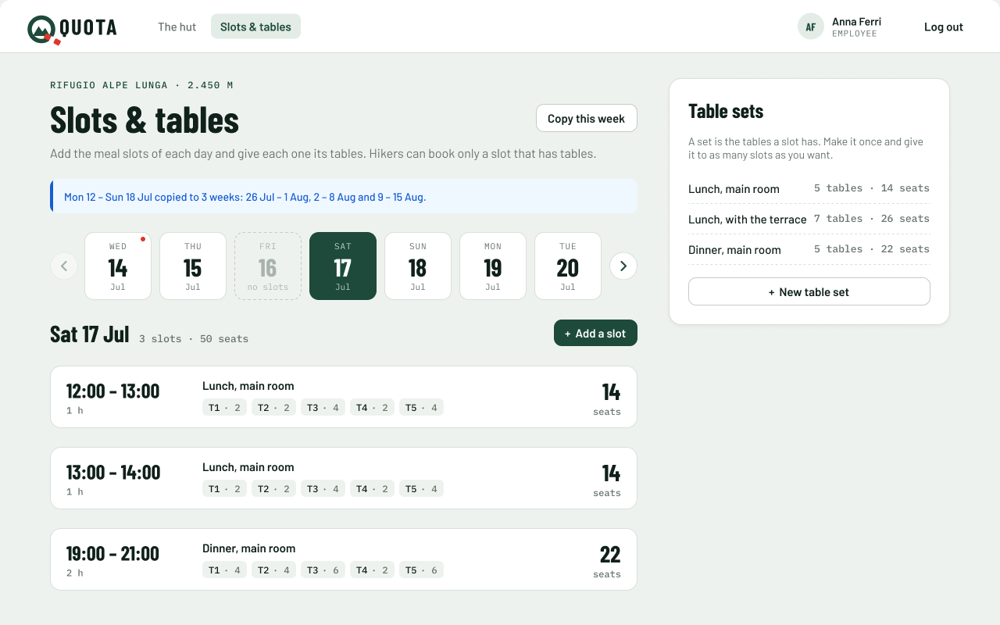 |
| 6 | A week got a booking meanwhile (`409`) | 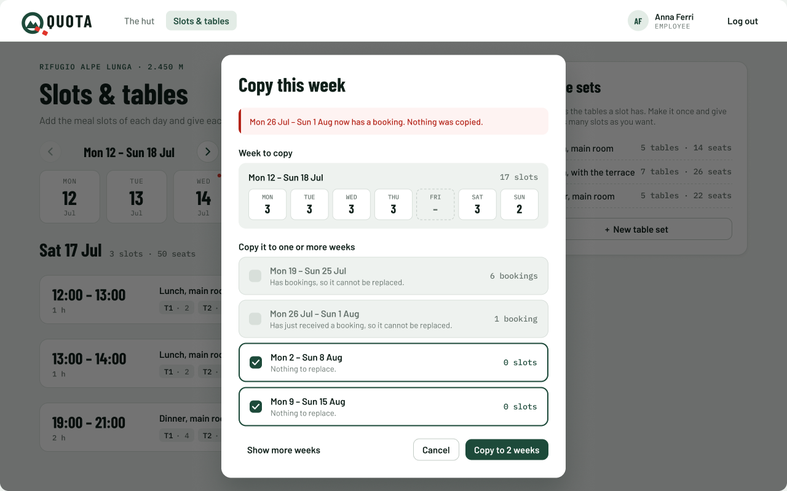 |
| 7 | A week with nothing to copy | 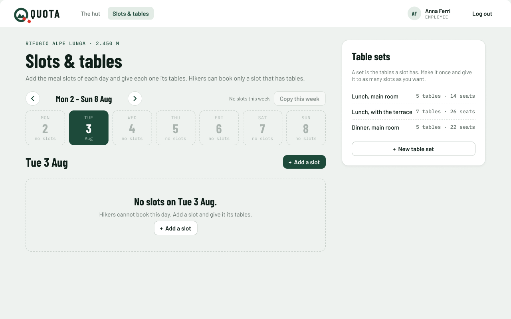 |

### On a phone

The same website in a phone browser. The 7 days of the week fit on one line (compact days) and a swipe moves one whole week. *Copy this week* sits on the week line, and *+ Add a slot* stays in the bar fixed at the bottom. The dialog becomes a sheet from the bottom: the weeks scroll, and the buttons stay at the bottom with the main button first.

| # | Screen | Image |
|---|---|---|
| 1 | Slots of a day | 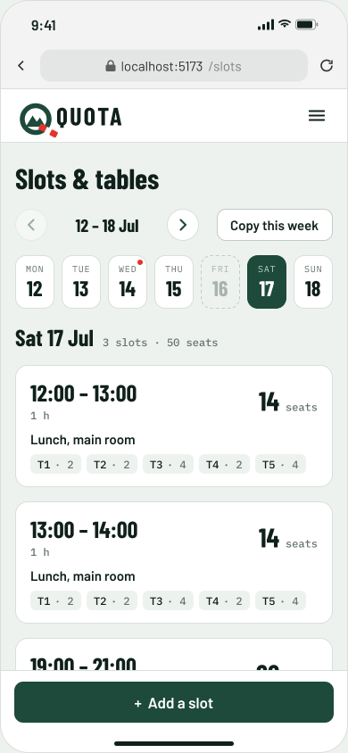 |
| 2 | Copy this week | 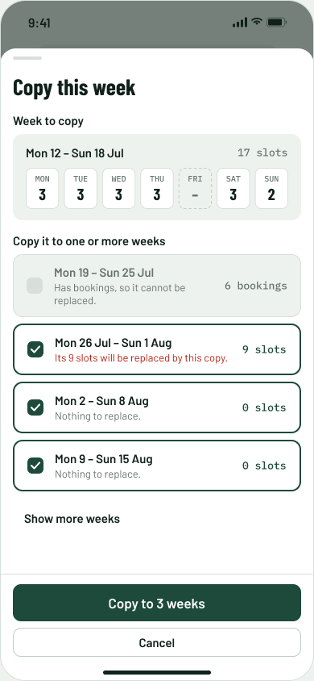 |
| 3 | Confirm the replacement | 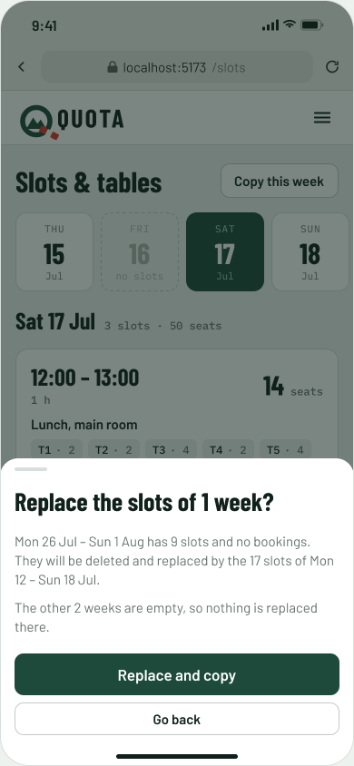 |
| 4 | Week copied | 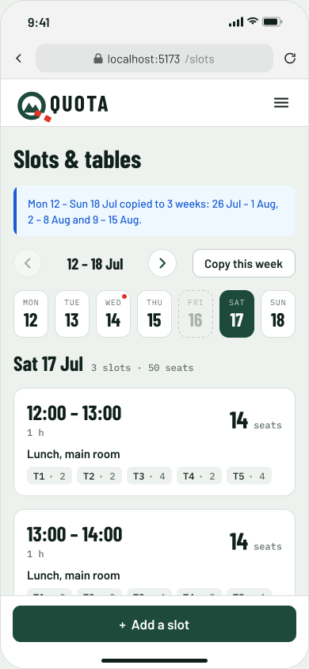 |
| 5 | A week got a booking meanwhile (`409`) | 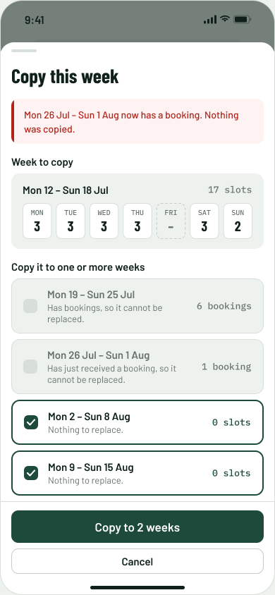 |

## Texts and server answers

| When | What the employee sees |
|---|---|
| Week with no slots on any day | *Copy this week* is off, with "No slots this week" beside it. |
| Empty week in the list | Nothing to replace. · *0 slots* |
| Week with slots and no bookings | No bookings. Its slots can be replaced. · *N slots* |
| The same week, ticked | Its *N* slots will be replaced by this copy. (in red) |
| Week with bookings | Has bookings, so it cannot be replaced. · *N bookings* |
| Copy pressed with no week ticked | Choose at least one week. |
| Main button | Copy to *N* weeks |
| Confirm step | **Replace the slots of *N* week?** *Week* has *N* slots and no bookings. They will be deleted and replaced by the *N* slots of *copied week*. Buttons: Go back, Replace and copy |
| Week copied | Alert on the page: "*Copied week* copied to *N* weeks: *the weeks*." |
| A chosen week got a booking meanwhile (`409`) | Alert in the dialog: "*Week* now has a booking. Nothing was copied." The list is reloaded, that week is locked and no longer ticked, and the other ticks are kept. |

## Left out on purpose

These belong to other stories: changing a copied slot (MH-19), closing a slot (MH-17) and booked and free seats per slot (MH-12).

## Assumptions to confirm

Not asked to the product owner:

- The selected day is the first day of the source period; continuation periods start every 7 days after it.
- Only continuation periods after the copied one can be chosen.
- The copy is all or nothing: if one chosen week cannot be copied onto, no week is saved.
- The endpoints for reading the periods and copying one are defined in `docs/openapi.json`.

Sample data (hut, names, dates, tables) is invented for the mockup.
