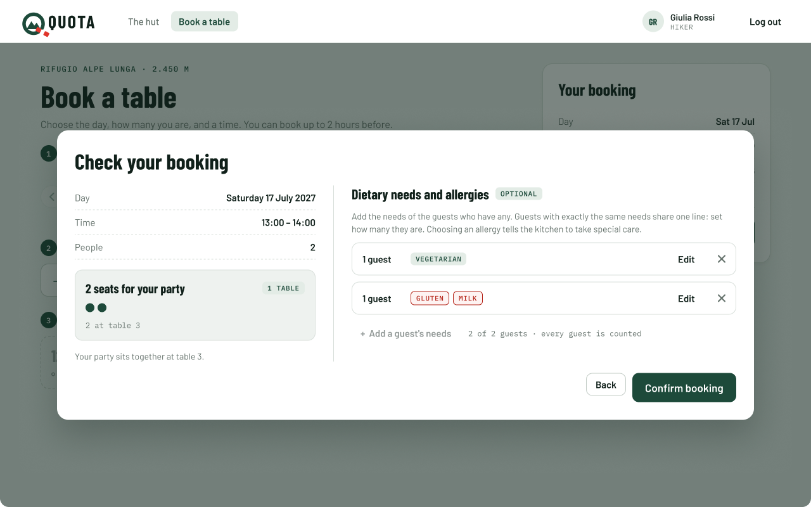
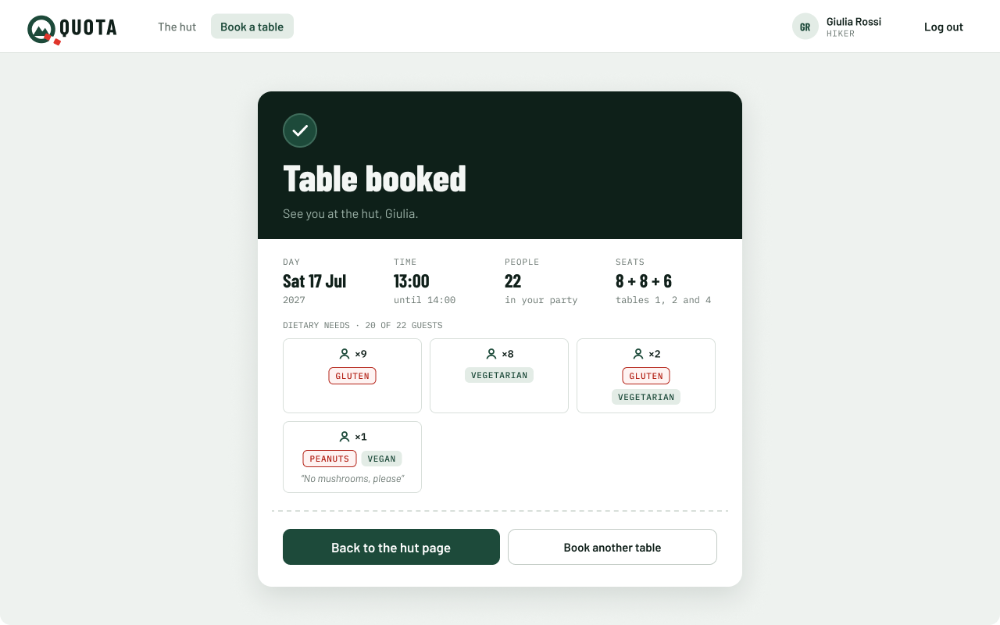
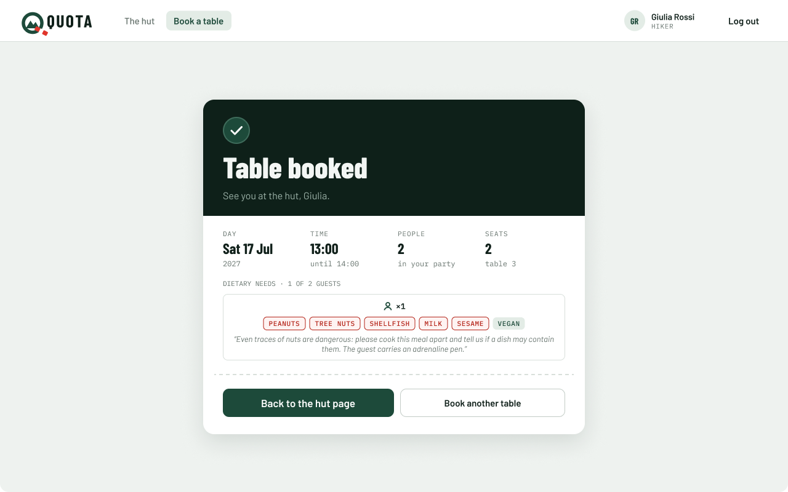

# Dietary needs and allergies mockup (MH-05)

Mockup for story **MH-05 Dietary needs and allergies**, used by the booking frontend and backend tasks and their tests. It extends the [Book a table mockup](../booking/README.md) (MH-01): only the *Check your booking* dialog and the *Table booked* confirmation change.

> "As a hiker I want to specify dietary restrictions and allergies for people in my party so that the hut can prepare suitable meals safely."

**Figma (source of truth):** page *MH-05 Dietary needs & allergies* in [Mountain Hut – Mockups (Team 16)](https://www.figma.com/design/VlTombwHX1DQ7yB2x4U5Yx?node-id=357-3978). Every element is an instance from the *Components* page: the ones already used by the [booking](../booking/README.md) mockup (navbar, button, text field, party seats, phone bars) and new ones for this story: *Need card*, *Need chip*, *Guest needs editor* and the *Icon / Food / …* icons. Same QUOTA brand, colours and fonts.

## Rules on these screens

| Source | Rule |
|---|---|
| Story | Dietary restrictions and allergies are given for people in the party, so the hut can prepare suitable meals safely. |
| Story notes | An allergy is flagged, so that special care is taken in the preparation. |
| PO answer | A booking has a **list of requirements**, each for part of the party, each with its own allergy flag. Example: yes "1 vegan, peanut allergy" · yes "1 shellfish allergy" · no "2 vegetarians". |
| Team choice | **One line per group of guests with exactly the same needs**, with **how many guests** they are (*Guests*, from 1). E.g. "3 guests: Vegan" and "1 guest: Vegan + Peanuts" instead of four lines. The guests of all the lines are at most the people in the party. |
| Team choice | The **backend does not change**: before `POST /api/bookings` the frontend turns a line of N guests into N equal requirements, one per guest, as the API expects. |
| Team choice | **Preset options instead of free text.** The needs are chosen with cards (icon in the middle, name centred below). *Diet* and *Allergies*: any number of each, but **at most one of Vegetarian, Vegan and Pescatarian**, which exclude each other (as in the backend). In both groups *Other* opens a text field, for a diet or an allergy that is not in the list (e.g. halal, sesame). |
| Team choice | The **allergy flag is set by the system**: a line is an allergy when at least one *Allergy* card is chosen. Allergy cards and chips are red, diets are green. |
| Team choice | **Other requests**: each line also has an optional free text for anything else the kitchen should know, that is not a diet or an allergy (e.g. no spicy food, a small portion). |
| Team choice | In the confirmation, **guests with the same needs are grouped** in one card with **×N** (how many guests). Guests are not numbered there. The summary grows with the number of different combinations, not with the people (screen 6). |
| Team choice | The needs are asked at the end of the booking, in *Check your booking*, just before *Confirm booking*. They are optional: a party with no needs confirms as before. |

## The options

| Group | Choice | Options |
|---|---|---|
| Diet | any number, at most one of Vegetarian, Vegan, Pescatarian | Vegetarian · Vegan · Pescatarian · Lactose-free · Other (with a text field) |
| Allergies | any number | Gluten · Milk · Eggs · Peanuts · Tree nuts · Fish · Shellfish · Other (with a text field) |

The PO example becomes three lines: 1 guest *Vegan* + *Peanuts*, 1 guest *Shellfish*, 2 guests *Vegetarian* (screen 2). They are sent as four requirements, and in *Table booked* the two vegetarians share one card with ×2.

## The flow

The first three steps of [Book a table](../booking/README.md#the-flow) (day, people, time) do not change.

1. **Review booking** opens *Check your booking*. On a computer the dialog has two columns: on the left the summary of MH-01 (day, time, people, the tables chosen), on the right **Dietary needs and allergies**, marked *Optional*. On a phone the sheet scrolls and the needs come after the summary, right above *Confirm booking*.
2. With no lines yet, the right column says "No dietary needs or allergies for this booking." and offers **+ Add a guest's needs**. Next to the button a counter shows the guests counted in the lines out of the people in the party ("0 of 6 guests").
3. **+ Add a guest's needs** opens the editor of a new line: its title ("1 guest", "2 guests"…), **Guests** (a − / + stepper, from 1, how many guests have exactly these needs), the *Diet* cards, the *Allergies* cards and the *Other requests* field. Tapping a card selects it (border, tinted background, check mark); tapping it again unselects it. More than one diet can be chosen (e.g. *Vegan* and *Lactose-free*), but Vegetarian, Vegan and Pescatarian exclude each other: choosing one of them unselects the other two.
4. When another line is added, the line being edited folds into a row: how many guests ("2 guests"), a chip per choice (green diet, red allergy), **Edit** to open it again and **×** to remove it. Only one line is open at a time.
5. When every person of the party is counted in a line, **+ Add a guest's needs** and the **+** of *Guests* are disabled, and the counter says "every guest is counted". Removing a line, or lowering its *Guests*, frees them again. If the hiker goes **Back** and makes the party smaller than the guests counted, lines must be removed or lowered before confirming.
6. **Confirm booking** sends the booking and its requirements in the same request (`POST /api/bookings`): each line becomes as many requirements as its guests. The dialog stays open, with the problem marked, when a line has no card chosen and no request, or *Other* (diet or allergy) is chosen with an empty field, or a text is longer than its limit (100 characters for *Other*, 300 for *Other requests*). **Back** keeps every choice, the lines too.
7. **Table booked** lists the needs as saved, in a grid of cards (3 per row, 2 on a phone). Guests with exactly the same needs (diet, allergies and request) share one card: a people icon with **×N**, the chips, and the request in quotes under them. With no needs the card is the same as in MH-01.

   Every card starts from the top, so the ×N of the cards of a row are on one line and the chips on the next one, also when one card has a request and the others do not. The cards of a row have the same height. The chips show the **allergies first** (red), then the diets (green), and wrap when they do not fit. The request goes under them, on as many lines as needed. A single card of a party takes the whole width (screen 7).

## Screens

| # | Screen | Image |
|---|---|---|
| 1 | Check your booking, no dietary needs yet |  |
| 2 | Choosing the needs of a line of 2 guests (the PO example), with an other request |  |
| 3 | *Other* allergy without a name |  |
| 4 | Party of 2: every guest is counted |  |
| 5 | Table booked with dietary needs, grouped with ×N |  |
| 6 | Big party with shared needs: 22 people, 20 with needs, in 4 cards |  |
| 7 | One guest with many needs: five allergies, a diet and a long request |  |

Screens 2 and 3 are taller than 800 px to show the dialog in full (with *Other* in the Diet group the cards take two lines, and the editor has the *Guests* stepper). On a smaller window the dialog scrolls.

### On a phone

The same website in a phone browser, as in MH-01. The dialog becomes a sheet from the bottom. The sheet scrolls, and the image shows it in full. The cards are 3 per line.

| # | Screen | Image |
|---|---|---|
| 1 | Check and confirm with dietary needs |  |
| 2 | Table booked with dietary needs |  |

## New components

| Component | Variants | Use |
|---|---|---|
| *Icon / Food / …* | one per option | 24 px line icons: Vegetarian, Vegan, Pescatarian, Lactose-free, Gluten, Milk, Eggs, Peanuts, Tree nuts, Fish, Shellfish, Other. |
| *Need card* | Kind = Diet / Allergy × State = Default / Selected | One option: icon in the middle, name centred below. Properties *Name* (text) and *Icon* (swap). Selected diet is green, selected allergy is red. |
| *Need chip* | Kind = Diet / Allergy | Read-only chip of a chosen option, in the folded lines and in the confirmation. Property *Name*. |
| *Guest needs editor* | Size = Desktop / Phone | The open editor of one line: title (how many guests), ×, *Guests* (a *People stepper*), the Diet cards, the Allergies cards, the *Other* field and the *Other requests* field. Properties *Guest* (text), *Show other field* (boolean, the *Other* allergy field) and *Show other diet field* (boolean, the *Other* diet field). |

## Texts and server answers

| When | What the hiker sees |
|---|---|
| Section title | Dietary needs and allergies · OPTIONAL |
| Help under the title | Add the needs of the guests who have any. Guests with exactly the same needs share one line: set how many they are. Choosing an allergy tells the kitchen to take special care. (On a phone: "Guests with the same needs share one line. An allergy tells the kitchen to take special care.") |
| No lines | No dietary needs or allergies for this booking. · **+ Add a guest's needs** · 0 of *N* guests |
| Group labels | DIET · choose all that apply · at most one of Vegetarian, Vegan, Pescatarian / ALLERGIES · choose all that apply / OTHER REQUESTS · optional · not a diet or an allergy |
| Other requests field | "Anything else the kitchen should know?", placeholder "e.g. no spicy food, a small portion", helper "Up to 300 characters." |
| Line title | "1 guest" / "*K* guests", the same in the folded row |
| Guests stepper | GUESTS · how many guests have exactly these needs, − *K* + |
| Counter | *K* of *N* guests (the guests of all the lines) |
| Every guest is counted | Button and *Guests* + disabled, "*N* of *N* guests · every guest is counted" |
| *Other* allergy chosen | Field "Which allergy?", placeholder "e.g. sesame, celery, mustard", helper "Up to 100 characters." |
| *Other* diet chosen | Field "Which diet?", placeholder "e.g. halal, kosher", helper "Up to 100 characters." |
| A text longer than its limit, on Confirm | The field is marked in red: "Too long: at most 100 characters." (*Other*) or "Too long: at most 300 characters." (*Other requests*). Nothing is sent. |
| *Other* left empty, on Confirm | Under the field, in red: "Write which allergy, or unselect Other." (or "Write which diet, or unselect Other.") Nothing is sent. |
| A line with no card and no request, on Confirm | The line is marked the same way. Nothing is sent. |
| Server saved the booking (`201`) | Table booked, with *Dietary needs · K of N guests* and one card per group of guests with the same needs: ×*count*, the chips, the request in quotes. |
| Invalid request (`400`, e.g. more requirements than people) | Checked in the browser first, so it should not happen. If it does, the general message "Something went wrong on our side. Try again in a minute." |
| Seats gone meanwhile (`409`) | As in MH-01 (screen 5). The lines are kept with the other choices. |

## Data

What the screens need from the API. The field names are for the backend task to decide:

- a booking has a list of requirements, one per guest, possibly empty, with **at most as many requirements as people** in the party. The lines of the screen (with *Guests* = N) are expanded by the frontend into N equal requirements, so the API does not know about them;
- each requirement has **any number of diets** from the fixed list (at most one of Vegetarian, Vegan, Pescatarian), an **other diet** text (required only when the diet *Other* is chosen, at most 100 characters), **any number of allergies** from the fixed list, an **other allergy** text (required only when the allergy *Other* is chosen, at most 100 characters) and an optional **other requests** text (at most 300 characters);
- a requirement has at least one choice or a request;
- the **allergy flag** of a requirement is true when it has at least one allergy. It is derived, so the client does not send it;
- the order of the requirements is the order in which the hiker added the lines;
- the grouping with ×N in the confirmation is only how the requirements are shown: they are saved one per guest.

## Left out on purpose

These belong to other stories and are added with them: how the hut staff read the needs of the bookings of a slot, changing them after booking (MH-06), menus and meal names (MH-10, MH-11).

## Open questions (not decided here)

Not asked to the product owner yet. The mockup does not depend on the answers, only the lists would change:

- Which diets and allergies are in the preset lists. Today: 4 diets and 7 allergies, each group with *Other*.

Sample data (hut, names, dates, tables, needs) is invented for the mockup.
