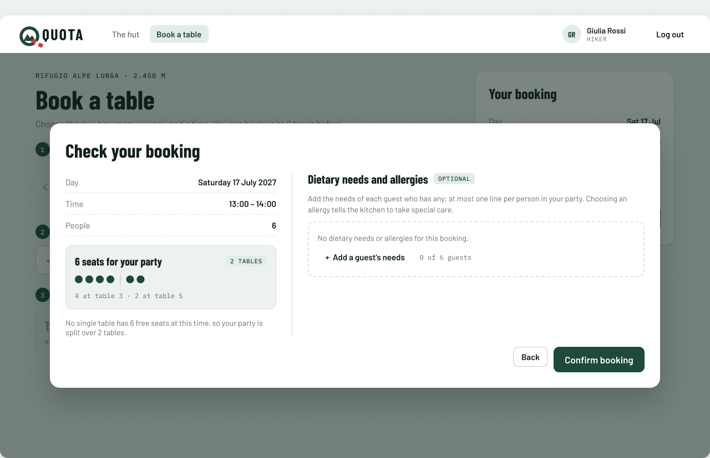
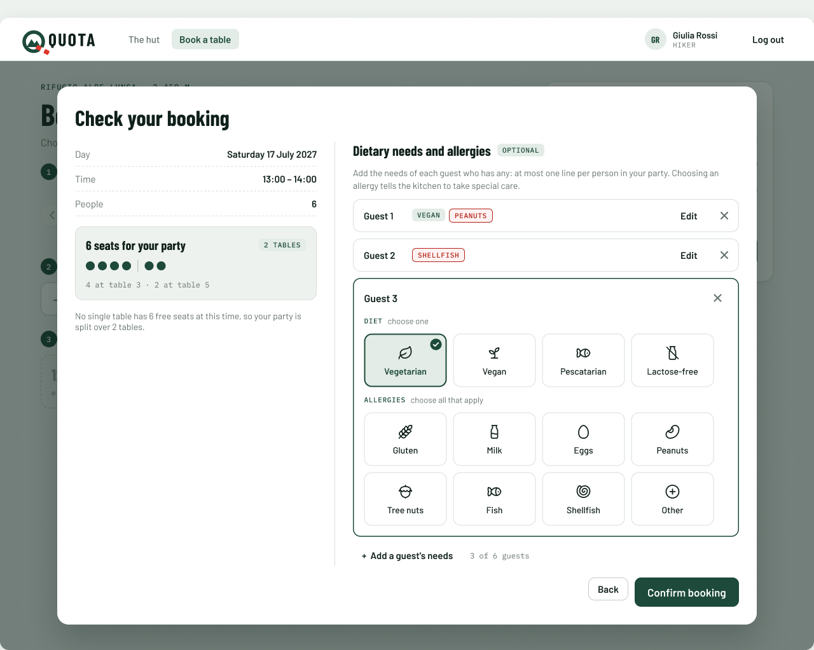
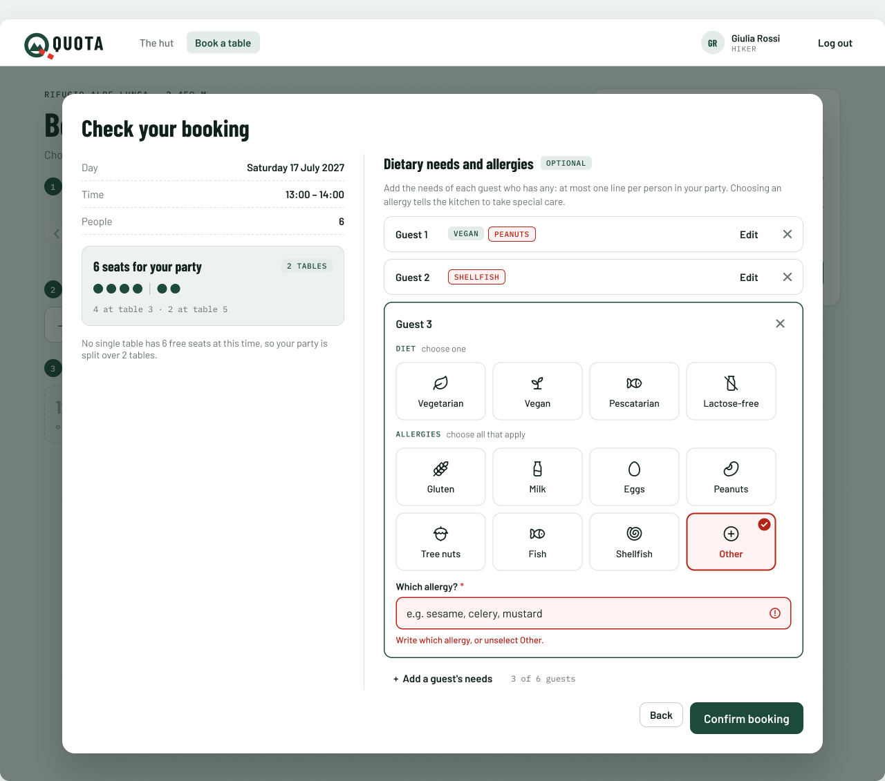
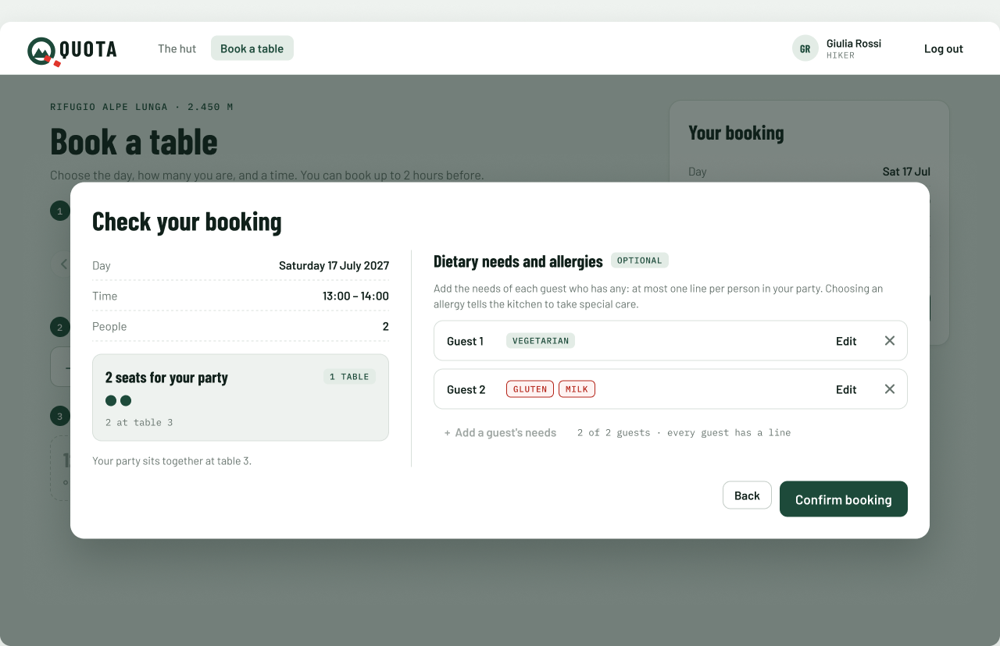
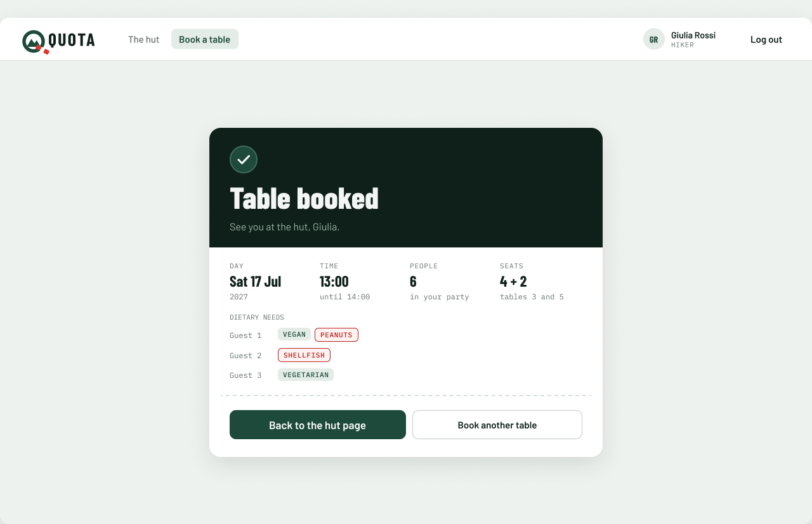
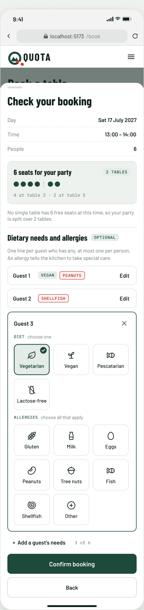
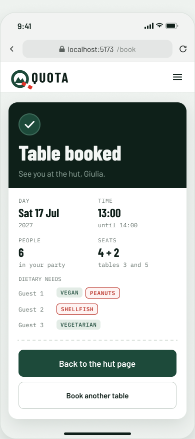

# Dietary needs and allergies mockup (MH-05)

Mockup for story **MH-05 Dietary needs and allergies**, used by the booking frontend and backend tasks and their tests. It extends the [Book a table mockup](../booking/README.md) (MH-01): only the *Check your booking* dialog and the *Table booked* confirmation change.

> "As a hiker I want to specify dietary restrictions and allergies for people in my party so that the hut can prepare suitable meals safely."

**Figma (source of truth):** page *MH-05 Dietary needs & allergies* in [Mountain Hut – Mockups (Team 16)](https://www.figma.com/design/VlTombwHX1DQ7yB2x4U5Yx?node-id=357-3978). Every element is an instance from the *Components* page: the ones already used by the [booking](../booking/README.md) mockup (navbar, button, text field, party seats, phone bars) and new ones for this story: *Need card*, *Need chip*, *Guest needs editor* and the *Icon / Food / …* icons. Same QUOTA brand, colours and fonts.

## Rules on these screens

| Source | Rule |
|---|---|
| Story | Dietary restrictions and allergies are given for people in the party, so the hut can prepare suitable meals safely. |
| Story notes | An allergy is flagged, so that special care is taken in the preparation. |
| PO answer | A booking has a **list of requirements**, each for part of the party, each with its own allergy flag. Example: yes "1 vegan, peanut allergy" · yes "1 shellfish allergy" · no "2 vegetarians". |
| Team choice | **One line per guest**, so a party of N people has at most N lines. Each line holds the needs of one person. |
| Team choice | **Preset options instead of free text.** The needs are chosen with cards (icon in the middle, name centred below). *Diet*: one at most. *Allergies*: any number. *Other* opens a text field for an allergy that is not in the list. |
| Team choice | The **allergy flag is set by the system**: a line is an allergy when at least one *Allergy* card is chosen. Allergy cards and chips are red, diets are green. |
| Team choice | The needs are asked at the end of the booking, in *Check your booking*, just before *Confirm booking*. They are optional: a party with no needs confirms as before. |

## The options

| Group | Choice | Options |
|---|---|---|
| Diet | one at most | Vegetarian · Vegan · Pescatarian · Lactose-free |
| Allergies | any number | Gluten · Milk · Eggs · Peanuts · Tree nuts · Fish · Shellfish · Other (with a text field) |

The PO example becomes: Guest 1 *Vegan* + *Peanuts*, Guest 2 *Shellfish*, Guest 3 *Vegetarian*.

## The flow

The first three steps of [Book a table](../booking/README.md#the-flow) (day, people, time) do not change.

1. **Review booking** opens *Check your booking*. On a computer the dialog has two columns: on the left the summary of MH-01 (day, time, people, the tables chosen), on the right **Dietary needs and allergies**, marked *Optional*. On a phone the sheet scrolls and the needs come after the summary, right above *Confirm booking*.
2. With no lines yet, the right column says "No dietary needs or allergies for this booking." and offers **+ Add a guest's needs**. Next to the button a counter shows the lines used out of the people in the party ("0 of 6 guests").
3. **+ Add a guest's needs** opens the editor of a new guest (*Guest 1*, *Guest 2*…): the *Diet* cards and the *Allergies* cards. Tapping a card selects it (border, tinted background, check mark); tapping it again unselects it. Choosing another diet replaces the first one.
4. When another guest is added, the guest being edited folds into a row: its name, a chip per choice (green diet, red allergy), **Edit** to open it again and **×** to remove it. Only one guest is open at a time.
5. When every person of the party has a line, **+ Add a guest's needs** is disabled and the counter says "every guest has a line". Removing a line frees it again. If the hiker goes **Back** and makes the party smaller than the number of lines, the extra lines must be removed before confirming.
6. **Confirm booking** sends the booking and its lines in the same request (`POST /api/bookings`). The dialog stays open, with the problem marked, when a guest has no card chosen or *Other* is chosen with an empty field. **Back** keeps every choice, the lines too.
7. **Table booked** lists the needs as saved, one row per guest with the same chips. With no needs the card is the same as in MH-01.

## Screens

| # | Screen | Image |
|---|---|---|
| 1 | Check your booking, no dietary needs yet |  |
| 2 | Choosing the needs of a guest (the PO example) |  |
| 3 | *Other* allergy without a name |  |
| 4 | Party of 2: every guest has a line |  |
| 5 | Table booked with dietary needs |  |

Screens 2 and 3 are taller than 800 px to show the dialog in full. On a smaller window the dialog scrolls.

### On a phone

The same website in a phone browser, as in MH-01. The dialog becomes a sheet from the bottom. The sheet scrolls, and the image shows it in full. The cards are 3 per line.

| # | Screen | Image |
|---|---|---|
| 1 | Check and confirm with dietary needs |  |
| 2 | Table booked with dietary needs |  |

## New components

| Component | Variants | Use |
|---|---|---|
| *Icon / Food / …* | one per option | 24 px line icons: Vegetarian, Vegan, Pescatarian, Lactose-free, Gluten, Milk, Eggs, Peanuts, Tree nuts, Fish, Shellfish, Other. |
| *Need card* | Kind = Diet / Allergy × State = Default / Selected | One option: icon in the middle, name centred below. Properties *Name* (text) and *Icon* (swap). Selected diet is green, selected allergy is red. |
| *Need chip* | Kind = Diet / Allergy | Read-only chip of a chosen option, in the guest rows and in the confirmation. Property *Name*. |
| *Guest needs editor* | Size = Desktop / Phone | The open editor of one guest: name, ×, the Diet cards, the Allergies cards and the *Other* field. Properties *Guest* (text) and *Show other field* (boolean). |

## Texts and server answers

| When | What the hiker sees |
|---|---|
| Section title | Dietary needs and allergies · OPTIONAL |
| Help under the title | Add the needs of each guest who has any: at most one line per person in your party. Choosing an allergy tells the kitchen to take special care. |
| No lines | No dietary needs or allergies for this booking. · **+ Add a guest's needs** · 0 of *N* guests |
| Group labels | DIET · choose one / ALLERGIES · choose all that apply |
| Counter | *K* of *N* guests |
| Every guest has a line | Button disabled, "*N* of *N* guests · every guest has a line" |
| *Other* chosen | Field "Which allergy?", placeholder "e.g. sesame, celery, mustard" |
| *Other* left empty, on Confirm | Under the field, in red: "Write which allergy, or unselect Other." Nothing is sent. |
| A guest with no card, on Confirm | The guest is marked the same way. Nothing is sent. |
| Server saved the booking (`201`) | Table booked, with a *Dietary needs* list: one row per guest, its chips. |
| Invalid request (`400`, e.g. more lines than people) | Checked in the browser first, so it should not happen. If it does, the general message "Something went wrong on our side. Try again in a minute." |
| Seats gone meanwhile (`409`) | As in MH-01 (screen 5). The lines are kept with the other choices. |

## Data

What the screens need from the API. The field names are for the backend task to decide:

- a booking has a list of guest lines, possibly empty, with **at most as many lines as people** in the party;
- each line has **at most one diet** from the fixed list, **any number of allergies** from the fixed list, and an **other allergy** text (required only when *Other* is chosen);
- a line has at least one choice;
- the **allergy flag** of a line is true when it has at least one allergy. It is derived, so the client does not send it;
- the order of the lines is the order in which the hiker added them.

## Left out on purpose

These belong to other stories and are added with them: how the hut staff read the needs of the bookings of a slot, changing them after booking (MH-06), menus and meal names (MH-10, MH-11).

## Open questions (not decided here)

Not asked to the product owner yet. The mockup does not depend on the answers, only the lists would change:

- Which diets and allergies are in the preset lists. Today: 4 diets and 7 allergies plus *Other*.
- Whether free notes are needed for diets as well (today only *Other* has text). The story notes speak of details "in a text field".

Sample data (hut, names, dates, tables, needs) is invented for the mockup.
