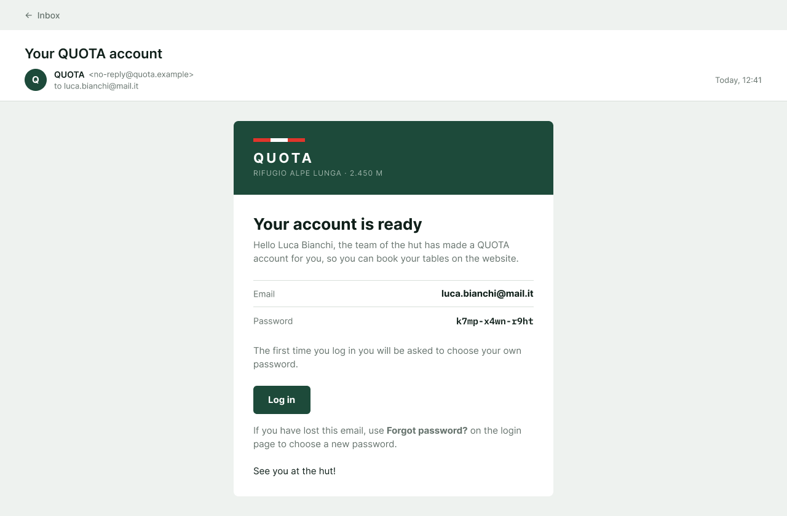
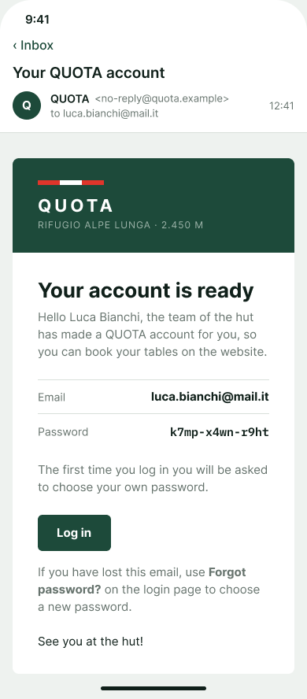

# Emails mockup (MH-03, MH-06, MH-07, MH-08)

Mockup of the emails QUOTA sends to a hiker:

- **Booking confirmation** (MH-03). The server already sends it.
- **Password reset.** The MH-07 clarifications say that "the hiker can recover their password via email".
- **Booking changed** (MH-06). Sent when a change to a booking is saved.
- **Booking cancelled** (MH-08). Sent when the hiker confirms the cancellation.
- **Hiker account** (MH-07). When an employee adds a hiker with a full profile, the employee never sees the generated password: the server sends it to the hiker with this email.

All use the same layout.

**Figma (source of truth):** page *Emails (MH-03, MH-07)* (it also has the emails of MH-06 and MH-08) in [Mountain Hut – Mockups (Team 16)](https://www.figma.com/design/VlTombwHX1DQ7yB2x4U5Yx?node-id=406-877). The emails use two components from the *Components* page:

- **Email / Header:** the pine band with the trail blaze, the QUOTA wordmark and the hut.
- **Email / Row:** a detail line, with the label on the left and the value on the right.

Each email is shown inside a generic email app: subject, sender, recipient. The app around it is not part of the design. Only the white card is what QUOTA sends.

## Rules on these emails

| Source | Rule |
|---|---|
| MH-03, [#24](https://github.com/SE2-Polito/AY26-27-Mountain-Hut/issues/24) | The confirmation has the booking reference, name, date, time and party size. Table numbers are left out on purpose. |
| MH-05 | When the booking has dietary needs, the confirmation lists them after the rows (see [Dietary needs](#dietary-needs-mh-05)). |
| MH-06, team decision confirmed by the product owner | A saved change to a booking (day, time, party size or dietary needs) is emailed to the hiker, with the new details of the booking. A failed change sends no email ([hiker booking page mockup](../hiker-booking-page/README.md)). |
| MH-08, team decision confirmed by the product owner | A confirmed cancellation is emailed to the hiker, who can cancel at any time. |
| MH-07 | The hiker can recover the password by email. The email has a link to *Choose a new password* ([login mockup](../login/README.md), screen 12). |
| Product owner, [#44](https://github.com/SE2-Polito/AY26-27-Mountain-Hut/issues/44) | The reset link works for 24 hours. |
| Login, screen 11 | A reset email is sent only if the email has an account. The page answers the same in both cases, so nobody can find out which emails are registered. |
| MH-07, team decision | When an employee adds a hiker with a full profile, the server generates the password and sends it with the hiker account email. The employee never sees it and the server keeps only its hash, so this email is the only place where the password is written. |
| Server | Sender: `QUOTA <no-reply@quota.example>` (`MAIL_FROM` in `server/src/config.js`). Every email has an HTML version, with tables and inline styles because that is what email apps support, and a plain text version for the apps that do not show HTML. |

## How they look

The emails share one layout, and the confirmation already uses it in [`server/src/domain/bookingConfirmation.js`](../../../server/src/domain/bookingConfirmation.js):

- **Background:** `mist` (#EEF2EF), with 32 px of space above and below and 16 px on the sides.
- **Card:** white, at most **520 px** wide, with rounded corners (8 px). On a phone it takes the full width minus 16 px on each side.
- **Header:** `pine` (#1D4A3A) with 28/32 px padding.
  - The trail blaze: three bars of 28 × 6 px, red, white, red.
  - **QUOTA** in white, bold, 22 px, letter spacing 4 px.
  - RIFUGIO ALPE LUNGA · 2.450 M in `on-dark-muted` (#9DB3A9), 12 px.
- **Body:** 32 px padding.
  - Title in bold, 26 px, `ink`.
  - Text 15 px, `stone`, line height 22 px.
  - Detail lines: label 14 px `stone`, value 15 px bold `ink`, with a 1 px `line` (#D8DFDA) border on top and 12 px above and below.
- **Font:** Helvetica, Arial, sans-serif, the fonts every email app has. Figma does not have them, so the mockup uses Inter, which looks very close. The password of email 5 is in a monospace font (Menlo, Consolas); the mockup uses IBM Plex Mono.

## Emails

| # | Email | Image |
|---|---|---|
| 1 | Booking confirmation |  |
| 2 | Password reset |  |
| 3 | Booking changed |  |
| 4 | Booking cancelled |  |
| 5 | Hiker account |  |

### On a phone

| # | Email | Image |
|---|---|---|
| 1 | Booking confirmation |  |
| 2 | Password reset |  |
| 3 | Booking changed |  |
| 4 | Booking cancelled |  |
| 5 | Hiker account |  |

The changed-booking email (3) and the hiker account email (5) are longer than the others, so their screens are taller: 1280 × 949 and 390 × 1000 for email 3, 1280 × 840 and 390 × 888 for email 5. The cancelled-booking email (4) is 1280 × 820 and 390 × 900.

## 1. Booking confirmation (MH-03)

It is sent when a booking is saved. The mockup is the email the server sends for a booking without dietary needs: the same texts, rows, colours and sizes.

It is also sent for a reservation entered by an employee ([MH-07](../reservation-for-a-hiker/README.md)), at *Save reservation*, when the hiker has an email. A new hiker with a full profile has already had the hiker account email (email 5) at *Add hiker*. A temporary hiker has no email, so no email is sent.

**Subject:** `Your table is booked (QUOTA-00042)`

**HTML:**

| Part | Text |
|---|---|
| Title | Your table is booked |
| Text | Hello *first name last name*, here are the details of your booking. |
| Rows | Booking reference: `QUOTA-` + the booking id in 5 digits · Name · Date (*17 July 2027*) · Time (*13:00–14:00*) · Party size |
| End | See you at the hut! |

**Plain text** (as the server writes it):

```
Hello Giulia Rossi,

Your table is booked. These are the details:

Booking reference: QUOTA-00042
Name: Giulia Rossi
Date: 17 July 2027
Time: 13:00–14:00
Party size: 4

See you at the hut!
```

### Dietary needs (MH-05)

The MH-05 backend is on `dev`: when the booking has dietary needs, the confirmation lists them after the rows, before "See you at the hut!". Guests with exactly the same needs are shown once, with how many they are, as on the *Table booked* screen of MH-05. A booking without needs has no such part, as in the images above.

**HTML:**

| Part | Text |
|---|---|
| Title | **Dietary needs**: bold, 16 px, `ink`, with 24 px above and 8 px below. |
| One line per group | A 1 px `line` border on top. On the left, how many guests (*1 guest*, *2 guests*): 14 px, `stone`. On the right, each part on its own line, 14 px: "Allergies: *…*" in bold `blaze` red, then "Diet: *…*" in `ink`, then the other requests between quotes, in italic `stone`. Allergies come first, because the kitchen reads them first. |

**Plain text:**

```
Party size: 4

Dietary needs:
- 2 guests: Allergies: Peanuts · Diet: Vegan
- 1 guest: Diet: Vegetarian · "No onions, please"

See you at the hut!
```

## 2. Password reset (MH-07)

*Send the link* on the *Forgot password?* page sends this email ([login mockup](../login/README.md), screens 10–11). It is sent only if the email has an account.

**Subject:** `Choose a new password for QUOTA`

**HTML:**

| Part | Text |
|---|---|
| Title | Choose a new password |
| Text | Hello *first name last name*, we received a request to reset the password of your QUOTA account. Use the button to choose a new one. |
| Button | **Choose a new password**: pine, white bold text 15 px, 14/24 px padding, 6 px corners. It opens the link. |
| Link | If the button does not work, copy this link into your browser: *the full link*, underlined, in `pine`, 13 px. |
| Note | Under a line: "Did not ask for it? You can ignore this email: your password stays the same. The link works for 24 hours, and only once." 13 px, `stone`. |

**Plain text:**

```
Hello Giulia Rossi,

We received a request to reset the password of your QUOTA account.
To choose a new one, open this link:

https://quota.example/reset-password?token=…

Did not ask for it? You can ignore this email: your password stays the same.
The link works for 24 hours, and only once.
```

**The link** opens *Choose a new password* (login screen 12). It stops working in three cases:

- it is more than 24 hours old;
- it was already used;
- a newer link was asked for.

The page cannot check the link before the form, so it finds out at *Save password*, when the server refuses it. Then it shows *This link no longer works* (login screen 13).

The name comes from the account. Like in the confirmation, it is escaped in the HTML, because the hiker typed it.

## 3. Booking changed (MH-06)

*Save changes* in the *Change your booking* dialog sends this email when the change is saved ([hiker booking page mockup](../hiker-booking-page/README.md), screens 4, 7 and 8). It leaves for every saved change: day, time, party size or dietary needs. It has the same layout, sender and colours as the confirmation. A change that fails (no seats, past the 48 hours) sends no email, and the old booking stays as it is.

The details are the new ones: they replace those of the earlier emails of the same booking. The booking reference does not change.

**Subject:** `Your booking has changed (QUOTA-00042)`

**HTML:**

| Part | Text |
|---|---|
| Title | Your booking has changed |
| Text | Hello *first name last name*, here are the new details of your booking. These details replace the ones of the earlier emails for booking *QUOTA-00042*. |
| Rows | Booking reference · Name · Date · Time · Party size, as in the confirmation, then **Changed on** (*14 July 2027, 11:20*) |
| Dietary needs | When the booking has dietary needs, the same part as in the confirmation ([Dietary needs](#dietary-needs-mh-05)): the title, then one line per group of guests. A booking without needs has no such part. |
| End | See you at the hut! |

**Plain text:**

```
Hello Giulia Rossi,

Your booking has changed. These are the new details, and they replace the ones of the earlier emails:

Booking reference: QUOTA-00042
Name: Giulia Rossi
Date: 17 July 2027
Time: 13:00–14:00
Party size: 6
Changed on: 14 July 2027, 11:20

Dietary needs:
- 1 guest: Allergies: Peanuts · Diet: Vegan

See you at the hut!
```

## 4. Booking cancelled (MH-08)

Confirming in the *Cancel this booking?* dialog sends this email ([hiker booking page mockup](../hiker-booking-page/README.md), screens 9 and 10). The hiker can cancel at any time, so it has no deadline. It has the same layout, sender and colours as the other emails.

The rows are those of the booking that was cancelled. There are no dietary needs in it: the booking no longer exists.

**Subject:** `Your booking has been cancelled (QUOTA-00042)`

**HTML:**

| Part | Text |
|---|---|
| Title | Your booking has been cancelled |
| Text | Hello *first name last name*, your booking *QUOTA-00042* has been cancelled. The seats are free again for other guests. |
| Rows | Booking reference · Name · Date · Time · Party size of the cancelled booking, then **Cancelled on** (*14 July 2027, 11:32*) |
| End | We hope to see you at the hut another time. |

**Plain text:**

```
Hello Giulia Rossi,

Your booking QUOTA-00042 has been cancelled. The seats are free again for other guests.

Booking reference: QUOTA-00042
Name: Giulia Rossi
Date: 17 July 2027
Time: 13:00–14:00
Party size: 4
Cancelled on: 14 July 2027, 11:32

We hope to see you at the hut another time.
```

## 5. Hiker account (MH-07)

*Add hiker* in the *New hiker* dialog, with a full profile, sends this email ([reservation for a hiker mockup](../reservation-for-a-hiker/README.md), screen 5). It leaves when the account is created, before the reservation is saved; the booking confirmation (email 1) follows at *Save reservation*. If it cannot be sent, the account exists all the same, and the hiker can choose a password with *Forgot password?* (email 2).

The texts are those of `server/src/domain/hikerAccountEmail.js` in the MH-07 backend (PR #93).

**Subject:** `Your QUOTA account`

**HTML:**

| Part | Text |
|---|---|
| Title | Your account is ready |
| Text | Hello *first name last name*, the team of the hut has made a QUOTA account for you, so you can book your tables on the website. |
| Rows | Email · Password. The password is in a monospace font, so every character is easy to read and type. |
| Text | The first time you log in you will be asked to choose your own password. |
| Button | **Log in**: the same button as in email 2. It opens the login page. |
| Text | If you have lost this email, use **Forgot password?** on the login page to choose a new password. |
| End | See you at the hut! |

**Plain text:**

```
Hello Luca Bianchi,

The team of the hut has made a QUOTA account for you, so you can book your tables on the website.

Email: luca.bianchi@mail.it
Password: k7mp-x4wn-r9ht

The first time you log in you will be asked to choose your own password.
Log in: https://quota.example/login

If you have lost this email, use "Forgot password?" on the login page to choose a new password.

See you at the hut!
```

**The password** is generated by the server: 12 lowercase letters and digits in three groups of four, without the characters that look alike (0 and o, 1, l and i). The hiker must change it at the first login (login screen 15). Like the name, it is escaped in the HTML.

## Left out on purpose

- Other emails, such as the waiting list (MH-16). They are added with their stories.
- An email to the staff when a booking is changed or cancelled. No story asks for it.

## Open questions

- **The address in the links** (`https://quota.example/...`) is a placeholder. The real one comes from the deployment settings.

Sample data (names, emails, reference, date, password) is invented for the mockup.
