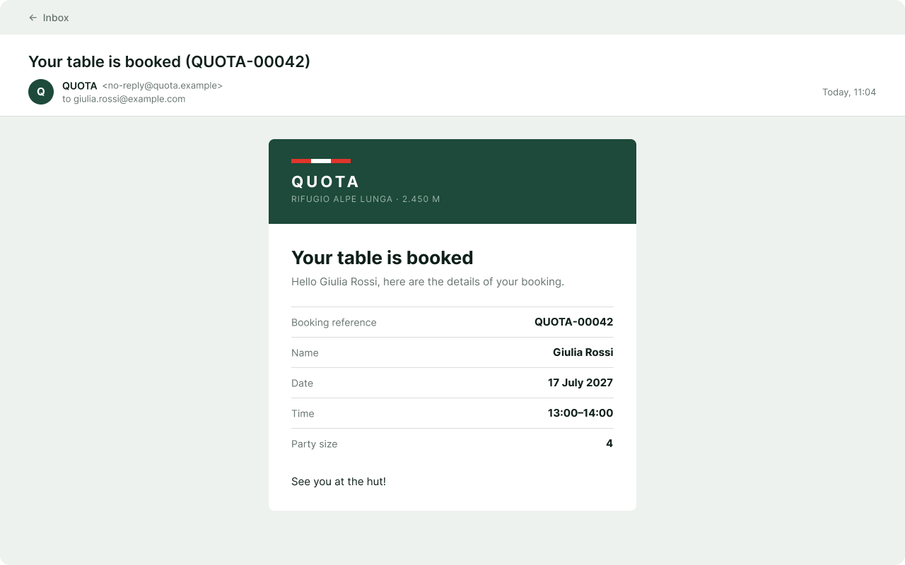
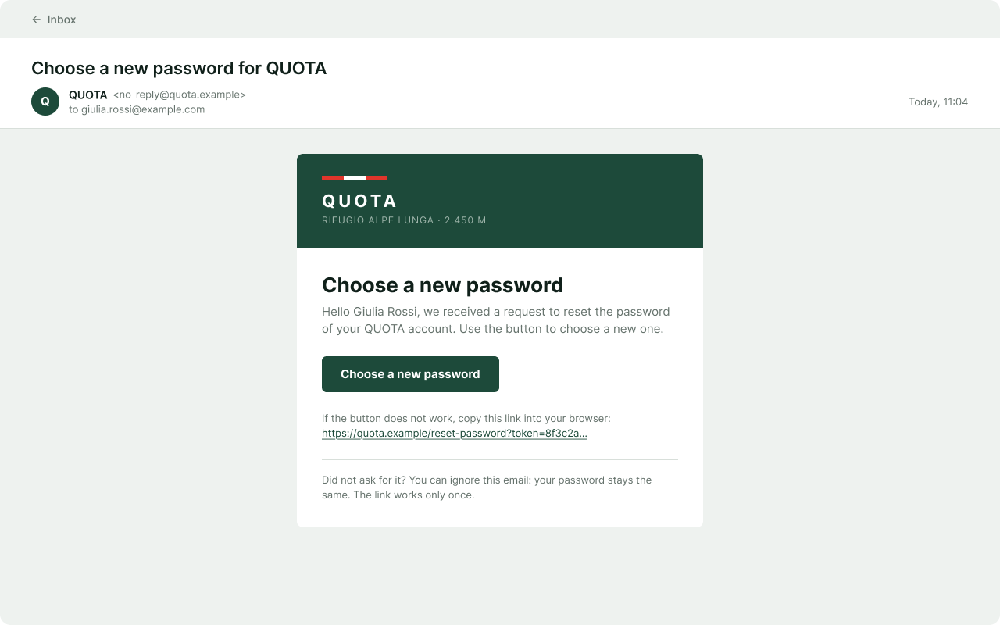
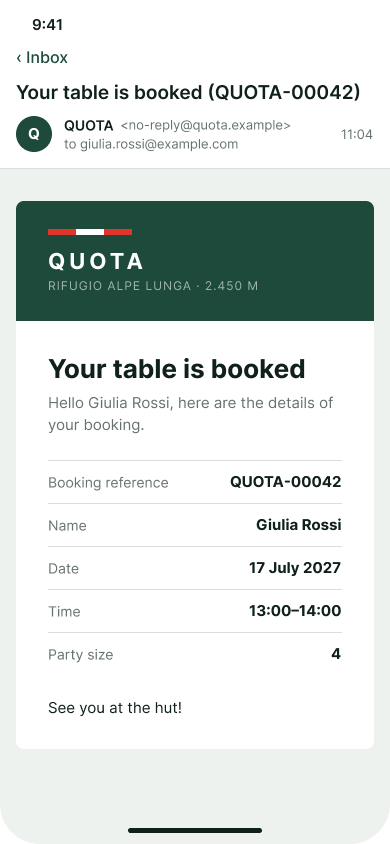
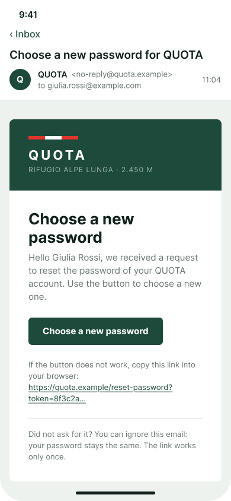

# Emails mockup (MH-03, MH-07)

Mockup of the emails QUOTA sends to a hiker:

- **Booking confirmation** (MH-03). The server already sends it.
- **Password reset.** The MH-07 clarifications say that "the hiker can recover their password via email".

Both use the same layout.

**Figma (source of truth):** page *Emails (MH-03, MH-07)* in [Mountain Hut – Mockups (Team 16)](https://www.figma.com/design/VlTombwHX1DQ7yB2x4U5Yx?node-id=406-877). The emails use two components from the *Components* page:

- **Email / Header:** the pine band with the trail blaze, the QUOTA wordmark and the hut.
- **Email / Row:** a detail line, with the label on the left and the value on the right.

Each email is shown inside a generic email app: subject, sender, recipient. The app around it is not part of the design. Only the white card is what QUOTA sends.

## Rules on these emails

| Source | Rule |
|---|---|
| MH-03, [#24](https://github.com/SE2-Polito/AY26-27-Mountain-Hut/issues/24) | The confirmation has the booking reference, name, date, time and party size. Table numbers are left out on purpose. |
| MH-07 | The hiker can recover the password by email. The email has a link to *Choose a new password* ([login mockup](../login/README.md), screen 12). |
| Login, screen 11 | A reset email is sent only if the email has an account. The page answers the same in both cases, so nobody can find out which emails are registered. |
| Server | Sender: `QUOTA <no-reply@quota.example>` (`MAIL_FROM` in `server/src/config.js`). Every email has an HTML version, with tables and inline styles because that is what email apps support, and a plain text version for the apps that do not show HTML. |

## How they look

The two emails share one layout, and the confirmation already uses it in [`server/src/domain/bookingConfirmation.js`](../../../server/src/domain/bookingConfirmation.js):

- **Background:** `mist` (#EEF2EF), with 32 px of space above and below and 16 px on the sides.
- **Card:** white, at most **520 px** wide, with rounded corners (8 px). On a phone it takes the full width minus 16 px on each side.
- **Header:** `pine` (#1D4A3A) with 28/32 px padding.
  - The trail blaze: three bars of 28 × 6 px, red, white, red.
  - **QUOTA** in white, bold, 22 px, letter spacing 4 px.
  - RIFUGIO ALPE LUNGA · 2.450 M in `on-dark-muted` (#9DB3A9), 12 px.
- **Body:** 32 px padding.
  - Title in bold, 26 px, `ink`.
  - Text 15 px, `stone`, line height 22 px.
  - Detail lines: label 14 px `stone`, value 15 px bold `ink`, with a 1 px `line` (#D8DFDA) border on top and 12 px above and below.
- **Font:** Helvetica, Arial, sans-serif, the fonts every email app has. Figma does not have them, so the mockup uses Inter, which looks very close.

## Emails

| # | Email | Image |
|---|---|---|
| 1 | Booking confirmation |  |
| 2 | Password reset |  |

### On a phone

| # | Email | Image |
|---|---|---|
| 1 | Booking confirmation |  |
| 2 | Password reset |  |

## 1. Booking confirmation (MH-03)

It is sent when a booking is saved. The mockup is the email the server sends today: the same texts, rows, colours and sizes.

It is also sent for a reservation entered by an employee ([MH-07](../reservation-for-a-hiker/README.md)), when the hiker has an email. A temporary hiker has no email, so no email is sent.

**Subject:** `Your table is booked (QUOTA-00042)`

**HTML:**

| Part | Text |
|---|---|
| Title | Your table is booked |
| Text | Hello *first name last name*, here are the details of your booking. |
| Rows | Booking reference: `QUOTA-` + the booking id in 5 digits · Name · Date (*17 July 2027*) · Time (*13:00–14:00*) · Party size |
| End | See you at the hut! |

**Plain text** (as the server writes it):

```
Hello Giulia Rossi,

Your table is booked. These are the details:

Booking reference: QUOTA-00042
Name: Giulia Rossi
Date: 17 July 2027
Time: 13:00–14:00
Party size: 4

See you at the hut!
```

## 2. Password reset (MH-07)

*Send the link* on the *Forgot password?* page sends this email ([login mockup](../login/README.md), screens 10–11). It is sent only if the email has an account.

**Subject:** `Choose a new password for QUOTA`

**HTML:**

| Part | Text |
|---|---|
| Title | Choose a new password |
| Text | Hello *first name last name*, we received a request to reset the password of your QUOTA account. Use the button to choose a new one. |
| Button | **Choose a new password**: pine, white bold text 15 px, 14/24 px padding, 6 px corners. It opens the link. |
| Link | If the button does not work, copy this link into your browser: *the full link*, underlined, in `pine`, 13 px. |
| Note | Under a line: "Did not ask for it? You can ignore this email: your password stays the same. The link works only once." 13 px, `stone`. |

**Plain text:**

```
Hello Giulia Rossi,

We received a request to reset the password of your QUOTA account.
To choose a new one, open this link:

https://quota.example/reset-password?token=…

Did not ask for it? You can ignore this email: your password stays the same.
The link works only once.
```

**The link** opens *Choose a new password* (login screen 12). There are two cases where it no longer works, and in both it opens *This link no longer works* (login screen 13):

- it has expired;
- it was already used, or a newer link was asked for.

The name comes from the account. Like in the confirmation, it is escaped in the HTML, because the hiker typed it.

## Left out on purpose

- The party requirements in the confirmation. They arrive with MH-05.
- Other emails: changes or cancellations (MH-06, MH-08), waiting list (MH-16). They are added with their stories.

## Open questions

- **How long the reset link stays valid** is not said by the product owner. Until it is decided, the email does not say it. If a duration is chosen, add "The link works for *N* hours." to the note.
- **The address in the link** (`https://quota.example/...`) is a placeholder. The real one comes from the deployment settings.

Sample data (names, email, reference, date) is invented for the mockup.
