# Hiker booking page mockup (MH-06, MH-08)

Mockup for stories **MH-06 Change a booking** and **MH-08 Cancel a booking**, used by the hiker frontend and backend tasks and their tests.

> "As a hiker I want to change the date, time, party size, or requirements of my booking so that the reservation reflects my current plans."

> "As a hiker I want to cancel a table booking so that the hut can make the places available to other guests."

One new page, **My bookings**, lists the bookings of the hiker who is logged in. On each booking the hiker can change it (a dialog) or cancel it (a confirmation).

**Figma (source of truth):** page *MH-06 My Booking Page* in [Mountain Hut – Mockups (Team 16)](https://www.figma.com/design/VlTombwHX1DQ7yB2x4U5Yx). Every element is an instance from the *Components* page. Most of them are already used by the [booking](../booking/README.md), [dietary](../dietary/README.md) and [login](../login/README.md) mockups: navbar, step heading, day, people stepper, time slot, party seats, alert, button, need chip, the guest needs editor and the phone bars. This story adds:

- *Navbar / Hiker with My bookings*: the hiker navbar with a third link, **My bookings**, after *The hut* and *Book a table*.
- *Booking card*: one booking of the list. Variants: `State` (Editable, Locked) and `Size` (Desktop, Phone). *Locked* is the booking that can no longer be changed: *Edit* is faded and a line says when changes closed.

Same QUOTA brand, colours and fonts.

## Rules on these screens

Everything shown comes from the story or from the product owner's clarifications. Nothing from later stories.

| Source | Rule |
|---|---|
| Story MH-06 | The hiker can change the day, the time, the party size or the requirements (dietary needs and allergies) of a booking. |
| Product owner | Changes are admitted within 48 hours from the date booked. |
| Product owner | A change of the party size is subject to the automatic verification of availability. |
| Story MH-08 | The hiker can cancel a booking, so the places are available to other guests. |
| Product owner | There are no time constraints: a hiker can cancel a reservation at any time. |
| Team decision (confirmed by the product owner) | The 48 hours are counted back from the booked time: a booking on 27/09 from 13:00 to 14:00 can be changed until 13:00 on 25/09. |
| Team decision (confirmed by the product owner) | The dietary needs follow the same 48 hours as every other change. |
| Team decision | The new time follows the booking rule of MH-01: it can be chosen until 2 hours before it starts ([#7](https://github.com/SE2-Polito/AY26-27-Mountain-Hut/issues/7)). |
| Team decision | Until a change is confirmed the old booking stays as it is. If the change fails, nothing changes. |
| Team decision | The page lists only the bookings of the hiker, from today on, that are not cancelled. Past and cancelled bookings are not listed. |
| Team decision | The system chooses the tables for the new day, time or party size, as when a hiker books ([booking mockup](../booking/README.md)). |
| Team decision (confirmed by the product owner) | A saved change and a confirmed cancellation are emailed to the hiker ([emails mockup](../emails/README.md), emails 3 and 4). A failed change sends no email. |

## The flow

1. **My bookings** (screen 1) lists the upcoming bookings in date order. Each booking shows the day, the time, the booking reference, how many people, the tables, the dietary needs and two buttons: *Edit* and *Cancel booking*. A booking that can still be changed says "Change until *day* · *time*". When the 48 hours have passed, *Edit* is faded and the line says "Changes closed on *day* · *time*"; *Cancel booking* still works. A hiker with no upcoming bookings sees a message and a *Book a table* button (screen 2).
2. **Edit** opens the *Change your booking* dialog on top of the list (screen 3). It has the booking filled in, with the same three steps as *Book a table*: **Day**, **How many people** and **Time**. On the right, *After the change* shows the new day, time and people, and under it the **Dietary needs and allergies**. Nothing changes until the hiker saves.
3. **Check availability.** When the day, the time or the people change, the button of the dialog is *Check availability*. The page asks the server for the seating of the new choice:
   - There is room (screen 4): the new seating is shown, like on *Book a table*, with a blue note. The button becomes *Save changes*.
   - There is no room (screen 5): a red note says which time is full. The booking stays as it is, and the hiker can choose another time or close the dialog.
4. **Dietary needs** (screens 6 and 7). *+ Add a guest's needs* and *Edit* on a guest line open the same editor as [MH-05](../dietary/README.md) inside the dialog. The dialog is wider to fit it (screen 6). When only the dietary needs change, no availability check is needed: the button is *Save changes* straight away and the tables stay the same (screen 7).
5. **Save changes** applies the change. The dialog closes and the list shows the new details with a green note (screen 8). The hiker is emailed the new details.
6. **Cancel booking** asks to confirm, with the same dialog as *Log out* (screen 9): "Cancel this booking?" with *Keep booking* and *Cancel booking*. It is open at any time, also on a booking whose *Edit* is faded.
7. **Confirming** frees the seats for other guests. The booking leaves the list at once and a green note says so (screen 10). The hiker is emailed a confirmation.

## Screens

| # | Screen | Image |
|---|---|---|
| 1 | My bookings: the first booking is past the 48 hours, *Edit* is faded | 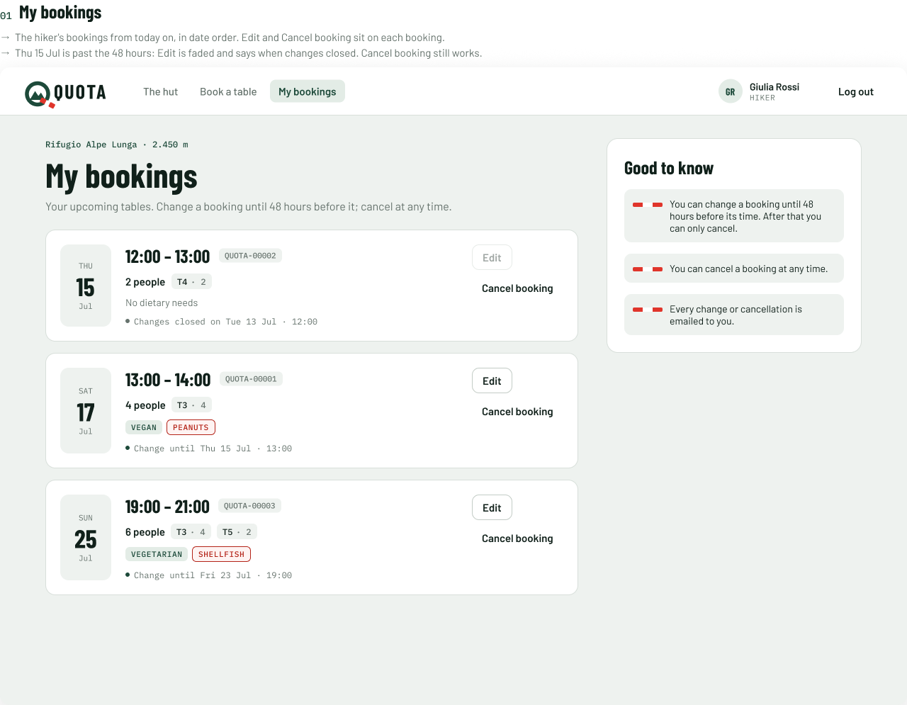 |
| 2 | No upcoming bookings | 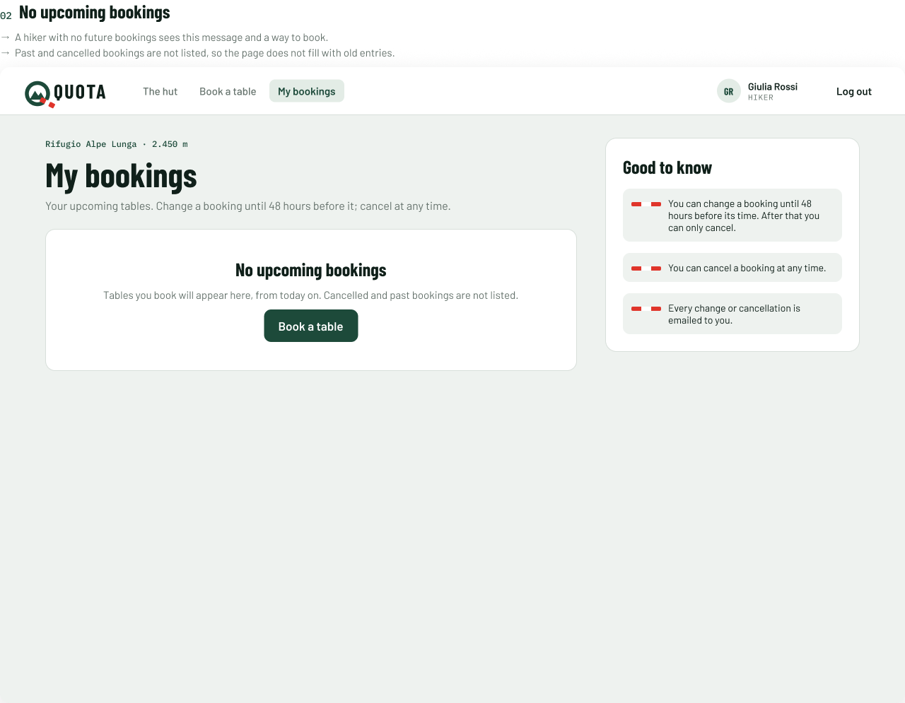 |
| 3 | Change a booking: the dialog with the booking filled in | 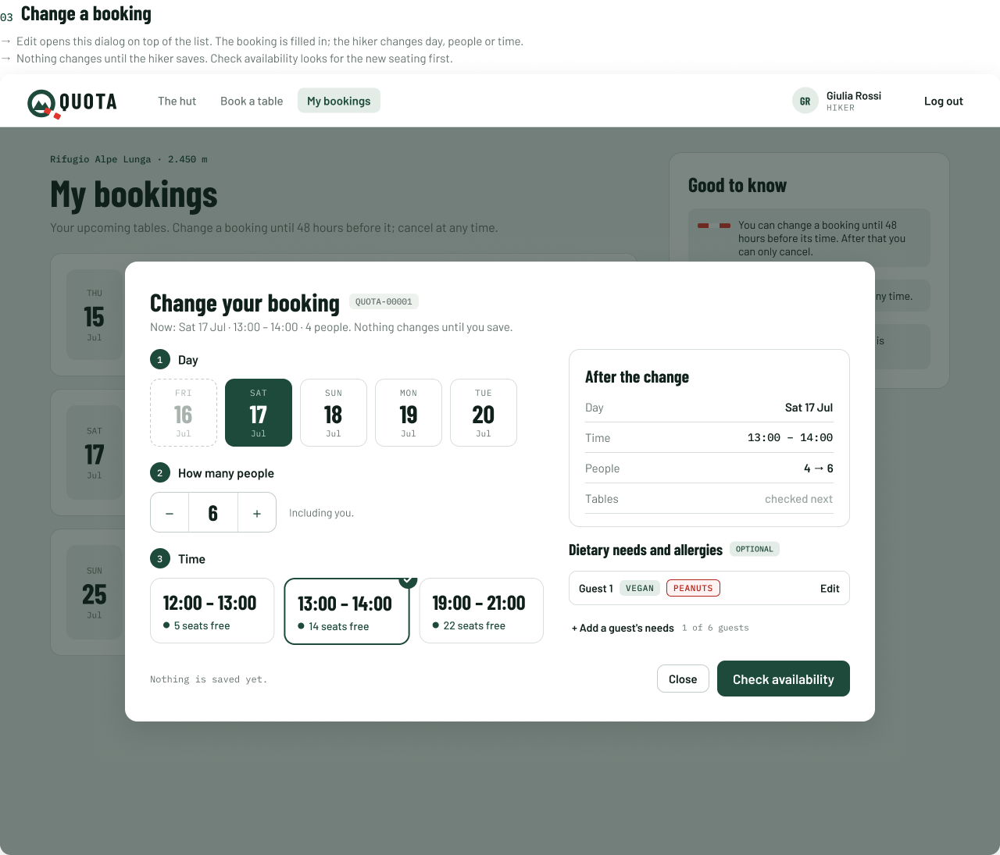 |
| 4 | Seats available for the change | 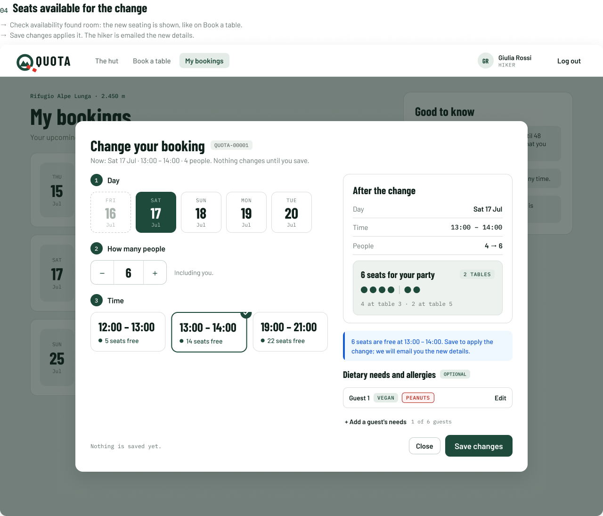 |
| 5 | No seats for the change | 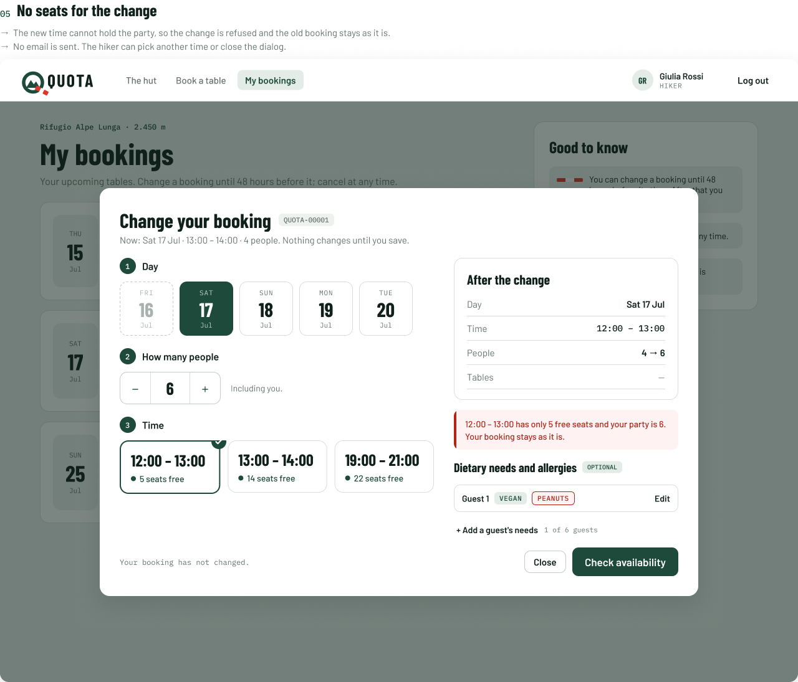 |
| 6 | Adding or editing a guest's needs | 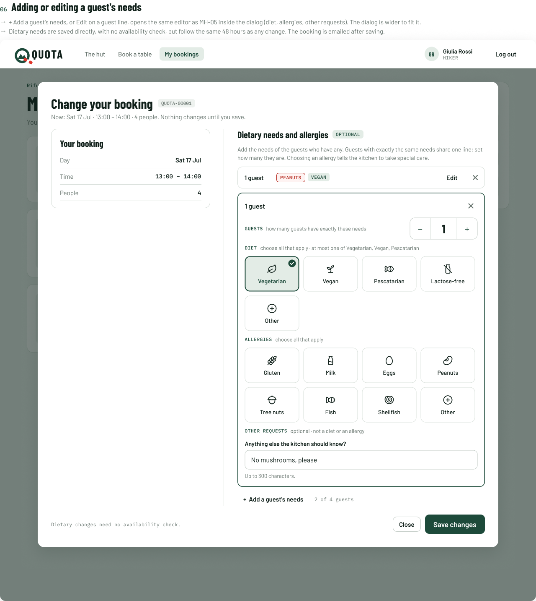 |
| 7 | Change only the dietary needs | 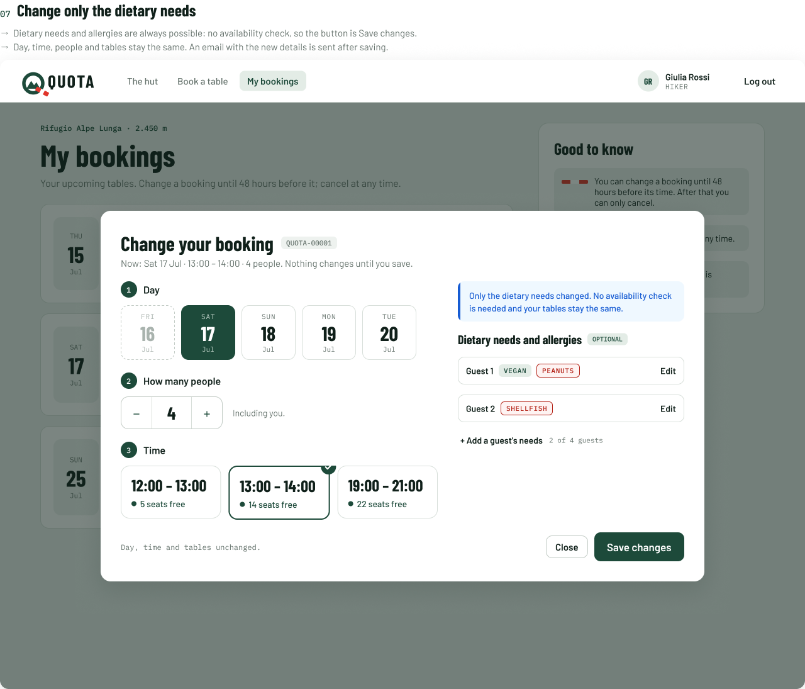 |
| 8 | Booking changed | 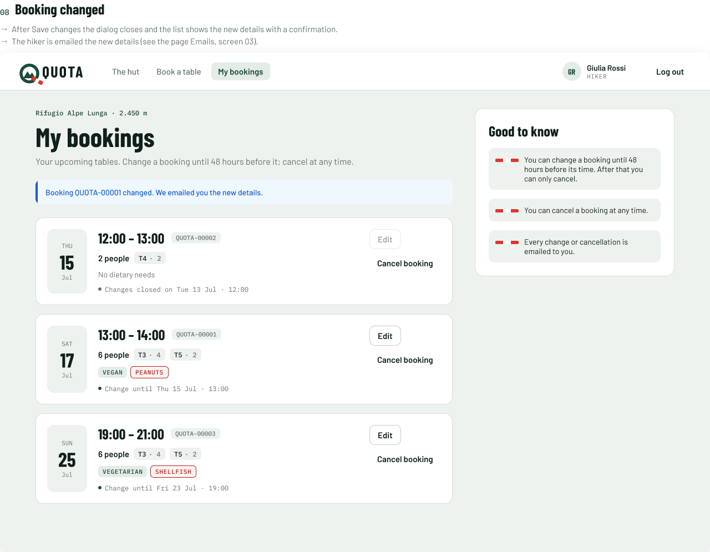 |
| 9 | Cancel a booking | 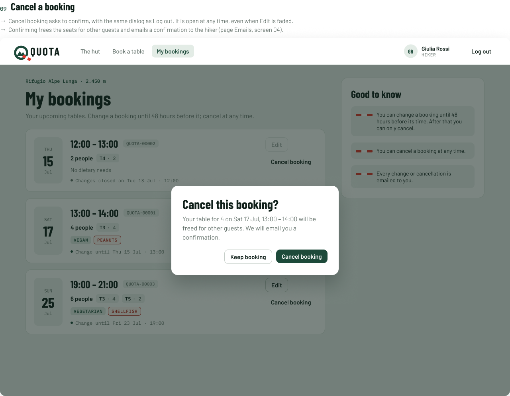 |
| 10 | Booking cancelled | 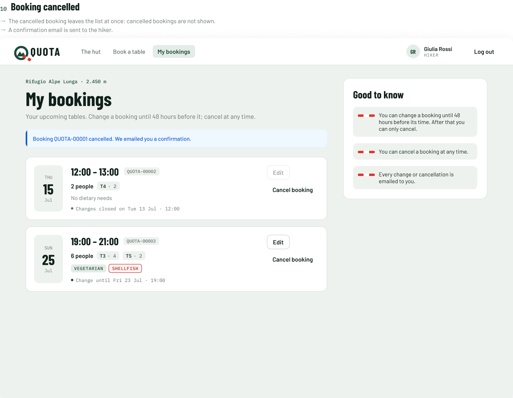 |

### On a phone

This is the same website in a phone browser, not a separate app. Below 992 px (react-bootstrap `lg`) the layout changes:

- The page becomes one column, and the *Good to know* box goes under the list.
- The navbar folds into the menu button, where *My bookings* is.
- In a booking card, *Edit* and *Cancel booking* are under the booking, and the line about the 48 hours wraps.
- The change dialog becomes a sheet from the bottom. It scrolls: the image shows it in full.
- The confirmation dialog is narrowed to fit the phone.

| # | Screen | Image |
|---|---|---|
| 1 | My bookings | 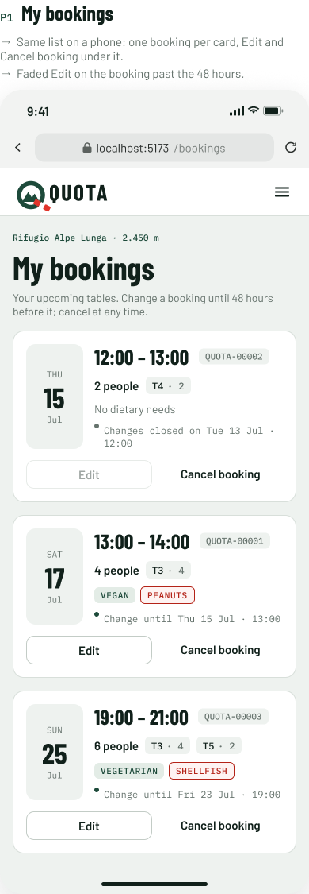 |
| 2 | Change a booking: no seats | 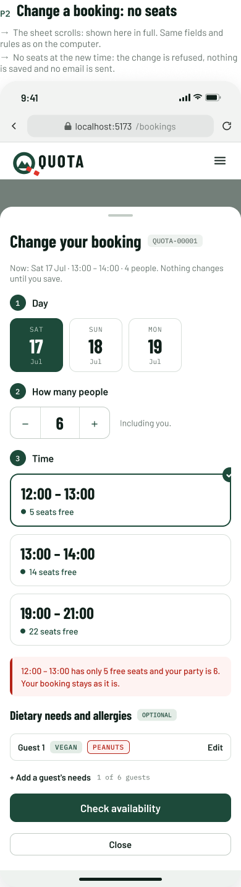 |
| 3 | Cancel a booking | 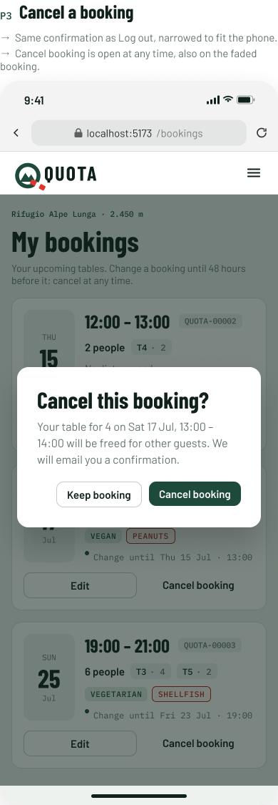 |
| 4 | Booking changed | 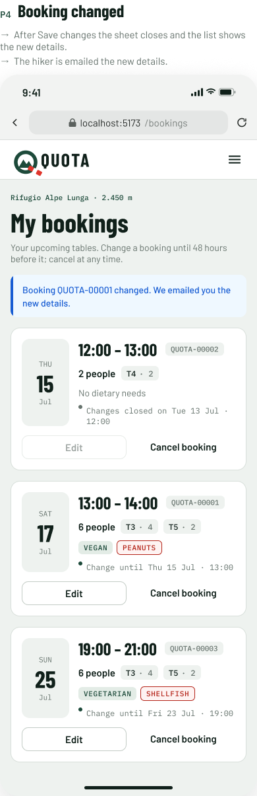 |

The sheet has the same steps and rules as desktop screens 3 to 7, and the dietary needs editor is the phone one of [MH-05](../dietary/README.md).

## Fields and rules

### My bookings

| Part | Rule |
|---|---|
| Which bookings | The hiker's own, from today on, not cancelled. In date order. |
| Day, time | The day (*THU 15 Jul*) and the time of the slot (*12:00 – 13:00*). |
| Reference | `QUOTA-` + the booking id in 5 digits, as in the confirmation email. |
| People and tables | How many people, and the tables with their seats (*T3 · 4*). |
| Dietary needs | One chip per need. "No dietary needs" when the booking has none. |
| Edit | Open until 48 hours before the start of the slot. After that it is faded and cannot be pressed. |
| Cancel booking | Always open. |
| Line under the buttons | Editable: "Change until *Thu 15 Jul · 13:00*". Locked: "Changes closed on *Tue 13 Jul · 12:00*". |

### Change your booking

| Field | Rule |
|---|---|
| Day | The days with slots, from today on. The current day is chosen. |
| How many people | From 1. Must fit in the free seats of the time. |
| Time | A time of that day that can still be booked (up to 2 hours before it starts). Each time says how many seats are free. |
| Dietary needs and allergies | Optional, as in [MH-05](../dietary/README.md): one line per group of guests with the same needs, and the guests counted must not be more than the people. |

## Texts and server answers

| When | What the hiker sees |
|---|---|
| Page subtitle | Your upcoming tables. Change a booking until 48 hours before it; cancel at any time. |
| *Good to know* | You can change a booking until 48 hours before its time. After that you can only cancel. · You can cancel a booking at any time. · Every change or cancellation is emailed to you. |
| No bookings | **No upcoming bookings.** Tables you book will appear here, from today on. Cancelled and past bookings are not listed. Button: *Book a table*. |
| Dialog | **Change your booking** and the reference. "Now: Sat 17 Jul · 13:00 – 14:00 · 4 people. Nothing changes until you save." Buttons: *Close*, *Check availability*. |
| Footer of the dialog | Before the check: "Your booking has not changed." For dietary needs only: "Day, time and tables unchanged." |
| Seats available | Blue note: "*N* seats are free at *HH:MM* – *HH:MM*. Save to apply the change; we will email you the new details." Button: *Save changes*. |
| No seats (`409`, `NO_SEATS`) | Red note: "*HH:MM* – *HH:MM* has only *N* free seats and your party is *M*. Your booking stays as it is." Nothing is saved and no email is sent. |
| Only dietary needs changed | Blue note: "Only the dietary needs changed. No availability check is needed and your tables stay the same." Button: *Save changes*. |
| Changed | Green note on the list: "Booking *QUOTA-00001* changed. We emailed you the new details." |
| Past the 48 hours | *Edit* is faded and the line says when changes closed. |
| Cancel dialog | **Cancel this booking?** "Your table for 4 on Sat 17 Jul, 13:00 – 14:00 will be freed for other guests. We will email you a confirmation." Buttons: *Keep booking*, *Cancel booking*. |
| Cancelled | Green note on the list: "Booking *QUOTA-00001* cancelled. We emailed you a confirmation." |
| Not logged in (`401`) | The login page (login mockup, screen 4). |
| Server or network down | Something went wrong on our side. Try again in a minute. |

## Left out on purpose

These belong to other stories or were not asked for:

- The staff view of changed and cancelled bookings.
- Past and cancelled bookings in the list.
- A waiting list for a full time (MH-16).

## Open questions

- **The API.** The endpoints to list, change and cancel a booking are not decided yet. The mockup does not show any.
- **The 48 hours passing between the page and the save.** The mockup has no message for it, because nobody has said what the hiker should see.
- **The tables changing between the check and the save** (`TABLES_CHANGED` in MH-01). The mockup does not show it for a change.

Sample data (hut, names, references, dates, tables) is invented for the mockup.
