# Meal details mockup (MH-11)

Mockup for story **MH-11 View meal details**, used by the hiker and staff frontend tasks, the backend tasks and their tests.

> "As a user I want to see meal times and menu so that I find options that suit my party."

**Figma (source of truth):** page *MH-11 Meal details* in [Mountain Hut – Mockups (Team 16)](https://www.figma.com/design/VlTombwHX1DQ7yB2x4U5Yx?node-id=748-9172). Every element is an instance from the *Components* page. The screens start from the [menus mockup (MH-10)](../menus/README.md): the menus are the ones the staff write there, and the *Book a table*, *Check availability* and *Write / Edit the menu* screens are the same. The *Menu* dialog (a sheet on a phone) is the one of MH-10 (screen 6), with *Choose this time* instead of *Edit menu*. This story adds:

- *Time slot with menu*: a time of *Book a table* and *Check availability* with the first words of its menu. Variants: `State` (Default, Selected, Disabled, as *Time slot*) and `Menu` (Set, Empty, Photo). Properties: `Time`, `Seats`, `Menu` (the first words), `Photos` (shows the camera and the number of photos next to MENU), `Photo count` and `Show menu` (the button shown when the first words are cut).
- *Menu photo*: the thumbnail of a photo of the menu. Variants: `Kind` (Photo; More: the last thumbnail when there is no room, with +N; Unavailable: a photo that does not load) and `Size` (Small: on the time cards; Medium: in the *Menu* box and the *Menu* dialog). The image is the fill of the instance.
- *Photo viewer*: a photo opened over the page. Variants: `Size` (Desktop, Phone) and `State` (Photo, Error). Properties: `Time` (the time the menu is for) and `Counter` (*n / total*).
- *Photo upload*: one tile of the *Photos* field. Variants: `State` (Photo, Uploading, Add, Error, Failed).
- *Menu photos*: the *Photos* field under the menu editor. Variants: `State` (Empty, Filled, Error, Failed). The tiles wrap on a phone.
- *Menu card* (from MH-10) has two new variants: *Set with photos* (the text, in a shorter box, and the thumbnails under it) and *Photo only* (a menu that is only a photo, shown big, with the open button).

Same QUOTA brand, colours and fonts.

## Rules on these screens

| Source | Rule |
|---|---|
| Story | Users see the meal times of a day together with their menus, so they choose the time that suits their party. "User" means everyone who books: hikers on *Book a table*, and visitors before logging in on *Check availability*. |
| [MH-10](../menus/README.md) | The menus are the ones the staff write on *Slots & tables*. The whole menu of the chosen time in the summary and on *My bookings* stays as in MH-10. |
| Team | A menu can have photos: of the menu itself (a board, a sheet) or of the dishes. A menu can also be only a photo. The staff add the photos in the same dialog where they write the menu. Not asked to the product owner: see *Assumptions to confirm*. |

## The flow

### Hiker and visitor: Book a table, Check availability

1. **Compare the menus of the times.** Under the free seats, each time shows **MENU** and the first words of its menu, so a party compares the times of a day without choosing them one by one (screen 1). The first words are the menu on one line: the formatting is removed, the lines (items and sub-items too) are joined with ` · `, and the text is cut after three lines with `…`.
   - A menu with photos says how many next to MENU: a camera and *3 photos*.
   - A menu that is only a photo shows its small thumbnail and "The menu is a photo".
   - A time with no menu yet says "No menu yet" (screen 3). It can still be booked.
2. **Show the whole menu.** When the first words are cut, the card has **Show menu** under them. It opens the *Menu* dialog: under the title, the day, the time and the free seats; then the whole menu, formatted as the staff wrote it, in a box that keeps its height (a long menu scrolls inside it); then the thumbnails of its photos (screen 2). *Choose this time* chooses that time and closes the dialog; *Close* goes back without choosing. A thumbnail opens the viewer (step 4). When the first words fit, there is no *Show menu*: the card already shows the whole menu. A card is narrower on a phone, so a menu that fits on a desktop can be cut there and have *Show menu* (phone screen 1).
3. **Choose a time.** The *Your booking* summary shows the whole menu of the chosen time, as in MH-10. If the menu has photos, their thumbnails are under the text, and the text box is shorter: a long menu scrolls inside it (screen 1). A menu that is only a photo is shown big, with "The menu is a photo. Open it to read it." (screen 6). With no menu, the summary says "No menu yet for this time. You can still book it." (screen 3).
4. **Open a photo.** A thumbnail, or the photo of a photo-only menu, opens the viewer over the page, on that photo (screen 5). On top, **Menu** and the time it belongs to (*Sat 17 Jul · 19:00 – 21:00*), the counter *1 / 3* and ×. The arrows (or ← →) move between the photos of that menu, and the thumbnails at the bottom jump to one. Esc, × or a click outside closes the viewer, and the page is as it was.
5. **Check availability** (screen 4): a visitor who is not logged in sees the same cards, the same *Show menu*, the same menu and the same photos. The answer (Available, the seats) does not depend on the menu.

On *My bookings* the expanded menu of a booking (MH-10, screen 11) ends with the same thumbnails, which open the same viewer. That screen is not drawn again here.

### Employee: Write / Edit the menu

6. **Add photos to the menu** (screen 7). Under the editor there is the *Photos* field: "A photo of the menu, or of the dishes". *Add photos* opens the file picker, and photos can also be dropped on it. Several photos can be chosen at once. Each photo shows *Uploading…* while it is sent, then the photo with × to remove it. Hikers see the photos in the order they were added. *Save menu* saves the text and the photos together; *Cancel* keeps the menu as it was, photos included.
7. **A menu that is only a photo** (screen 8). With a photo, the text is optional: here the employee removed the text and keeps only the photo of the board, and *Save menu* works. *Start from a previous menu* copies the photos of that menu too, together with its text.

The menu line of a slot on *Slots & tables* (MH-10, screen 1) shows the first words of the text, as before. A menu that is only a photo shows "The menu is a photo" there.

### Errors

- **A file that is not a photo** (screen 8): a file that is not a JPG, PNG or WebP image is not added. Its tile turns red ("Not added") and the reason is under the field. The other photos are kept; × removes the red tile.
- **Nothing to save** (screen 9): *Save menu* with no text and no photo. The editor turns red, as in MH-10, and says what to do.
- **A photo not uploaded** (screen 10): the upload stopped (no connection, server down). The tile says *Not uploaded*, and *Try again* sends it again. *Save menu* saves the text and the photos already uploaded; a photo not uploaded is not saved.
- **A photo that does not load** (screen 11): the viewer says so, with *Try again*. The arrows still move to the other photos. On the page, its thumbnail is grey with a crossed-out picture; the rest of the menu is shown as usual.

## Screens

| # | Screen | Image |
|---|---|---|
| 1 | Compare the menus of the times | 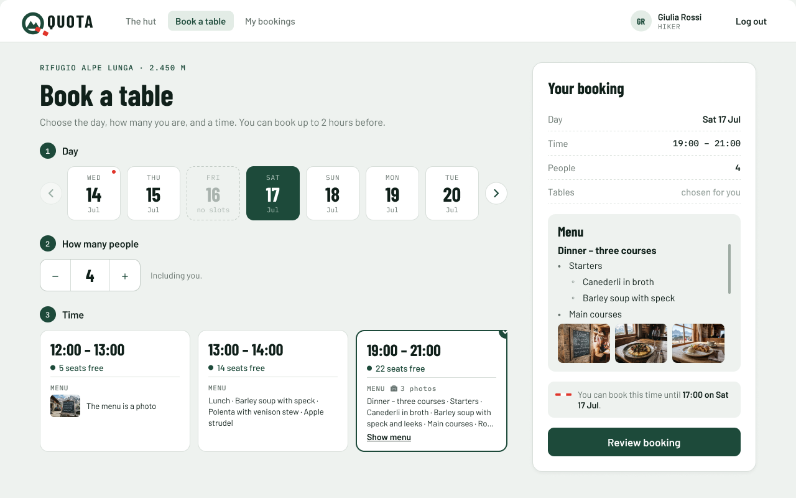 |
| 2 | Show the whole menu | 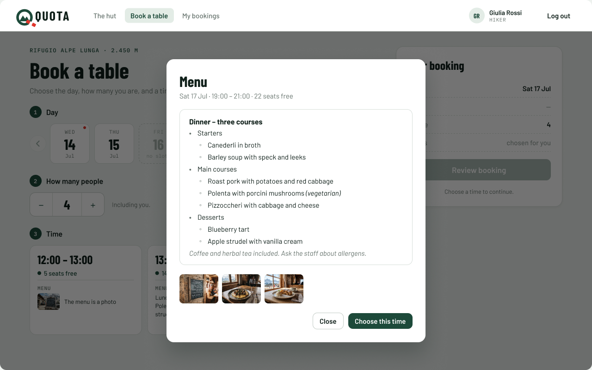 |
| 3 | A time with no menu yet | 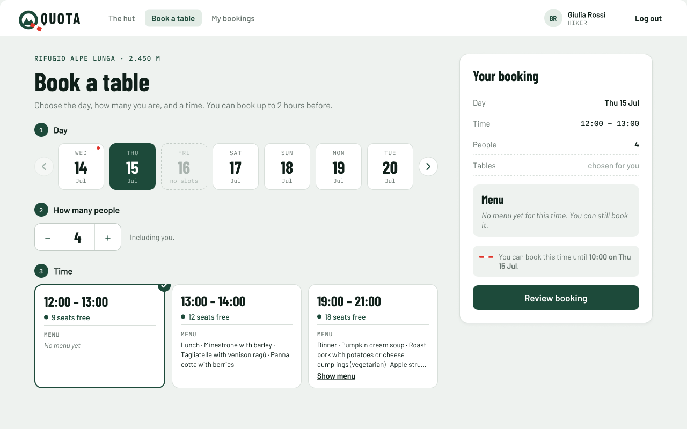 |
| 4 | Check availability: the menus of the times | 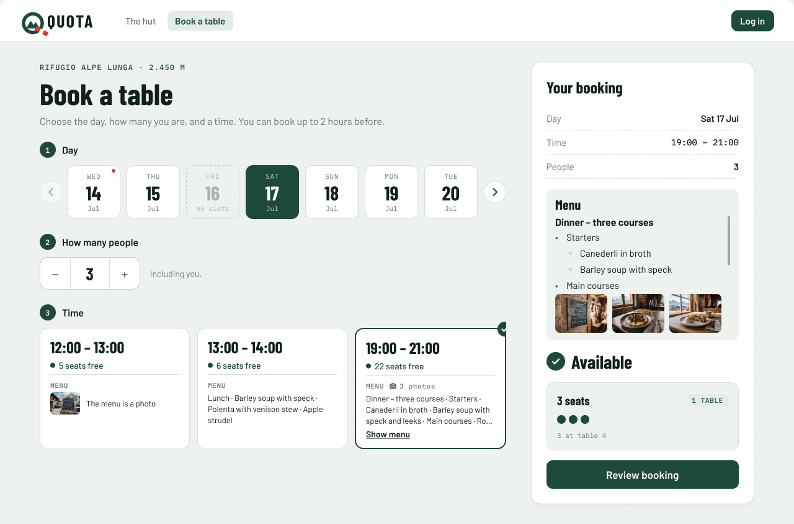 |
| 5 | Open a photo | 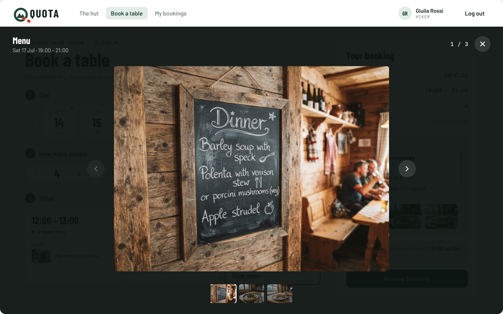 |
| 6 | A menu that is only a photo | 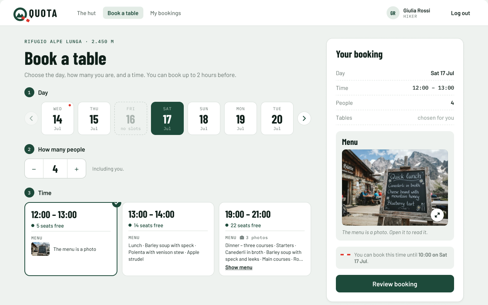 |
| 7 | Add photos to the menu | 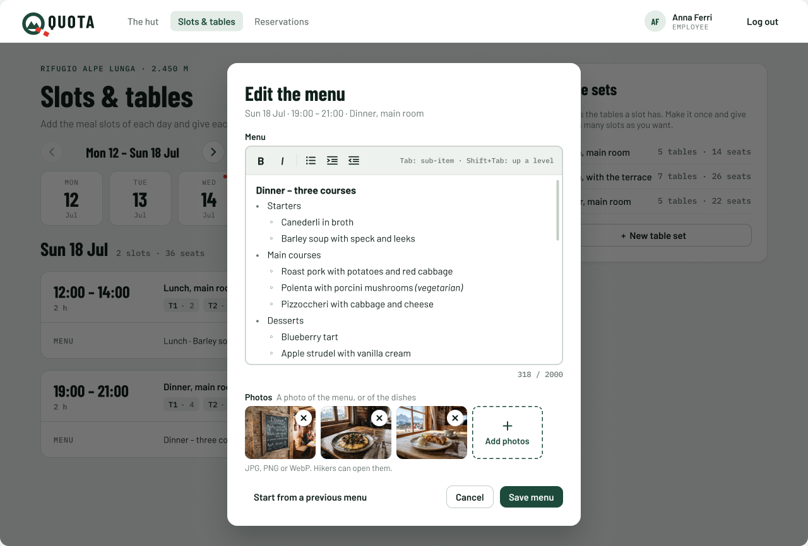 |
| 8 | A menu that is only a photo, and a file not added | 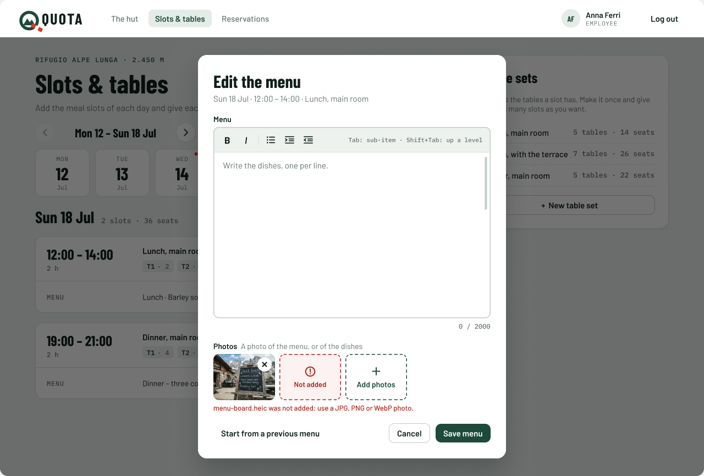 |
| 9 | Nothing to save (error) | 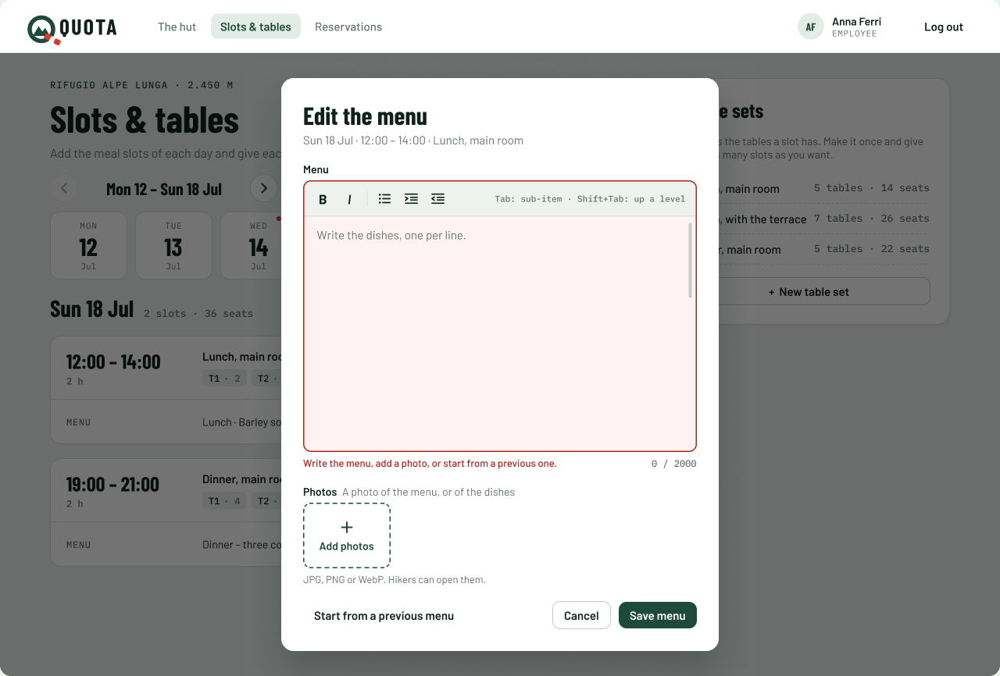 |
| 10 | A photo not uploaded (error) | 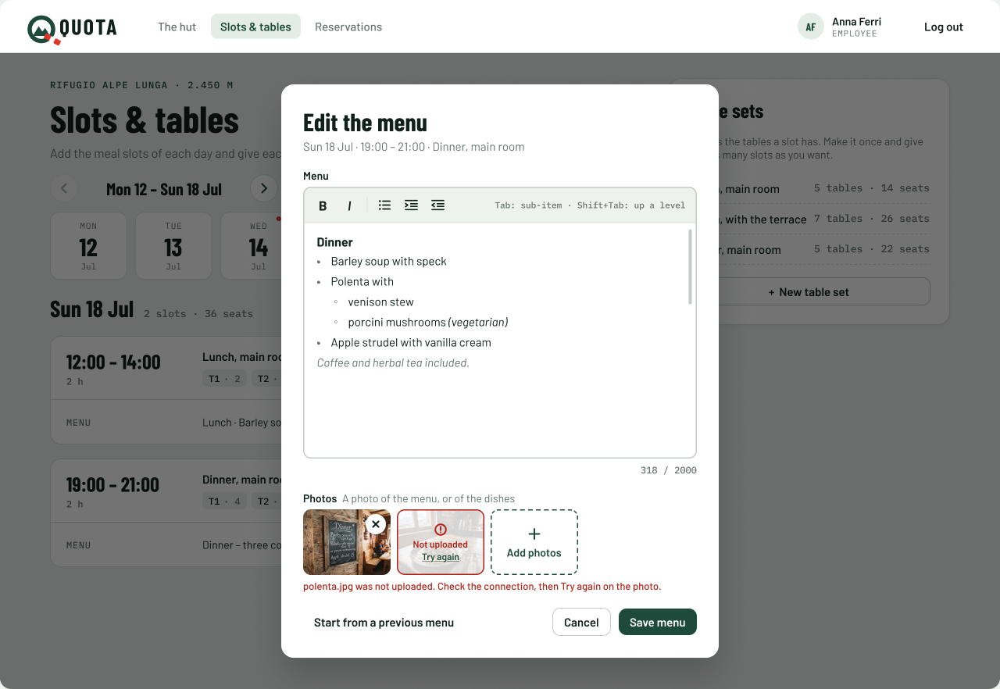 |
| 11 | A photo that does not load (error) | 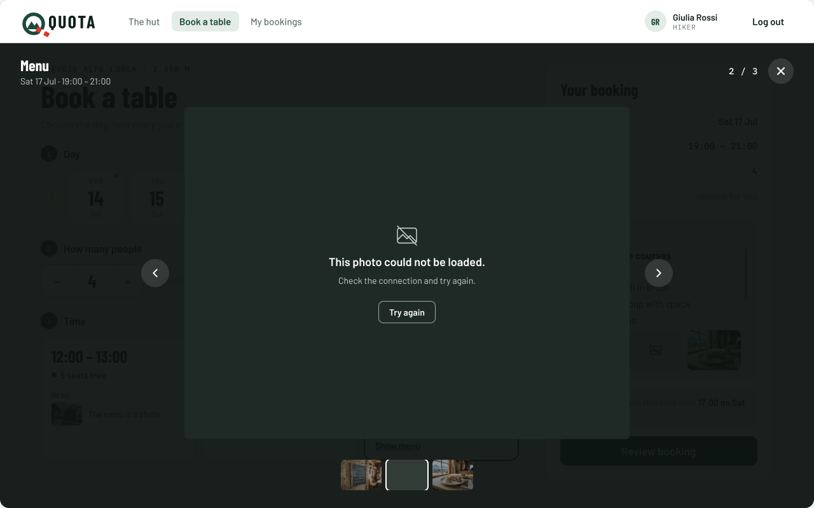 |

Screens 4, 7, 8, 9 and 10 are taller than 800 px: the page scrolls. The photos make the summary and the dialog taller.

### On a phone

The same website in a phone browser. Below 992 px (react-bootstrap `lg`) the time cards go two per row, and the whole menu of the chosen time is under the times, with its photos (phone screen 1). *Show menu* opens the *Menu* sheet from the bottom, with *Choose this time* as the first button and *Close* under it (phone screen 2). On *Check availability* a time the party does not fit in stays greyed, with its menu still readable, and the bar at the bottom shows the menu of the chosen time, as in MH-10 (phone screen 3). The viewer takes the whole screen: swipe to see the next photo, pinch to zoom, × closes it (phone screen 4). In the *Edit the menu* sheet the *Photos* field is under the editor and its tiles wrap. *Add photos* also offers the camera, which the phone's file picker shows for images (phone screen 5). The sheet scrolls; *Save menu* stays in the bar at the bottom.

| # | Screen | Image |
|---|---|---|
| 1 | Compare the menus of the times | 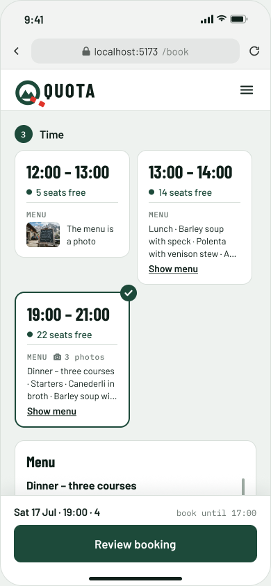 |
| 2 | Show the whole menu | 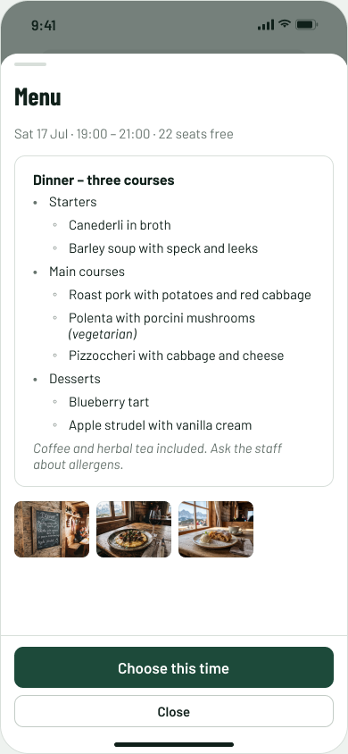 |
| 3 | Check availability: the menus of the times | 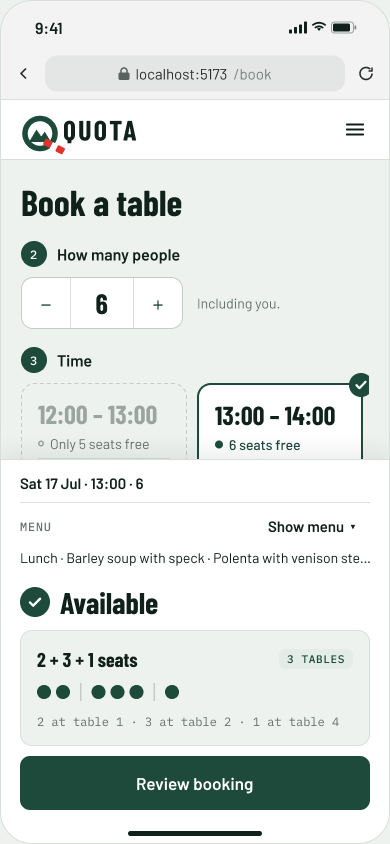 |
| 4 | Open a photo | 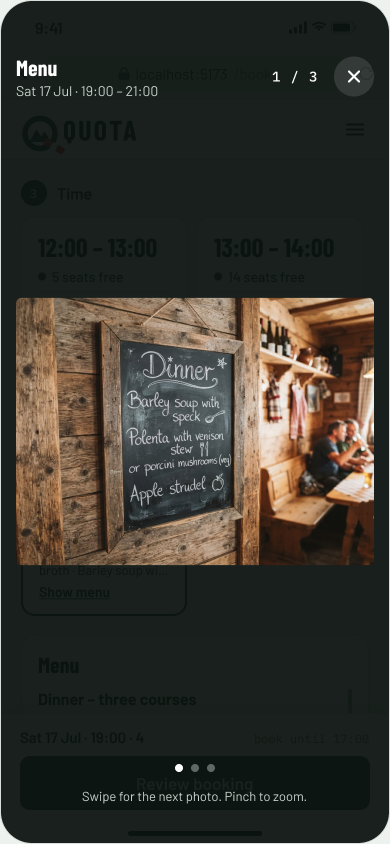 |
| 5 | Add photos to the menu | 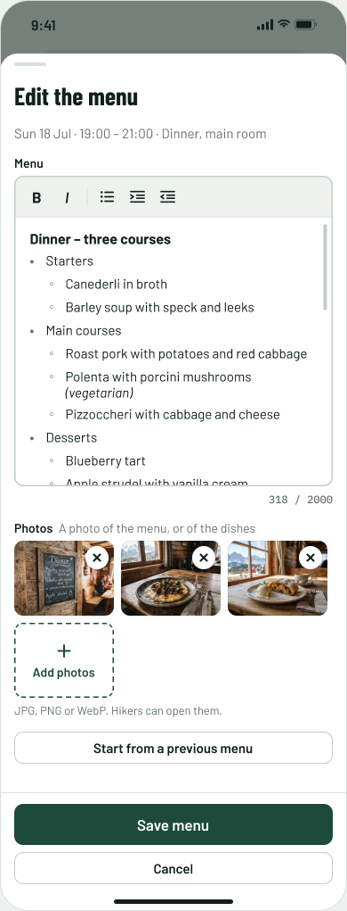 |
| 6 | A photo not uploaded (error) | 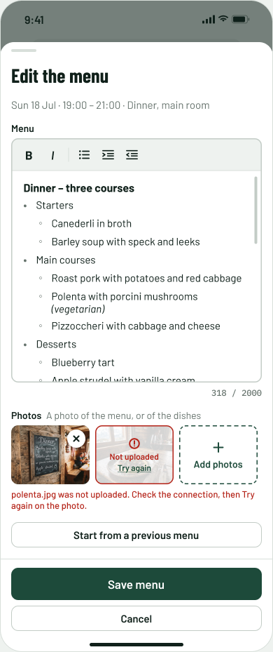 |
| 7 | A photo that does not load (error) | 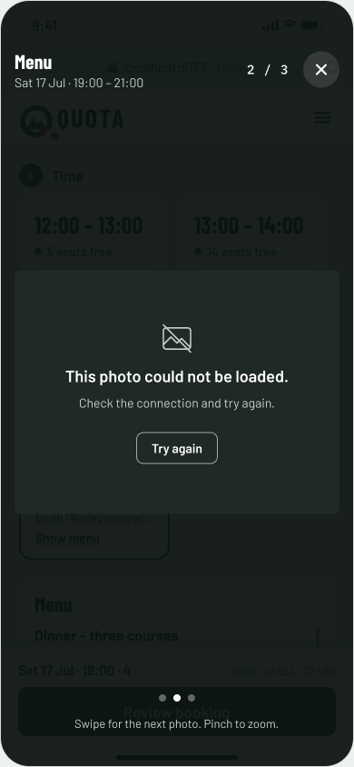 |

Phone screens 5 and 6 are taller than 844 px: the sheet scrolls.

## Fields and rules

### Write / Edit the menu

| Field | Required | Rule | Message |
|---|---|---|---|
| Menu | yes, unless there is at least one photo | as in MH-10: at least one visible character, at most 2000 characters | Write the menu, add a photo, or start from a previous one. |
| Photos | no | JPG, PNG or WebP images, checked from the content of the file, not only from its name | *file name* was not added: use a JPG, PNG or WebP photo. |

The rules are checked in the browser and again by the server (`400` if they fail). The other messages of the *Menu* field (more than 2000 characters) are the ones of MH-10.

Each photo is sent when it is added, so the tile shows *Uploading…* and then the photo. *Save menu* links the uploaded photos to the menu of the slot. While a photo is still uploading, *Save menu* waits for it. Photos removed with ×, or left behind by *Cancel*, are not linked to any menu.

## Texts and server answers

| When | What the user sees |
|---|---|
| Time card, menu with text | **MENU** · the first words, on one line, cut after three lines with … |
| Time card, first words cut | the same, then the button *Show menu* |
| Time card, menu with photos | **MENU** · camera · *N photos*, then the first words |
| Time card, menu that is only a photo | **MENU** · the thumbnail · The menu is a photo |
| Time card, no menu | **MENU** · No menu yet |
| Menu dialog (sheet on a phone) | **Menu** · *day* · *start – end* · *N seats free*, then the whole menu, formatted, and its thumbnails. Buttons: Close, Choose this time |
| Summary, menu with photos | **Menu**, the menu as it was written, then the thumbnails |
| Summary, menu that is only a photo | **Menu**, the photo with the open button · The menu is a photo. Open it to read it. |
| Viewer | **Menu** · *day* · *start – end* · *n / total* · ×; arrows and thumbnails (desktop), dots and "Swipe for the next photo. Pinch to zoom." (phone) |
| Viewer, photo that does not load | This photo could not be loaded. Check the connection and try again. Button: Try again |
| Photos field | **Photos** A photo of the menu, or of the dishes · tiles · *Add photos* · JPG, PNG or WebP. Hikers can open them. |
| File that is not a photo (`400`) | Red tile *Not added* · *file name* was not added: use a JPG, PNG or WebP photo. |
| Upload stopped | Tile *Not uploaded*, *Try again* · *file name* was not uploaded. Check the connection, then Try again on the photo. |
| Nothing to save (`400`) | The editor turns red · Write the menu, add a photo, or start from a previous one. |
| Menu saved, slot no longer exists, not logged in, staff only, server down | As in MH-10. |

## Left out on purpose

These are not in any story, so they are not here: filters by dish or by dietary need (the menus have no dietary labels, MH-10), captions on the photos, changing the order of the photos, the menus of several days side by side, prices.

## Assumptions to confirm

Not asked to the product owner; the mockup works either way:

- Photos on the menus are a team choice: the story asks only for meal times and menus.
- There is no limit on the number or the size of the photos of a menu.
- With at least one photo, the text of the menu is optional.
- *Start from a previous menu* (MH-10) copies the photos of that menu too. *Copy a week* (MH-09) copies the slots without their menus, so without photos either.
- A time with no menu can still be booked (as in MH-10).
- The endpoints for uploading the photos and linking them to a menu are not defined yet, so `docs/openapi.json` is unchanged.

Sample data (hut, names, dates, tables, dishes) is invented for the mockup. The photos of the boards and of the dishes were generated for the mockup.
