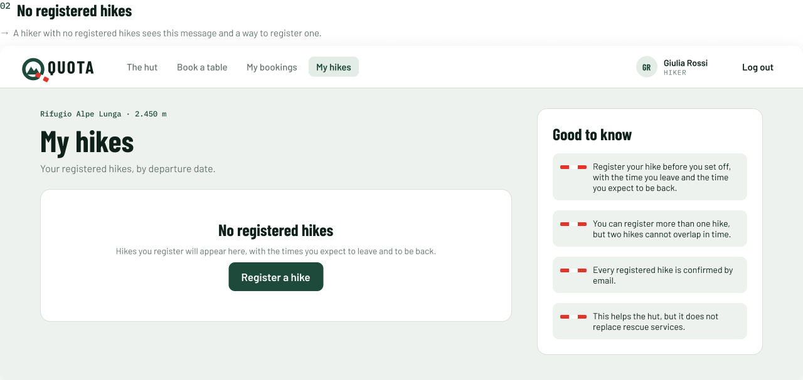
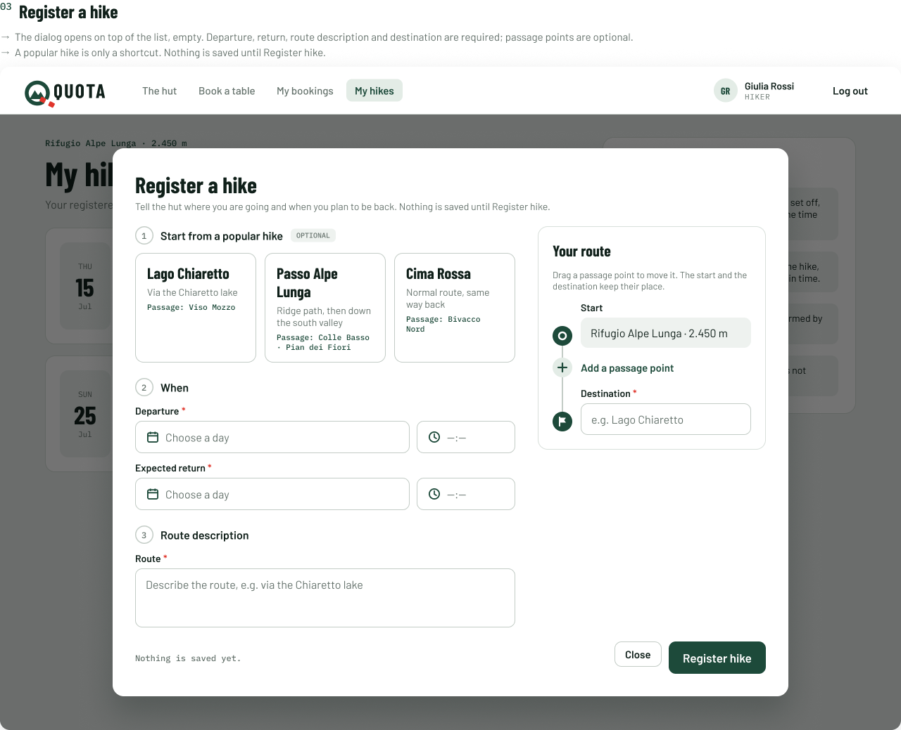
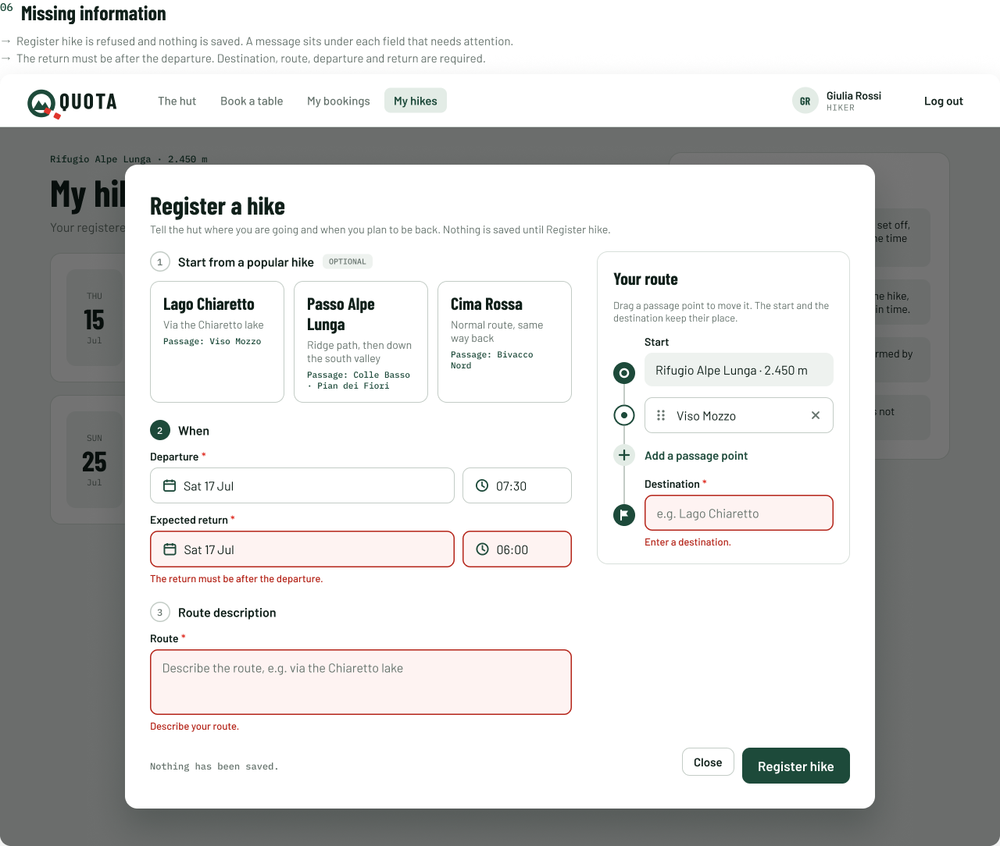
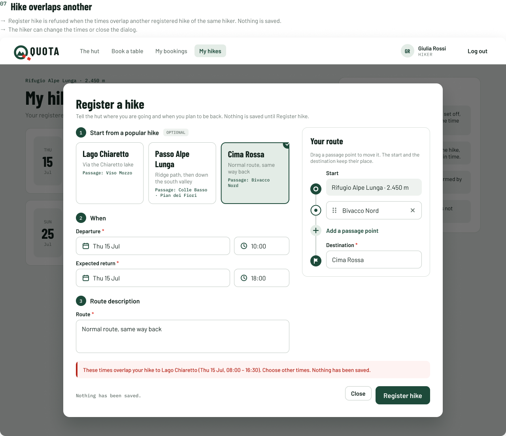
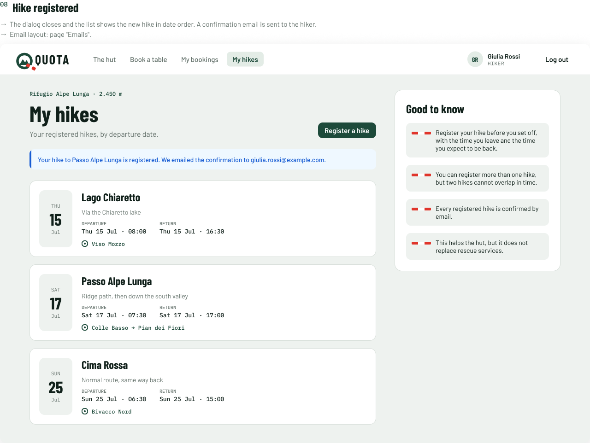

# Register a hike mockup (MH-20)

Mockup for story **MH-20 Register a hike**, used by the hiker frontend and backend tasks and their tests.

> "As a hiker I want to register my planned hike before departure so that the hut has information that can be used if I do not return as expected."

One new page, **My hikes**, lists the hikes registered by the hiker who is logged in. **Register a hike** opens a dialog (a sheet on a phone) where the hiker enters the destination, the route, the passage points and the times. A saved hike is emailed to the hiker.

**Figma (source of truth):** page *MH-20 Register a hike* in [Mountain Hut – Mockups (Team 16)](https://www.figma.com/design/VlTombwHX1DQ7yB2x4U5Yx?node-id=663-520). The email is on the page *Emails*, see the [emails mockup](../emails/README.md). Every element is an instance from the *Components* page. Most of them are already used by the [hiker booking page](../hiker-booking-page/README.md), [booking](../booking/README.md) and [login](../login/README.md) mockups: step heading, button, alert, text field and the phone bars. This story adds:

- *Navbar* with the link **My hikes** after *My bookings* (the hiker navbar, `Role=Hiker, Tab=My hikes`). It is a separate navbar for this page: the shared *Navbar / Logged in* is not changed.
- *Hike card*: one hike of the list. Variants: `Size` (Desktop, Phone).
- *Hike option*: a popular hike to start from. Variants: `State` (Default, Selected).
- *Route point*: one point of the route. Variants: Start, Passage point, Passage point dragging, Add, Destination.
- *Date and time field*: the day and the time of the departure or the return. Variants: Empty, Filled, Error.
- Six icons: start, passage point, destination, add, grip (drag handle) and remove.

Same QUOTA brand, colours and fonts.

## Rules on these screens

Everything shown comes from the story or from the product owner's clarifications. Nothing from later stories.

| Source | Rule |
|---|---|
| Story MH-20 | A hiker registers a planned hike before the departure, so that the hut has the information if the hiker does not come back as expected. |
| Product owner (clarification) | The hike has a **destination** (a name), a **route** (a text description, e.g. "via the Chiaretto lake") and **intermediate passage points** (e.g. "Viso Mozzo"). |
| Product owner (clarification) | The hiker can also select one of a few predefined or popular hikes. |
| Team decision (not yet confirmed by the product owner) | The popular hikes are a fixed list, written by the team. There is no algorithm that updates it. Choosing one only fills the form: the hiker can change everything before registering. |
| Team decision (not yet confirmed by the product owner) | Destination and route are required. The passage points are optional, with no fixed limit. |
| Team decision (not yet confirmed by the product owner) | The hike has a **departure** and a **return** (day and time), both required. The return must be after the departure. The team has opened a clarification issue with the product owner on this. |
| Team decision (not yet confirmed by the product owner) | A hiker can register more than one hike, but two hikes of the same hiker cannot overlap in time. |
| Team decision (not yet confirmed by the product owner) | The passage points are in order: the hiker moves them by dragging. The start and the destination keep their place. |
| Team decision (not yet confirmed by the product owner) | The saved hike is emailed to the hiker, as the bookings are ([emails mockup](../emails/README.md), email 6). A refused registration sends no email. |
| Team decision | Only a logged in hiker can register a hike. A table booking is not needed. The page is reached from the new navbar link *My hikes*. |

## The flow

1. **My hikes** (screen 1) lists the hikes registered by the hiker, in departure date order. Each hike shows the day, the destination, the route, the departure, the return and, when there are any, the passage points in order. The hikes have no buttons: marking a hike as completed (MH-22) and updating it (MH-27) are other stories. A hiker with no registered hikes sees a message and a *Register a hike* button (screen 2).
2. **Register a hike** opens the dialog on top of the list, empty (screen 3). It has three steps: **Start from a popular hike** (optional), **When** (departure and expected return) and **Route description** (the route, then the points of the route). Nothing is saved until *Register hike*.
3. **A popular hike** (screen 4) is a card to press: it fills the route description, the passage points and the destination. The times stay empty for the hiker. Everything can be changed afterwards.
4. **The route** is a list, one point under the other, with a line that joins them: the **start** (the hut, it cannot be changed or moved), the **passage points**, and the **destination** (required, it cannot be moved). *Add a passage point* adds one before the destination. Each passage point has a handle to move it and a button to remove it. While one is dragged, a line shows where it will land (screen 5).
5. **Register hike** sends the hike. It works, or it is refused and nothing is saved:
   - Missing information (screen 6): a message sits under each field that needs attention. The return must be after the departure.
   - Overlap (screen 7): the times overlap another registered hike of the same hiker. A red note says which one. The hiker can change the times or close the dialog.
6. When the hike is registered, the dialog closes and the list shows the new hike in its place, with a green note (screen 8). The hiker is emailed the confirmation.

## Screens

| # | Screen | Image |
|---|---|---|
| 1 | My hikes |  |
| 2 | No registered hikes |  |
| 3 | Register a hike: the dialog, empty |  |
| 4 | A popular hike chosen |  |
| 5 | Moving a passage point |  |
| 6 | Missing information |  |
| 7 | The hike overlaps another one |  |
| 8 | Hike registered |  |

### On a phone

This is the same website in a phone browser, not a separate app. Below 992 px (react-bootstrap `lg`) the layout changes:

- The page becomes one column, and the *Good to know* box goes under the list.
- The navbar folds into the menu button, where *My hikes* is.
- In a hike card, the details are under the destination.
- The dialog becomes a sheet from the bottom. It scrolls: the image shows it in full.

| # | Screen | Image |
|---|---|---|
| 1 | My hikes |  |
| 2 | Register a hike, with a popular hike chosen |  |
| 3 | Hike registered |  |

The sheet has the same steps and rules as desktop screens 3 to 7.

## Fields and rules

### My hikes

| Part | Rule |
|---|---|
| Which hikes | The hiker's own, in departure date order. The mockup does not say whether past hikes are listed (see the open questions). |
| Day | The day of the departure (*THU 15 Jul*). |
| Destination, route | The destination as the title, the route description under it. |
| Departure, return | Day and time (*Thu 15 Jul · 08:00*). |
| Passage points | In order, separated by an arrow (*Colle Basso → Pian dei Fiori*). A hike without passage points shows none. |
| Buttons | None. |

### Register a hike

| Field | Rule |
|---|---|
| Start from a popular hike | Optional. One card per popular hike, with the destination, the route and the passage points. Pressing a card fills the form; the card stays marked as chosen. |
| Departure | Required. Day and time. |
| Expected return | Required. Day and time, after the departure. |
| Route | Required. A text description, e.g. "via the Chiaretto lake". |
| Start | The hut (*Rifugio Alpe Lunga · 2.450 m*). Read only, always first. |
| Passage points | Optional. Free text, one per line, in order, with no fixed limit. The hiker adds them with *Add a passage point*, moves them by dragging the handle and removes them with the remove button. |
| Destination | Required. Free text (a name). Read only in its place: always last. |

## Texts and answers

| When | What the hiker sees |
|---|---|
| Page subtitle | Your registered hikes, by departure date. |
| *Good to know* | Register your hike before you set off, with the time you leave and the time you expect to be back. · You can register more than one hike, but two hikes cannot overlap in time. · Every registered hike is confirmed by email. · This helps the hut, but it does not replace rescue services. |
| No hikes | **No registered hikes.** Hikes you register will appear here, with the times you expect to leave and to be back. Button: *Register a hike*. |
| Dialog | **Register a hike.** "Tell the hut where you are going and when you plan to be back. Nothing is saved until Register hike." Buttons: *Close*, *Register hike*. |
| Footer of the dialog | "Nothing is saved yet." After a refusal: "Nothing has been saved." |
| Route | "Drag a passage point to move it. The start and the destination keep their place." |
| Missing information | Under the field: "Describe your route." · "Enter a destination." · "The return must be after the departure." The empty field keeps its placeholder (*Describe the route, e.g. via the Chiaretto lake*, *e.g. Lago Chiaretto*, *Choose a day*). |
| Overlap | Red note: "These times overlap your hike to *Lago Chiaretto* (*Thu 15 Jul, 08:00 – 16:30*). Choose other times. Nothing has been saved." Every choice is kept. |
| Registered | Green note on the list: "Your hike to *Passo Alpe Lunga* is registered. We emailed the confirmation to *giulia.rossi@example.com*." |
| Not logged in | The login page (login mockup, screen 4). |

## Left out on purpose

These belong to other stories or were not asked for:

- Marking a hike as completed (MH-22) and updating the route or the return time (MH-27).
- Cancelling a hike and the automatic activation of a hike at the departure time (MH-21). The team has opened a clarification issue on this.
- The employee view of the active hikes (MH-21).
- The overdue and late notifications (MH-24, MH-26).
- A way for a hiker to manage the popular hikes. The list is fixed.

## Open questions

These are for the product owner. Until they are answered, the mockup follows the team decisions above.

- **Start and end.** Is the start always the hut, and does the hike always end back at the hut? The mockup assumes both: the start is read only and "return" means back at the hut.
- **Which hikes are listed.** Does *My hikes* also list the past hikes, or only the ones to come and the ones in progress? The mockup lists them all, with no status.
- **Departure and return.** Both are required, and the return is after the departure (clarification issue opened by the team). Can a hike be registered with a departure already past?
- **Overlap.** Two hikes overlap when their times cross. Do two hikes where one starts exactly when the other ends overlap? Is a margin needed between two hikes?
- **Confirmation email.** The specifications do not ask for it. The team added it to be consistent with the bookings.
- **Popular hikes.** Is a fixed list, written by the team, enough? Are the destination, the route and the passage points editable after choosing one?
- **Passage points.** Is there a limit to their number?

The days, times, hikes and names of the screens are examples. Sample data (hut, names, emails, dates) is invented for the mockup.
