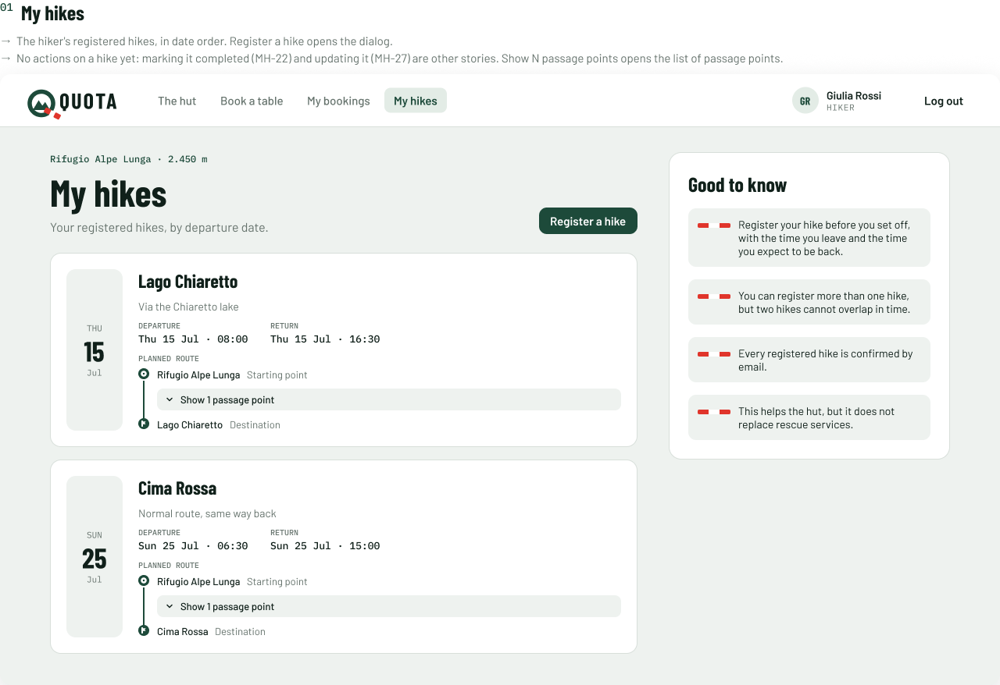
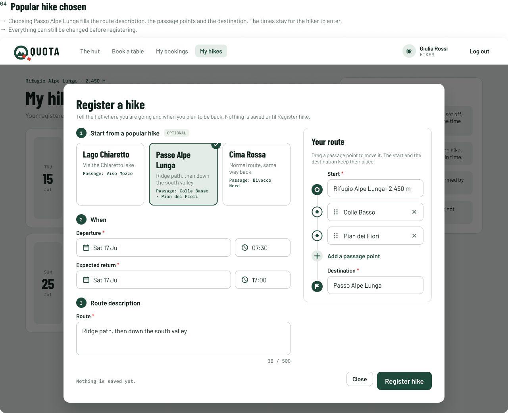
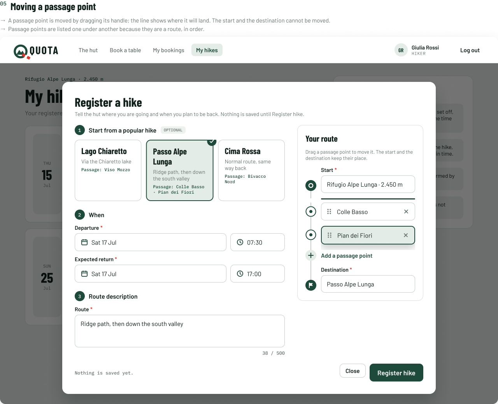
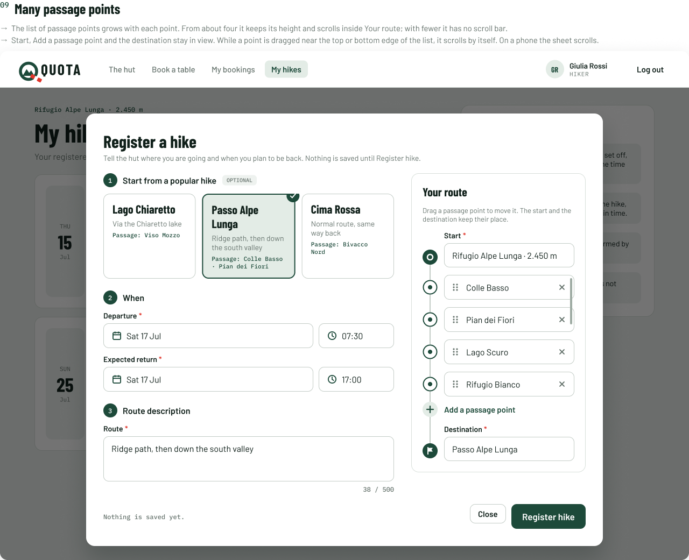
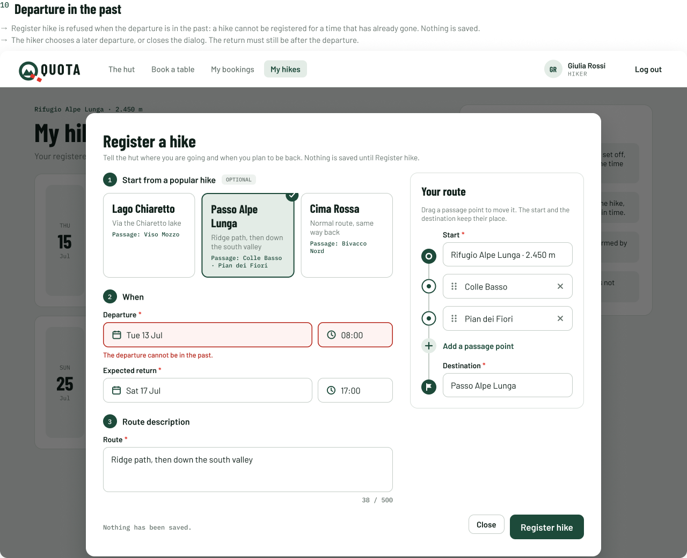
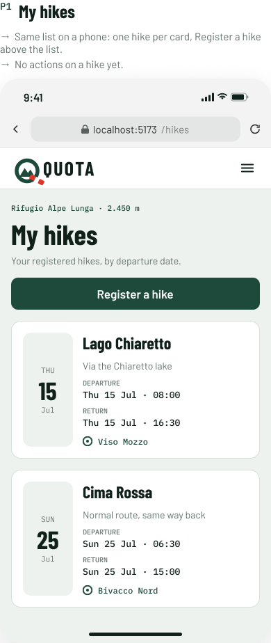
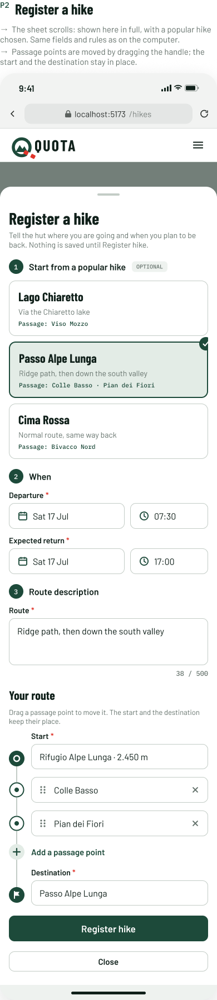
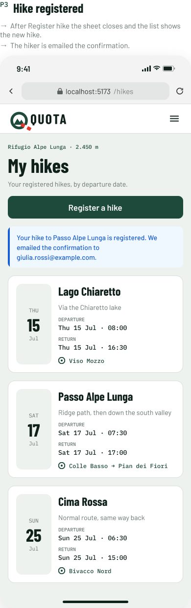

# Register a hike mockup (MH-20)

Mockup for story **MH-20 Register a hike**, used by the hiker frontend and backend tasks and their tests.

> "As a hiker I want to register my planned hike before departure so that the hut has information that can be used if I do not return as expected."

One new page, **My hikes**, lists the hikes registered by the hiker who is logged in. **Register a hike** opens a dialog (a sheet on a phone) where the hiker enters the start, the destination, the route, the passage points and the times. A saved hike is emailed to the hiker.

**Figma (source of truth):** page *MH-20 Register a hike* in [Mountain Hut – Mockups (Team 16)](https://www.figma.com/design/VlTombwHX1DQ7yB2x4U5Yx?node-id=663-520). The email is on the page *Emails*, see the [emails mockup](../emails/README.md). Every element is an instance from the *Components* page. Most of them are already used by the [hiker booking page](../hiker-booking-page/README.md), [booking](../booking/README.md) and [login](../login/README.md) mockups: step heading, button, alert, text field and the phone bars. This story adds:

- *Navbar* with the link **My hikes** after *My bookings* (the hiker navbar, `Role=Hiker, Tab=My hikes`). It is a separate navbar for this page: the shared *Navbar / Logged in* is not changed.
- *Hike card*: one hike of the list. Variants: `Size` (Desktop, Phone) and `State` (Collapsed, Expanded). The card shows the *planned route*: the start, the destination and, between them, a line *Show N passage points* that opens the list (Expanded: *Hide N passage points*). The [active hikes mockup](../active-hikes/README.md) uses the same planned route on its own card.
- *Hike option*: a popular hike to start from. Variants: `State` (Default, Selected).
- *Route point*: one point of the route. Variants: Start, Passage point, Passage point dragging, Add, Destination.
- *Date and time field*: the day and the time of the departure or the return. Variants: Empty, Filled, Error.
- Six icons: start, passage point, destination, add, grip (drag handle) and remove, and a chevron for the *Show passage points* line.

Same QUOTA brand, colours and fonts.

## Rules on these screens

Everything shown comes from the story or from the product owner's clarifications. Nothing from later stories.

| Source | Rule |
|---|---|
| Story MH-20 | A hiker registers a planned hike before the departure, so that the hut has the information if the hiker does not come back as expected. |
| Product owner, [#49](https://github.com/SE2-Polito/AY26-27-Mountain-Hut/issues/49) | The hike has a **destination** (a name), a **route** (a text description, e.g. "via the Chiaretto lake") and **intermediate passage points** (e.g. "Viso Mozzo"). |
| Product owner, [#49](https://github.com/SE2-Polito/AY26-27-Mountain-Hut/issues/49) | The hiker can also select one of a few predefined or popular hikes, as long as the UX is smooth. |
| Team decision (not yet confirmed by the product owner) | The popular hikes are a fixed list, written by the team. There is no algorithm that updates it. Choosing one only fills the form: the hiker can change everything before registering. |
| Team decision (not yet confirmed by the product owner) | Start, destination and route are required. The passage points are optional, with no fixed limit. |
| Team decision (not yet confirmed by the product owner) | The route description has a maximum of 500 characters, because the server keeps at most 500. A counter under the field shows how many are used (e.g. *38 / 500*). The limit is the team's choice: the specifications do not give one. |
| Team decision (not yet confirmed by the product owner) | The hike starts at the hut unless the hiker says otherwise: the start is filled with the hut and the hiker can change it (e.g. *Pian del Re*). The product owner lists only the destination, the route and the passage points ([#49](https://github.com/SE2-Polito/AY26-27-Mountain-Hut/issues/49)). |
| Product owner, [#51](https://github.com/SE2-Polito/AY26-27-Mountain-Hut/issues/51) | The hike has a planned **departure** and an expected **return** (day and time), both required. The product owner agreed with the team's reading that the return must be after the departure. |
| Team decision (not yet confirmed by the product owner) | A hiker can register more than one hike, but two hikes of the same hiker cannot overlap in time. |
| Team decision (not yet confirmed by the product owner) | The passage points are in order: the hiker moves them by dragging. The start and the destination keep their place. |
| Team decision | A hiker cannot register a hike in the past: the departure must be in the future. |
| Team decision (not yet confirmed by the product owner) | In the list, a hike shows its **planned route**: the start (the hut, or the start the hiker entered), the destination and, between them, a line *Show N passage points*. The passage points are hidden until the hiker opens the line, so a hike with many points stays short. The employee sees the same route on the [active hikes](../active-hikes/README.md) page. |
| Team decision (not yet confirmed by the product owner) | The list of passage points has no fixed limit. It grows with each point up to a maximum height (about four points), then it scrolls inside *Your route*, as a long menu does in the MH-10 menus mockup. The start, *Add a passage point* and the destination stay in view. |
| Team decision (not yet confirmed by the product owner) | The saved hike is emailed to the hiker, as the bookings are ([emails mockup](../emails/README.md), email 6). A refused registration sends no email. |
| Team decision | Only a logged in hiker can register a hike. A table booking is not needed. The page is reached from the new navbar link *My hikes*. |

## The flow

1. **My hikes** (screen 1) lists the hikes registered by the hiker, in departure date order. Each hike shows the day, the destination, the route, the departure, the return and its planned route (start, passage points, destination). The hikes have no buttons: marking a hike as completed (MH-22) and updating it (MH-27) are other stories. A hiker with no registered hikes sees a message and a *Register a hike* button (screen 2).
2. **Register a hike** opens the dialog on top of the list, empty (screen 3). It has three steps: **Start from a popular hike** (optional), **When** (departure and expected return) and **Route description** (the route, then the points of the route). Nothing is saved until *Register hike*.
3. **A popular hike** (screen 4) is a card to press: it fills the route description, the passage points and the destination. The times stay empty for the hiker. Everything can be changed afterwards.
4. **The route** is a list, one point under the other, with a line that joins them: the **start** (required, the hut until the hiker changes it; it cannot be moved), the **passage points**, and the **destination** (required, it cannot be moved). *Add a passage point* adds one before the destination. Each passage point has a handle to move it and a button to remove it. While one is dragged, a line shows where it will land (screen 5). With many passage points the list keeps its height and scrolls (screen 9, see [Many passage points](#many-passage-points)).
5. **Register hike** sends the hike. It works, or it is refused and nothing is saved:
   - Missing information (screen 6): a message sits under each field that needs attention. The return must be after the departure.
   - Departure in the past (screen 10): the departure is earlier than now. A message sits under the departure. The hiker chooses a later time or closes the dialog.
  - Overlap (screen 7): the times overlap another registered hike of the same hiker. A red note says which one. The hiker can change the times or close the dialog.
6. When the hike is registered, the dialog closes and the list shows the new hike in its place, with a blue note (screen 8). The hiker is emailed the confirmation.

## Screens

| # | Screen | Image |
|---|---|---|
| 1 | My hikes |  |
| 2 | No registered hikes |  |
| 3 | Register a hike: the dialog, empty |  |
| 4 | A popular hike chosen |  |
| 5 | Moving a passage point |  |
| 6 | Missing information |  |
| 7 | The hike overlaps another one |  |
| 8 | Hike registered |  |
| 9 | Many passage points: the list scrolls inside *Your route* |  |
| 10 | Departure in the past |  |

### On a phone

This is the same website in a phone browser, not a separate app. Below 992 px (react-bootstrap `lg`) the layout changes:

- The page becomes one column, and the *Good to know* box goes under the list.
- The navbar folds into the menu button, where *My hikes* is.
- In a hike card, the details are under the destination.
- The dialog becomes a sheet from the bottom. It scrolls: the image shows it in full.

| # | Screen | Image |
|---|---|---|
| 1 | My hikes |  |
| 2 | Register a hike, with a popular hike chosen |  |
| 3 | Hike registered |  |

The sheet has the same steps and rules as desktop screens 3 to 7. With many passage points the sheet itself scrolls, as it already does, and the list of passage points grows with it: it has no scroll of its own.

## Fields and rules

### My hikes

| Part | Rule |
|---|---|
| Which hikes | The hiker's own, in departure date order. The mockup does not say whether past hikes are listed (see the open questions). |
| Day | The day of the departure (*THU 15 Jul*). |
| Destination, route | The destination as the title, the route description under it. |
| Departure, return | Day and time (*Thu 15 Jul · 08:00*). |
| Planned route | A line *Show N passage points* between the start and the destination, closed by default; pressing it opens the list, in order, and the line says *Hide N passage points*. The start is the one the hiker entered, the hut (*Rifugio Alpe Lunga*) when it was not changed (*Starting point*), and the destination is the one the hiker entered (*Destination*). A hike without passage points has no such line. |
| Buttons | None. |

### Register a hike

| Field | Rule |
|---|---|
| Start from a popular hike | Optional. One card per popular hike, with the destination, the route and the passage points. Pressing a card fills the form; the card stays marked as chosen. |
| Departure | Required. Day and time. |
| Expected return | Required. Day and time, after the departure. |
| Route | Required. A text description, e.g. "via the Chiaretto lake", up to 500 characters. A counter under the field, on the right, shows the characters used (*0 / 500* when empty). |
| Start | Required. Filled with the hut (*Rifugio Alpe Lunga · 2.450 m*); the hiker can change it. Free text (a name), on one line. Always first: it cannot be moved. |
| Passage points | Optional. Free text, one per line, in order, with no fixed limit. The hiker adds them with *Add a passage point*, moves them by dragging the handle and removes them with the remove button. See [Many passage points](#many-passage-points). |
| Destination | Required. Free text (a name). Always last: it cannot be moved. |

### Many passage points

Screen 9 shows ten passage points. On a computer:

- The list of passage points grows with each point added, up to a maximum height of about four points. Until then it has no scroll bar and the dialog does not change.
- From there on the list keeps its height and scrolls inside *Your route*. The scroll bar shows only when the list is longer than its box, as in the menu box of the MH-10 menus mockup.
- The **start** above the list, *Add a passage point* and the **destination** under it stay in view, so the hiker can always add a point or see where the route ends.
- While a point is dragged near the top or bottom edge of the list, the list scrolls by itself.
- *Add a passage point* adds a point at the end of the list, before the destination, and scrolls the list to it.
- The dialog keeps its height: *Register hike* and *Close* never go off screen.

On a phone the sheet scrolls and the list grows with it.

## Texts and answers

| When | What the hiker sees |
|---|---|
| Page subtitle | Your registered hikes, by departure date. |
| *Good to know* | Register your hike before you set off, with the time you leave and the time you expect to be back. · You can register more than one hike, but two hikes cannot overlap in time. · Every registered hike is confirmed by email. · This helps the hut, but it does not replace rescue services. |
| No hikes | **No registered hikes** Hikes you register will appear here, with the times you expect to leave and to be back. Button: *Register a hike*. |
| Dialog | **Register a hike.** "Tell the hut where you are going and when you plan to be back. Nothing is saved until Register hike." Buttons: *Close*, *Register hike*. |
| Footer of the dialog | "Nothing is saved yet." After a refusal: "Nothing has been saved." |
| Route | "Drag a passage point to move it. The start and the destination keep their place." |
| Departure in the past | Under the departure, in red: "The departure cannot be in the past." Nothing is saved ("Nothing has been saved."). |
| Missing information | Under the field: "Enter a starting point." · "Choose the departure day and time." · "Choose the return day and time." · "Describe your route." · "Enter a destination." · "The return must be after the departure." The empty field keeps its placeholder (*Describe the route, e.g. via the Chiaretto lake*, *e.g. Pian del Re* for the start, *e.g. Lago Chiaretto*, *Choose a day*). |
| Overlap | Red note: "These times overlap your hike to *Lago Chiaretto* (*Thu 15 Jul, 08:00 – 16:30*). Choose other times. Nothing has been saved." Every choice is kept. |
| Registered | Blue (information) note on the list: "Your hike to *Passo Alpe Lunga* is registered. We emailed the confirmation to *giulia.rossi@example.com*." |
| Saving | While the hike is being registered the button says *Registering…* and the fields are disabled. |
| Server or network error | Red note: "Something went wrong on our side. Try again in a minute. Nothing has been saved." Every choice is kept. |
| Year | A day in the current year is shown without the year (*Sat 17 Jul*). A day in another year shows it (*Sat 17 Jul 2027*). |
| Not logged in | The login page (login mockup, screen 4). |

## Left out on purpose

These belong to other stories or were not asked for:

- Marking a hike as completed (MH-22) and updating the route or the return time (MH-27).
- A button to cancel a hike. A hike is considered started at its planned departure time, and a hiker who decides not to leave declares it finished with MH-22, even before it starts ([#53](https://github.com/SE2-Polito/AY26-27-Mountain-Hut/issues/53)). So there is no cancel on *My hikes*.
- The automatic start of a hike at the departure time (MH-21).
- The employee view of the active hikes (MH-21).
- The overdue and late notifications (MH-24, MH-26).
- A way for a hiker to manage the popular hikes. The list is fixed.

## Open questions

These are for the product owner. Until they are answered, the mockup follows the team decisions above.

- **Start and end.** Can a hike start somewhere other than the hut, and where does it end? The mockup starts it at the hut but lets the hiker change the start. The expected return is the time the hiker expects to have finished the hike, which MH-24 counts from; where it ends is not asked.
- **Which hikes are listed.** Does *My hikes* also list the past hikes (finished hikes, MH-22), or only the ones to come and the ones in progress? The mockup lists them all, with no status.
- **Overlap.** Two hikes overlap when their times cross. Do two hikes where one starts exactly when the other ends overlap? Is a margin needed between two hikes?
- **Confirmation email.** The specifications do not ask for it. The team added it to be consistent with the bookings.
- **Popular hikes.** The product owner accepts a few predefined hikes as long as the UX is smooth. The team made a fixed list. Are the destination, the route and the passage points editable after choosing one? The mockup says yes.

The days, times, hikes and names of the screens are examples. Sample data (hut, names, emails, dates) is invented for the mockup.
