# Reservation for a hiker mockup (MH-07)

Mockup for story **MH-07 Enter a reservation for a hiker**, used by the staff frontend and backend tasks and their tests.

> "As an employee I want to enter a reservation for a hiker so that I can accept reservations via other channels than web."

A party arrives at the hut some time before the meal and asks for seats, or someone books by phone or by message. The employee enters the hiker and the reservation on one page.

**Figma (source of truth):** page *MH-07 Reservation for a hiker* in [Mountain Hut – Mockups (Team 16)](https://www.figma.com/design/VlTombwHX1DQ7yB2x4U5Yx?node-id=381-1282). Every element is an instance from the *Components* page. Most of them are already used by the [login](../login/README.md), [booking](../booking/README.md) and [slots](../slots/README.md) mockups: navbar, step heading, day, day arrow, people stepper, time slot, text field, alert, button, table chip and the phone bars. This story adds:

- *Hiker option*: a hiker found by the search, or the hiker chosen. Variants: `State` (Default, Selected) and `Size` (Desktop, Phone). On desktop, name, email and phone are on one line. On a phone they are on three lines. Its `Kind=Temporary` variants, with a "TEMPORARY · NO LOGIN" badge, are not used: temporary hikers are not shown in the search.
- *Hiker mode*: the Quick entry / Full profile switch.
- *Icon / Search*.
- A `Search icon` option on *Text field*. It is off by default, so the other mockups are unchanged.

The employee navbar gets a third link, **Reservations**. The navbar component has no property for links, so on these screens it is detached from the component.

Same QUOTA brand, colours and fonts.

## Rules on these screens

Everything shown comes from the story or from the product owner's clarifications. Nothing from later stories.

| Source | Rule |
|---|---|
| Story | The procedure has two ways to enter the hiker. The quick way is a name and maybe a phone. The full way is all the details of the hiker. The reservation details come in addition: day, how many people, time. |
| Clarification | The hiker may already be in the system. Then they are found by name, phone or email. |
| Clarification | A hiker who is missing is entered with a **quick entry**: a name (first and last name) and an optional phone. This makes a **temporary hiker**, who cannot log in or use the website. |
| Team decision | The search lists **only full hiker accounts**, never temporary hikers, so each quick entry makes a new temporary hiker. `GET /api/staff/hikers` leaves them out, and the staff accounts too, so the limit of 20 results counts only hiker accounts. |
| Clarification | A hiker who is missing can also be entered with a **full profile**: first name, last name, email and an optional phone. This makes a regular hiker account, which can later use the website. |
| Clarification | For a full profile the password is generated at random. The hiker must change it at the next login, and can always recover it by email. |
| Team decision | **The employee never sees the password.** The server generates it when the account is created (*Add hiker*), sends it to the hiker by email (email 5 of the [emails mockup](../emails/README.md)) and keeps only its hash. |
| Clarification | The only time limit for the staff is the start of the time slot: no reservation after it starts. The 2-hour limit of hikers ([#7](https://github.com/SE2-Polito/AY26-27-Mountain-Hut/issues/7)) does not apply. |
| MH-01 | The party must fit in the free seats of that time. The system chooses the tables, as when a hiker books ([booking mockup](../booking/README.md)). |

## The flow

1. **Find the hiker.** The page opens with an empty search, today's date already chosen and 1 person (screen 1). The search starts as the employee types, from the second character. It matches name, phone or email among **full hiker accounts only** (screen 2). Each result shows name, email and phone. Picking a result chooses that hiker. The chosen hiker card has a *Change* button to go back to the search.
2. **New hiker.** The *+ New hiker* button is there from the start: under the search, or next to "Not in the list?" under the results. It opens a dialog with a switch:
   - **Quick entry** (screen 4): first name, last name and optional phone. *Add hiker* creates a temporary hiker.
   - **Full profile** (screen 5): first name, last name, email and optional phone. There is no password field. *Add hiker* creates the account: the server generates the password and emails it to the hiker straight away (email 5 of the [emails mockup](../emails/README.md)). The employee never sees it.

   After *Add hiker* the dialog closes and the new hiker is chosen in step 1. The account stays even if no reservation is saved afterwards. If the email does not arrive, the hiker can choose a password with *Forgot password?* on the login.
3. **Day, how many people, time** (screen 3). These work as on Book a table, and they stay locked until the hiker is chosen. A time that has already started cannot be picked and says "Started at *HH:MM*". A time that cannot fit the party says so, as in MH-01.
4. **Save reservation** saves the reservation for the hiker, who then sees it as their own. A new full profile already has its account: it was created at *Add hiker*.
5. **Reservation saved** (screen 7) shows the hiker, day, time, people and the tables the system chose. For a new full profile a blue note also says where the password was sent. Other hikers get the same dialog without the note.
6. **The hiker's first login** is in the [login mockup](../login/README.md):
   - when the hiker logs in with the password from the email, they must choose their own before anything else (login screen 15);
   - instead of the emailed password they can use *Forgot password?* and choose a new one by email (login screens 10–14; the reset email is email 2 of the [emails mockup](../emails/README.md)).
7. **Emails to the hiker.** At *Save reservation* a hiker with an email gets the same confirmation email as when they book themselves (MH-03, email 1 of the [emails mockup](../emails/README.md)). So a new full profile gets two emails: the account email at *Add hiker*, then the confirmation. A temporary hiker has no email, so no email is sent.

The summary on the right (a bar at the bottom on a phone) fills in as the employee chooses. It says until when the chosen time can be entered.

## Screens

| # | Screen | Image |
|---|---|---|
| 1 | New reservation, empty search | 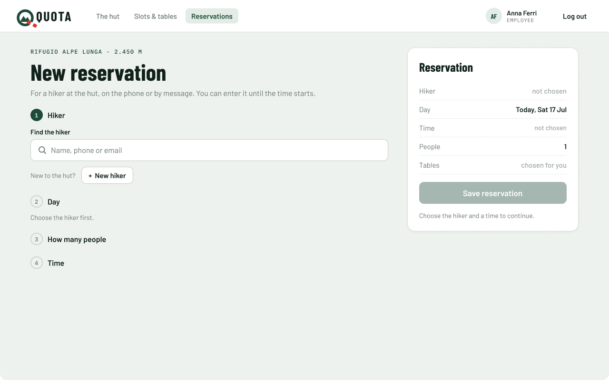 |
| 2 | Find the hiker: results of the search | 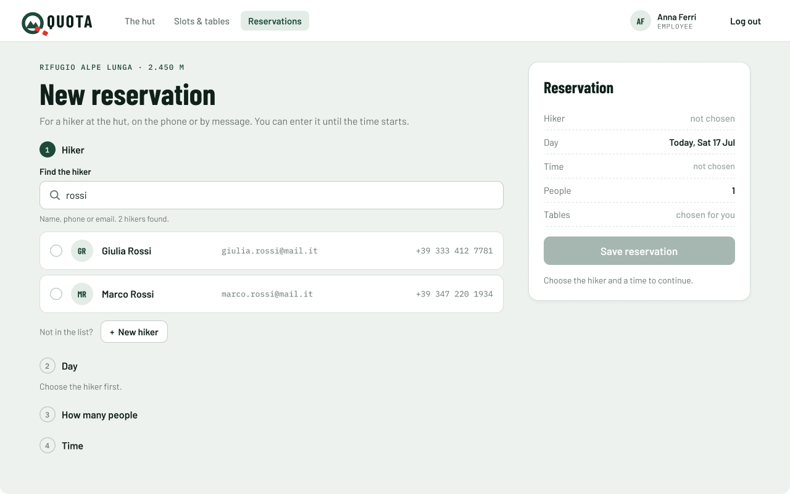 |
| 3 | Reservation details: hiker chosen, the 12:00 time already started | 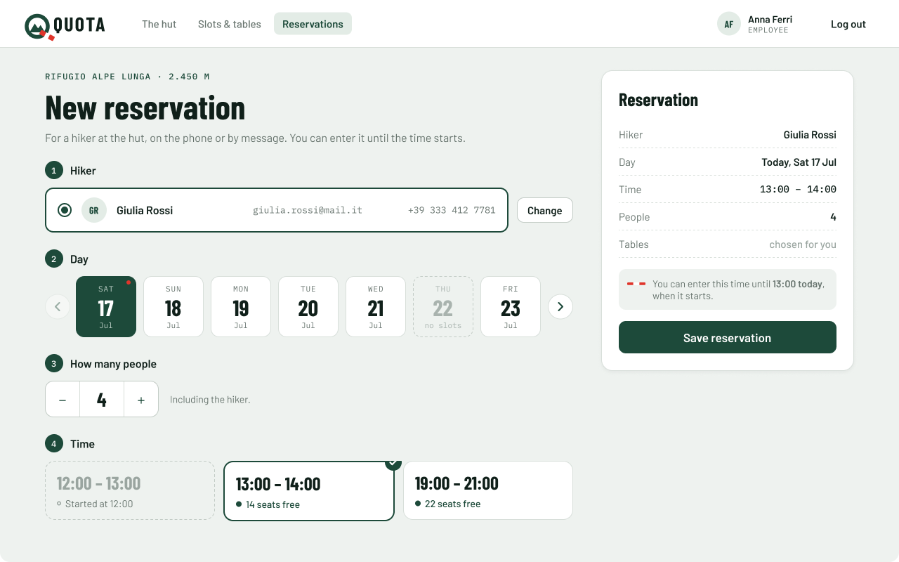 |
| 4 | New hiker: quick entry (temporary hiker) | 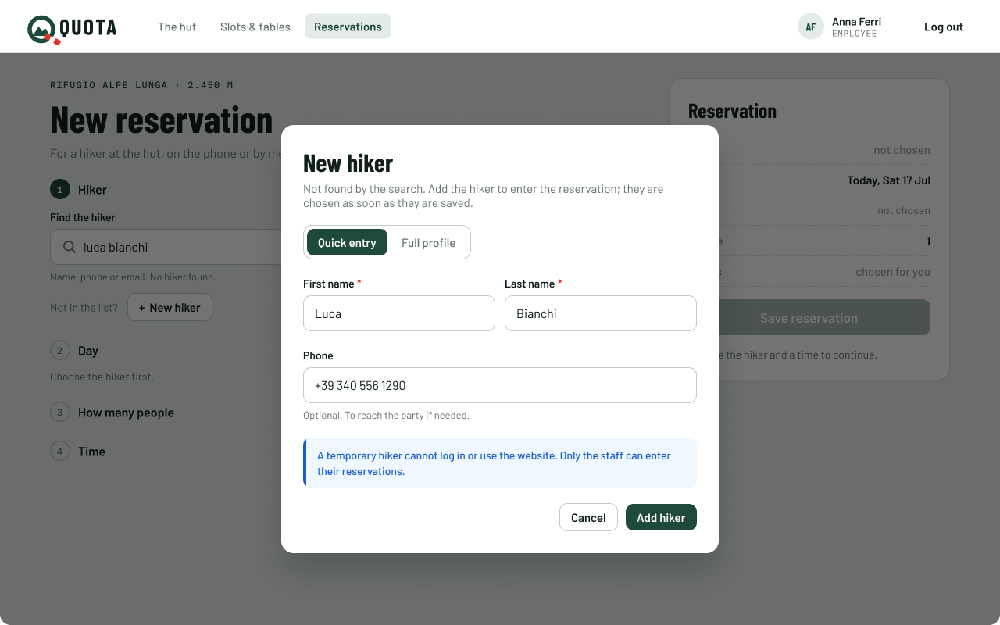 |
| 5 | New hiker: full profile (hiker account) | 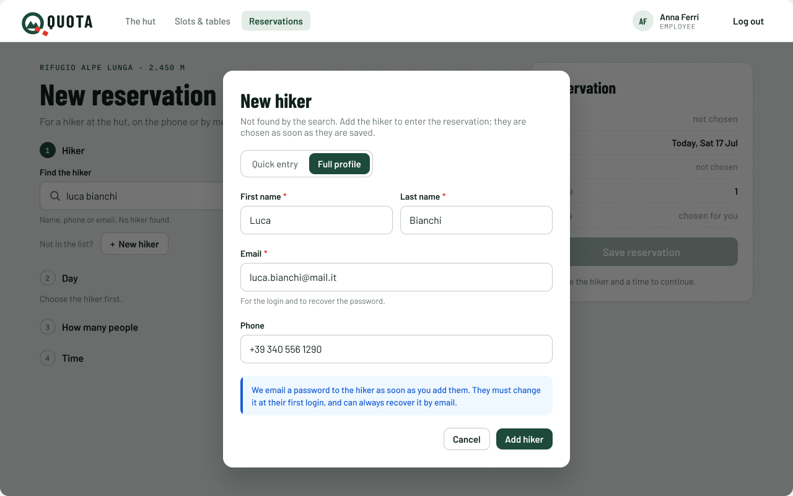 |
| 6 | New hiker: errors, and the email of a hiker already in the system (`409`) | 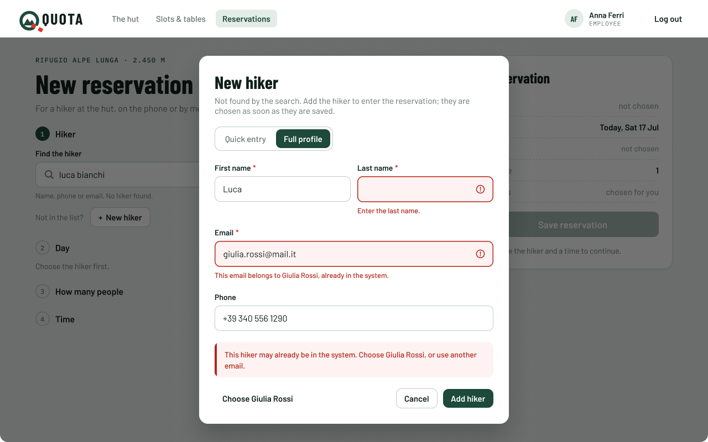 |
| 7 | Reservation saved: for a new hiker account, where the password was sent | 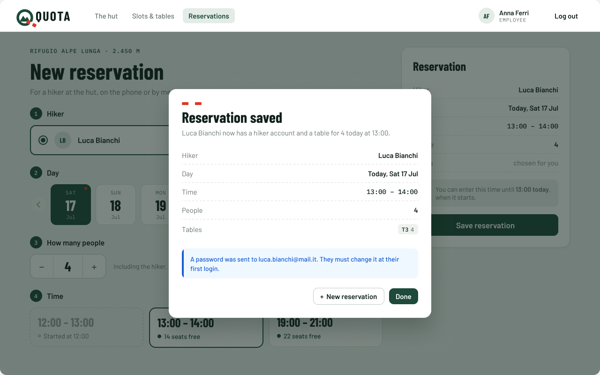 |
| 8 | The hiker already has a booking at that time (`422`) | 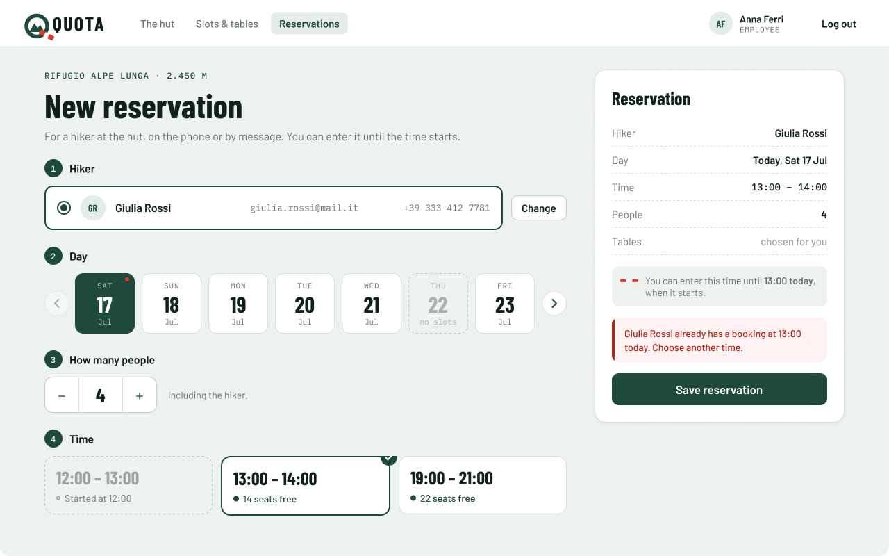 |
| 9 | New hiker: the email belongs to a staff account (`409`) | 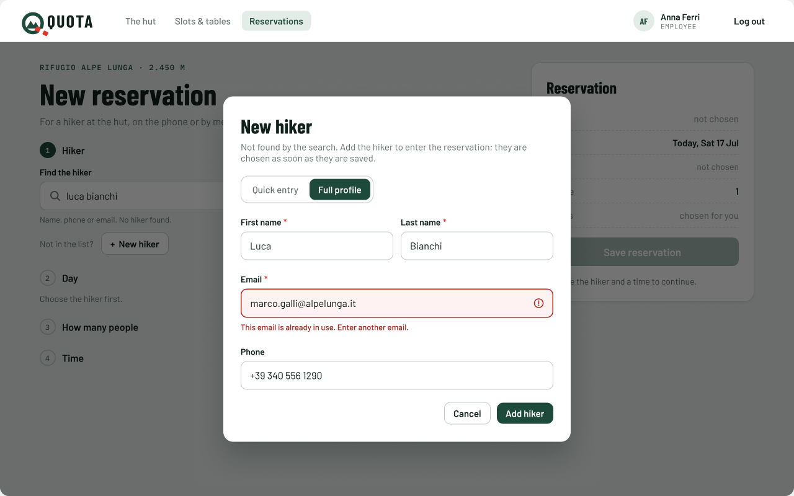 |
| 10 | The time started between the choice and the save (`422`) | 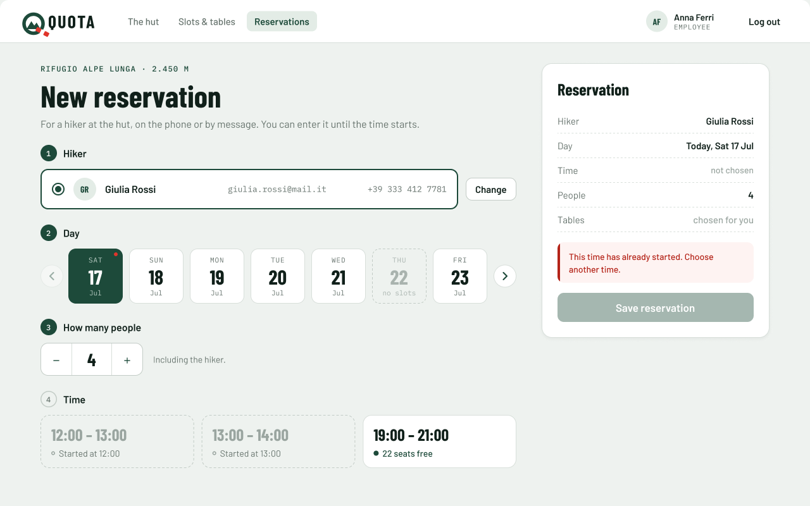 |

### On a phone

This is the same website in a phone browser, not a separate app. Below 992 px (react-bootstrap `lg`) the layout changes:

- The page becomes one column.
- The navbar folds into the menu button, where *Reservations* is.
- The summary becomes a bar fixed at the bottom.
- The dialogs become sheets from the bottom.
- In a hiker card, name, email and phone are on three lines.

| # | Screen | Image |
|---|---|---|
| 1 | Find the hiker | 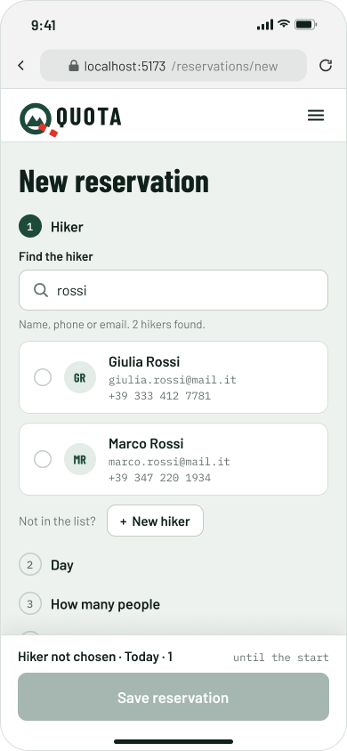 |
| 2 | New hiker: quick entry | 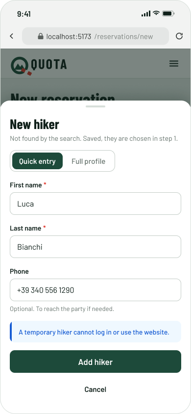 |
| 3 | Reservation saved | 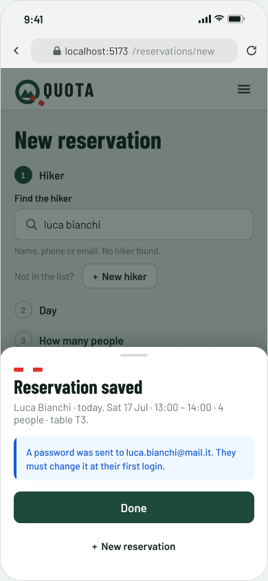 |

The full profile sheet on a phone has the same fields as desktop screen 5, and its errors are the same as desktop screens 6 and 9.

## Fields and rules

### Find the hiker

| Field | Rule |
|---|---|
| Find the hiker | Free text with the magnifier icon and the placeholder "Name, phone or email". From 2 characters it matches the name, phone or email of full hiker accounts (the server answers `400` to a shorter text, so the page does not send it). Under the field: "Name, phone or email. *N* hikers found." or "No hiker found." |

### New hiker: quick entry

| Field | Required | Rule | Message under the field |
|---|---|---|---|
| First name | yes | not empty | Enter the first name. |
| Last name | yes | not empty | Enter the last name. |
| Phone | no | digits, spaces and a leading `+` | Helper: "Optional. To reach the party if needed." Error: "Enter a valid phone number." |

### New hiker: full profile

These are the same fields as the sign-up in the [login mockup](../login/README.md), without the password.

| Field | Required | Rule | Message under the field |
|---|---|---|---|
| First name | yes | not empty | Enter the first name. |
| Last name | yes | not empty | Enter the last name. |
| Email | yes | valid email format, not used by another account | Enter a valid email, like name@example.com. / This email belongs to *name*, already in the system. (a hiker, screen 6) / This email is already in use. Enter another email. (a staff account, screen 9) |
| Phone | no | digits, spaces and a leading `+` | Enter a valid phone number. |

The browser checks these rules before sending, and the server checks them again (`400` if they fail).

### Reservation

| Field | Required | Rule |
|---|---|---|
| Hiker | yes | chosen from the search, or just added with New hiker |
| Day | yes | a day with slots; starts at today |
| How many people | yes | from 1, must fit in the free seats of the time |
| Time | yes | a time of that day that has not started yet |

## Texts and server answers

| When | What the employee sees |
|---|---|
| Page subtitle | For a hiker at the hut, on the phone or by message. You can enter it until the time starts. |
| Steps 2–4 before a hiker is chosen | Choose the hiker first. |
| Nothing chosen yet | Save reservation disabled, "Choose the hiker and a time to continue." |
| Time already started | Started at *HH:MM* (the time cannot be picked). |
| Summary note | You can enter this time until *HH:MM today*, when it starts. |
| Quick entry note | A temporary hiker cannot log in or use the website. Only the staff can enter their reservations. |
| Full profile note | We email a password to the hiker as soon as you add them. They must change it at their first login, and can always recover it by email. |
| Email already used by a hiker (`409`, screen 6) | The `409` does not say whose the email is, so the page looks for it with `GET /api/staff/hikers?q=` and the email. It finds a hiker: under Email, "This email belongs to *name*, already in the system." Red alert: "This hiker may already be in the system. Choose *name*, or use another email." Button *Choose name* picks that hiker and closes the dialog. |
| Email already used by a staff account (`409`, screen 9) | The search finds no hiker, because employees and the warden are never listed. Under Email: "This email is already in use. Enter another email." No alert, no *Choose* button and no name. |
| Reservation saved (`201`) | **Reservation saved.** *Name* now has a hiker account and a table for *N* today at *HH:MM*. The details and the tables follow. For a new full profile, also a blue note: "A password was sent to *email*. They must change it at their first login." Buttons: *+ New reservation*, *Done*. |
| The hiker already has a booking for that time (`422`, screen 8) | Red alert in the summary, above Save reservation: "*Name* already has a booking at *HH:MM* today. Choose another time." Nothing is saved, every choice is kept. Changing that booking is MH-06. |
| The time started meanwhile (`422`, screen 10) | For example 13:00 chosen at 12:59 and saved at 13:01. Red alert in the summary, above Save reservation: "This time has already started. Choose another time." Nothing is saved. The hiker, the day and the people are kept. The times are loaded again: that time says "Started at *HH:MM*" and is no longer chosen. |
| Seats gone or tables changed (`409`, `NO_SEATS` or `TABLES_CHANGED`) | As in MH-01: the free seats are reloaded, the choices are kept, and the employee chooses another time or fewer people. |
| Not logged in (`401`) | The login page (login mockup, screen 4). |
| A hiker opens the page (`403`) | The "Staff only" page (login mockup, screen 7). |
| Server or network down | Something went wrong on our side. Try again in a minute. |

Screens 8 and 10 are both a `422`. The API does not give them a `code` yet, as it does for the two `409` answers: the page needs one to show the right message.

## Left out on purpose

These belong to other stories and are added with them:

- Seeing, changing and cancelling reservations (MH-06, MH-08).
- Dietary needs and allergies (MH-05).
- Turning a temporary hiker into a full account. This is not in any story.

## Open questions (not decided by the product owner)

- **The warden** probably has the same page (as for Slots & tables). The mockup shows only an employee.

Sample data (hut, names, emails, phones, dates, tables) is invented for the mockup.
