# Slots & tables mockup (MH-02)

Mockup for story **MH-02 Define slot capacity**, used by the staff frontend and backend tasks and their tests.

> "As an employee I want to define the set of tables and seats available for each time slot so that the hut does not accept more customers than it can serve."

**Figma (source of truth):** page *MH-02 Slots & tables* in [Mountain Hut – Mockups (Team 16)](https://www.figma.com/design/VlTombwHX1DQ7yB2x4U5Yx?node-id=246-126). Every element is an instance from the *Components* page: the ones already used by the [login](../login/README.md) and [booking](../booking/README.md) mockups (navbar, day, day arrow, button, text field, alert, phone bars) and four new ones for this story: *Slot row*, *Table set option*, *Table row* and *Table chip*. Same QUOTA brand, colours and fonts.

## Rules on these screens

Everything shown comes from the story or from the product owner's answers. Nothing from later stories.

| Source | Rule |
|---|---|
| Story | An employee defines the tables and the seats of each slot. The warden can do the same (same page, navbar *Warden*). |
| Story, [#9](https://github.com/SE2-Polito/AY26-27-Mountain-Hut/issues/9) | A slot is a day with a start and an end time, both free: any start, any length. A day can have several slots (e.g. 12–13 and 13–14). |
| [#11](https://github.com/SE2-Polito/AY26-27-Mountain-Hut/issues/11) | The tables of a slot are a list: each table has its number and its own number of seats. |
| Story, [#17](https://github.com/SE2-Polito/AY26-27-Mountain-Hut/issues/17) | The list of tables is entered once and reused in other slots without typing it again. There is no fixed list: lunch and dinner, a sunny or a rainy day can have different tables. |
| [#17](https://github.com/SE2-Polito/AY26-27-Mountain-Hut/issues/17) | A slot without tables has 0 seats and cannot be booked. Changing the tables of a slot that already has them is MH-19. |

## How it works

A **table set** is a named list of tables (e.g. *Lunch, main room*: tables 1–5, 14 seats). It is made once and given to any number of slots, which is how the tables are reused ([API](../../openapi.json): `POST /api/staff/table-sets`, `GET /api/staff/table-sets`).

1. **Pick a day** in the strip. Every day can be picked, also the ones with no slots; the strip has no end, as on Book a table.
2. **The slots of the day** are listed in order of time, each with its table set, its tables (`T3 · 4` = table 3, 4 seats) and its total seats (`GET /api/staff/slots`).
3. **Add a slot**: day, start, end, and one of the table sets (`POST /api/staff/slots`). *No tables for now* saves a slot with 0 seats, which hikers cannot book yet.
4. **+ New table set** (in the Add a slot dialog or in the Table sets card): a name and the tables. *Copy the tables of* fills the list from a set already made, so only what differs is changed. After saving, the new set is chosen in the Add a slot dialog it came from.

   The tables are edited in one table made to stay readable with many tables. The column titles (*Table*, *Seats*) are written once on top. Each table is a separate cell, with its number, its seats and the remove button (×). On desktop there are 3 cells per line, read left to right (1 2 3, 4 5 6). On a phone there is 1 cell per line. **Adding a table:** the last cell is always empty, with a dashed border and the next number already written in grey. The cursor is in *Seats*, so the employee types the seats and presses Enter. The table is added and a new empty cell opens with the next number. Under the table, *By size* counts the tables by seats (`3 × 2 seats · 2 × 4 · 1 × 6`), so a long list can be checked at a glance.
5. **Choose tables** on a slot without tables gives it a table set (`PUT /api/staff/slots/{id}/table-set`). From then on hikers can book it.

The page shows only total seats. Booked and free seats per slot are MH-12, so they are not here.

## Screens

| # | Screen | Image |
|---|---|---|
| 1 | Slots of a day, and the table sets | 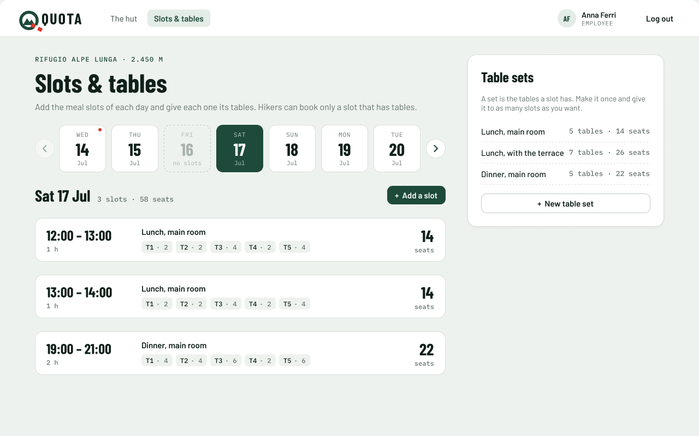 |
| 2 | A day with no slots | 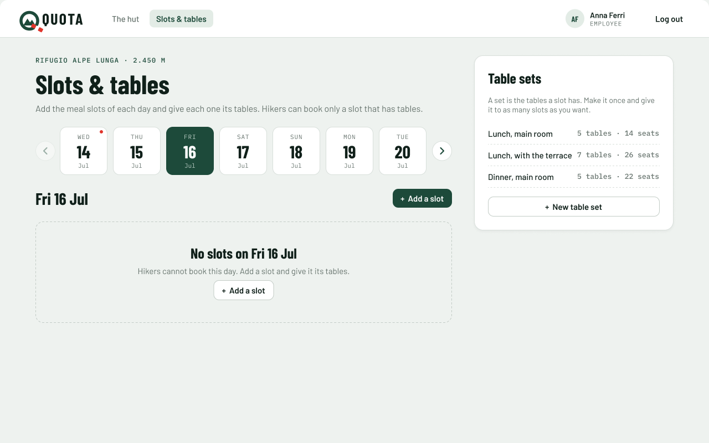 |
| 3 | Add a slot, reusing a table set | 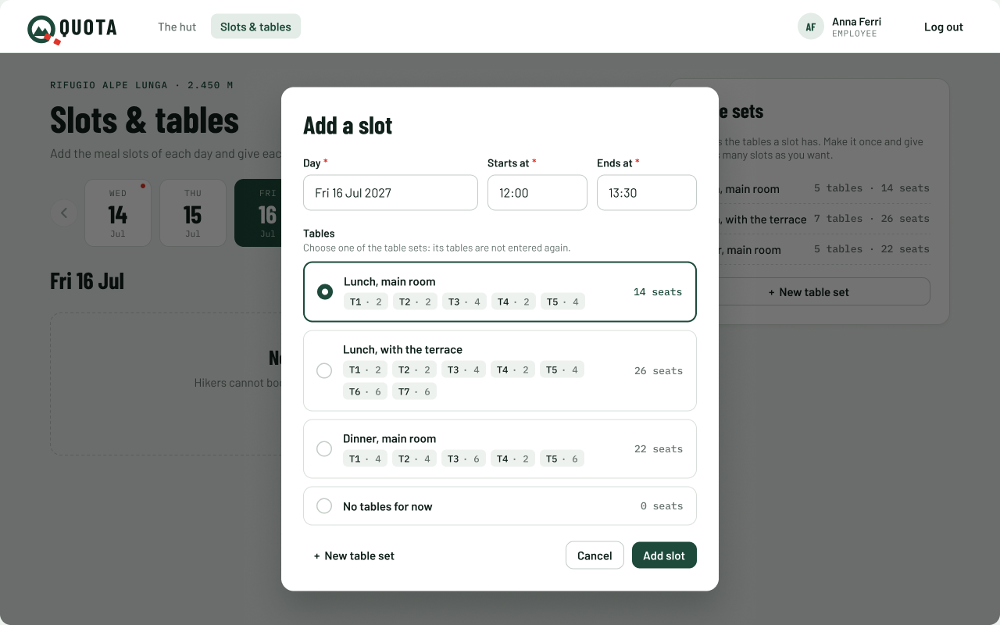 |
| 4 | Add a slot: start time already used (`409`) | 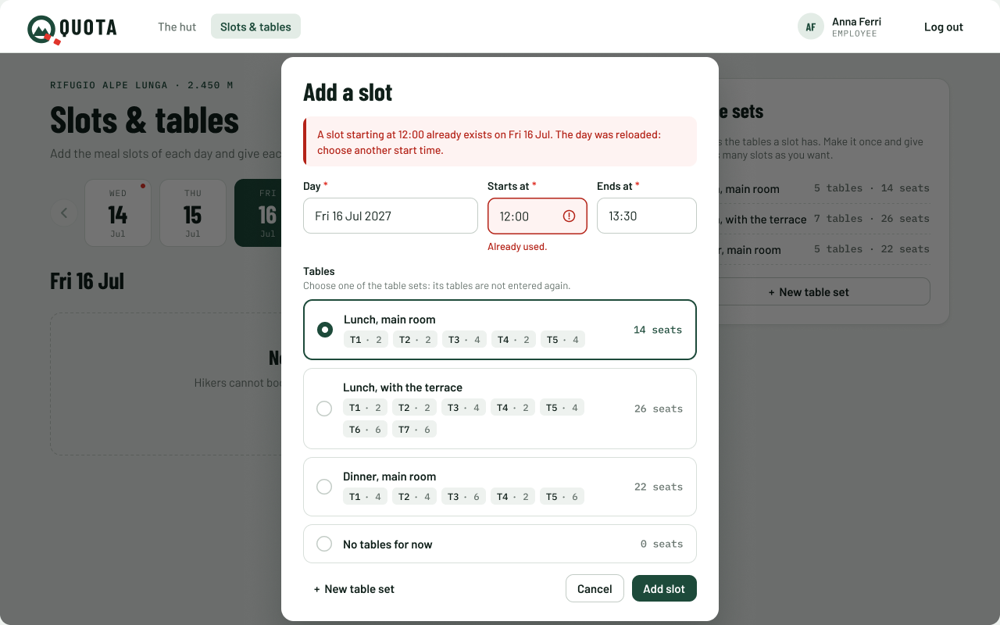 |
| 5 | New table set, copied from another and changed | 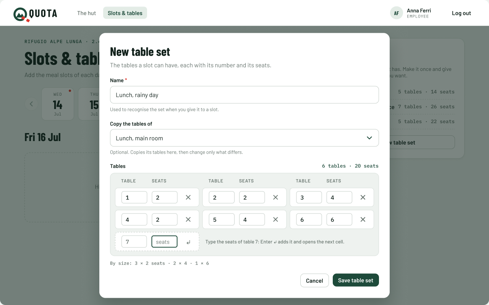 |
| 6 | New table set, errors (the fields in red, as in screen 4) | 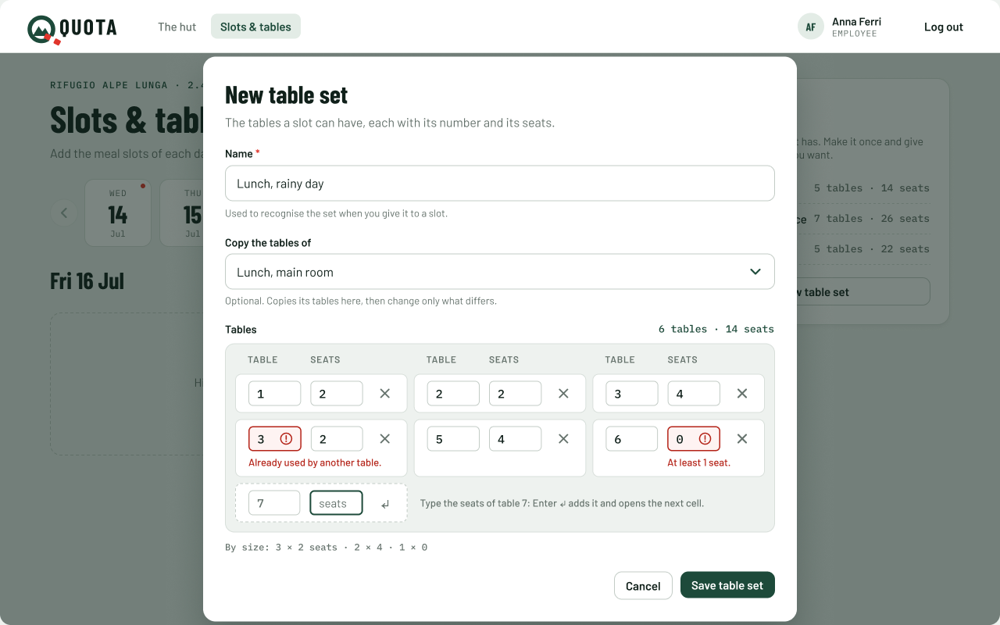 |
| 7 | A slot without tables (the warden is logged in) | 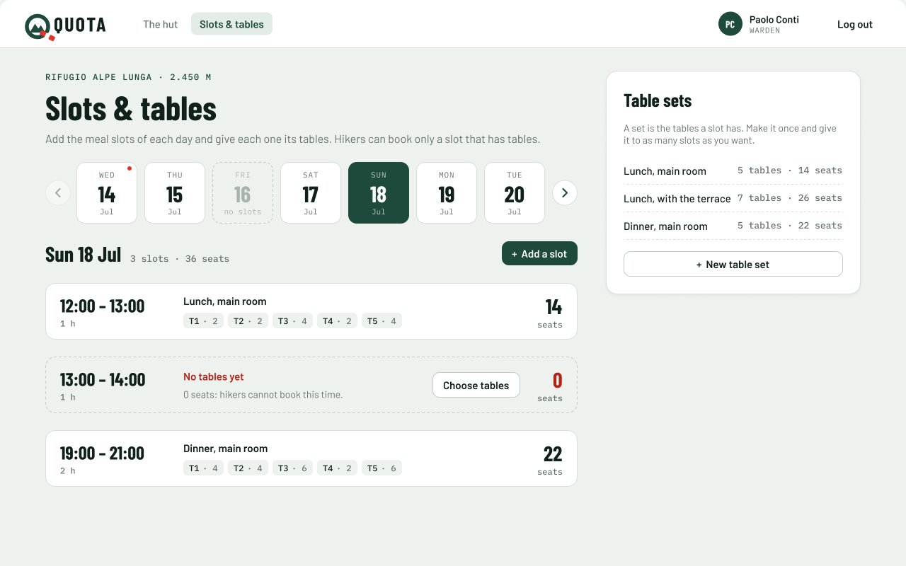 |
| 8 | Choose tables for that slot | 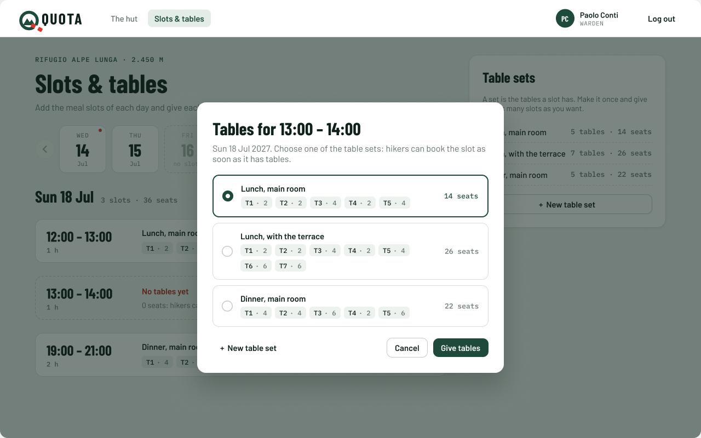 |

### On a phone

The same website in a phone browser, not a separate app. Below 992 px (react-bootstrap `lg`) the page is one column, the navbar folds into the menu button, the days are swiped sideways (no arrows), each slot shows time and seats on top and the tables below, *Add a slot* moves to a bar fixed at the bottom, and the dialogs become sheets from the bottom: the content scrolls, the buttons stay at the bottom, the main button first. Time fields use `type="time"`, number fields `inputmode="numeric"`, so the phone shows the right keyboard.

| # | Screen | Image |
|---|---|---|
| 1 | Slots of a day | 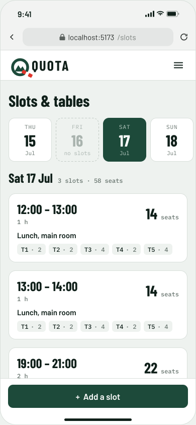 |
| 2 | Add a slot | 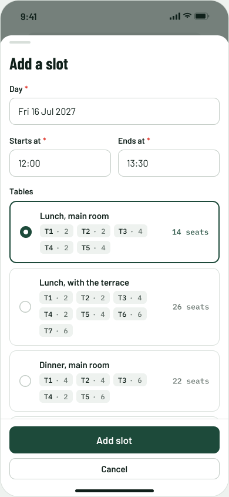 |
| 3 | Add a slot: start time already used (`409`) | 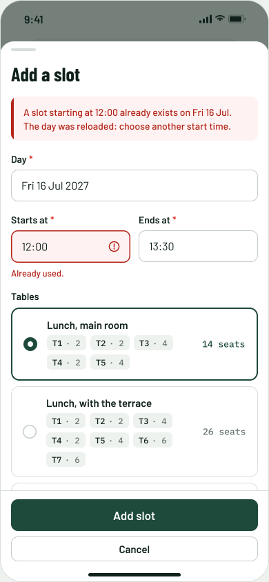 |
| 4 | New table set | 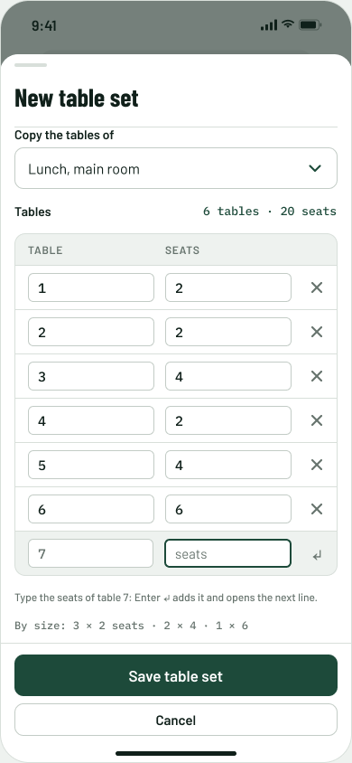 |
| 5 | New table set, errors | 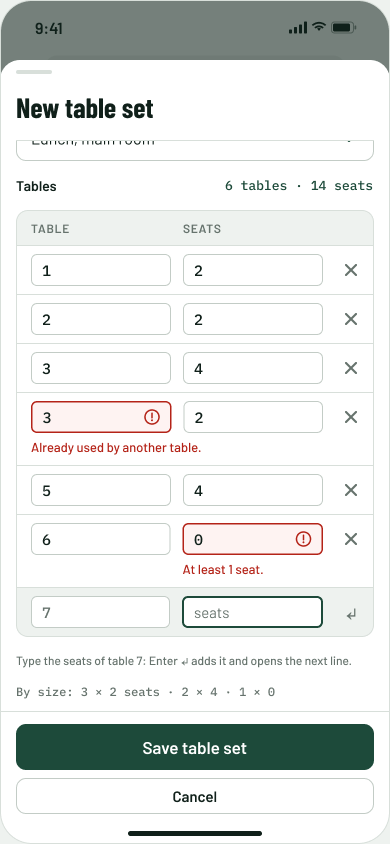 |
| 6 | A slot without tables | 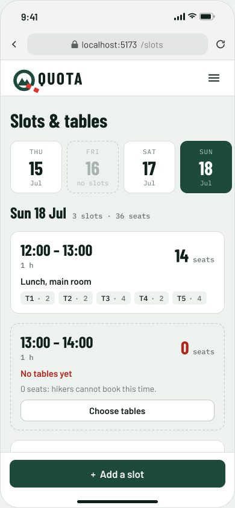 |

In New table set, the number field and the seats field share the width of the row, and the × (or ↵ in the empty row) is at the right edge. The hint "Enter ↵ adds it and opens the next line" is under the table. The sheet scrolls to the first field in red.

## Fields and rules

### Add a slot

| Field | Required | Rule | Message under the field |
|---|---|---|---|
| Day | yes | a valid date; starts at the day picked in the strip | Choose a day. |
| Starts at | yes | a valid time, `HH:MM` | Enter the start time. |
| Ends at | yes | a valid time, after Starts at | The slot must end after it starts. |
| Tables | no | one of the table sets, or *No tables for now* (default: the first set) | – |

### New table set

| Field | Required | Rule | Message |
|---|---|---|---|
| Name | yes | not empty | Enter a name for the set. |
| Copy the tables of | no | one of the table sets | – |
| Tables | yes | at least one | Add at least one table. |
| Table number | yes | whole number from 1, all different | Already used by another table. |
| Seats | yes | whole number from 1 | At least 1 seat. |

The total (*K tables · S seats*) and *By size* update while typing. The empty last cell gets the next free number. An empty last cell is not a table and is not saved.

Errors look like the ones in Add a slot (screen 4). The wrong field is red, with the (!) icon and its message right under it, inside the cell of that table. The other cells on the same line keep the same height, so the table stays aligned. When two tables have the same number, the second one is marked.

All the rules above are checked in the browser before sending, and checked again by the server (`400` if they fail).

## Texts and server answers

| When | What the employee sees |
|---|---|
| Page subtitle | Add the meal slots of each day and give each one its tables. Hikers can book only a slot that has tables. |
| Day heading | *Sat 17 Jul* · *N* slots · *S* seats |
| Day with no slots | **No slots on *Fri 16 Jul*.** Hikers cannot book this day. Add a slot and give it its tables. |
| Slot without tables | **No tables yet.** 0 seats: hikers cannot book this time. Button: Choose tables |
| Table sets card | A set is the tables a slot has. Make it once and give it to as many slots as you want. |
| Slot saved (`201`) | The dialog closes; the slot appears in the list, in order of time. |
| Table set saved (`201`) | Back to the dialog it came from, with the new set chosen; the Table sets card shows it. |
| Tables given to a slot (`200`) | The dialog closes; the slot shows its table set and seats. |
| Same start time on that day (`409`) | Alert in the dialog: "A slot starting at *HH:MM* already exists on *day*. The day was reloaded: choose another start time." Under Starts at: "Already used." The other choices are kept. |
| Table set name already used (`409`) | Under the name: "A table set with this name already exists. Choose another name." |
| Slot already has tables (`409`, e.g. a colleague gave them meanwhile) | The dialog closes, the day is reloaded, alert on top: "This slot already has its tables." |
| Slot or table set not found (`404`) | The day is reloaded, alert on top: "That slot or table set no longer exists." |
| Not logged in (`401`) | The login page with the blue note "Log in to see Slots & tables." (login mockup, screen 4). |
| A hiker opens the page (`403`) | The "Staff only" page (login mockup, screen 7). |
| Server or network down | Something went wrong on our side. Try again in a minute. |

## Left out on purpose

These belong to other stories and are added with them: changing the time or the tables of a slot (MH-19), closing a slot (MH-17) and the bookings it affects (MH-18), repeating a week of slots (MH-09), booked and free seats per slot (MH-12), menus (MH-10), a reservation entered by an employee (MH-07). Deleting a slot or a table set is not in any story, so there is no delete button.

## Assumptions to confirm

Not asked to the product owner; the mockup works either way:

- Table sets have a name, unique, so the employee can recognise them when reusing them (the stories only say the tables are reused).
- Two slots of a day cannot start at the same time; slots that overlap (e.g. 12:00–13:00 and 12:30–13:30) are not refused.
- A slot can be added on any day, also a past one; the strip starts at today.

Sample data (hut, names, dates, tables) is invented for the mockup.
